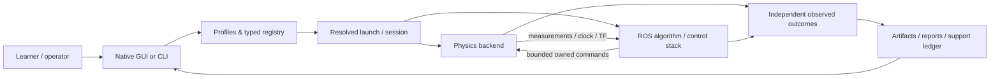

# 🤖 Robot Lab — Multi-Robot Simulation & Algorithm Laboratory

A ROS 2 Humble simulation laboratory for composing, launching, and measuring multi-robot workflows across wheeled, legged, humanoid, aerial, marine, and tracked platforms — with a native GUI, typed registry, four physics backends, and an interactive architecture explorer.

[](https://docs.ros.org/en/humble/)
[](LICENSE)
[](https://www.nvidia.com/en-us/autonomous-machines/jetson-agx-orin/)

---

## What is Robot Lab?

Robot Lab is a multi-robot simulation and algorithm laboratory. It lets you choose a **robot**, a **world**, a **physics backend**, and **algorithms**, then compose, launch, and measure the result through a unified desktop GUI or the command line.

Instead of wiring simulators, controllers, and planners by hand, you select from a typed registry and the GUI resolves a launch configuration for you. Each robot class keeps its own native controls (Drive, Arm, Hand, Drone, Marine, Gait, Tracks, MOLAR) with explicit Connect/Enable/Plan/Execute gates, so you see exactly what is commanded and what is measured.

**The platform is partial.** It is an active research lab, not a finished product. Some robot × simulator × map combinations are measured and qualified; others are implemented but unqualified. See [Current Status](#current-status) for what is done and what remains.

---

## 🎯 Key capabilities

| Area | What's available |
|------|------------------|
| **Robots** | Bumperbot, Labbot, TurtleBot3/4, Husky, Go2, Go2W, A1, B2, G1 humanoid, Panda/SO101 arms, Stretch, X500 drone, Tethys AUV, amphibious rover, snake, surface vessel, tracked vehicles |
| **Simulators / backends** | Gazebo (gz-sim), PyBullet, MuJoCo, Isaac Sim — each with typed readiness/health/reset contracts |
| **Algorithms** | Global planning, local planning, control, perception, localization, state estimation, sensor fusion — with measured comparisons |
| **GUI** | Native Tkinter control center: Home, Run a robot, category/type filters, live session indicator, Ctrl+K search, right-hand control column (Drive/Arm/Hand/Drone/Marine/Gait/Tracks/MOLAR) |
| **Fleet & swarm** | Queued lift/floor transport, door/dock/RMF routes, aerial formation itineraries (Plan/Execute), concurrent Nav2 missions |
| **Architecture** | Interactive **Learn & diagnose** workspace: 12 diagram views, guided tours, source/tutorial library, ROS graph/QoS discovery |
| **Comparisons** | Measured planner/controller/filter comparisons on shared seeded goals with truth metrics |

---

## 🚀 Quick start

### Prerequisites
- **Ubuntu 22.04** with **ROS 2 Humble** (measured development host: Jetson AGX Orin)
- Workspace built with `colcon` (or `build.bash`)
- Large trial outputs go on the mounted SSD at `/workspace` — source `scripts/ssd_env.sh` before builds/trials

### Build & run the GUI

```bash
# From the workspace root
cd /home/molar1/bumperbot_ws

# Source ROS 2 and the workspace
source /opt/ros/humble/setup.bash
source install/setup.bash

# (Recommended for trials) point runtime output at the SSD
source scripts/ssd_env.sh

# Launch the native GUI
ros2 run robot_lab_gui robot_lab_gui
```

The GUI opens on **Home**. Nothing is launched, connected, or armed just by opening it.

### Your first workflow (via the GUI)

1. **Run a robot** — pick a robot family + source variant, task, world, and simulator using the Category/Type filters.
2. **Review & launch** — a card describes the setup in plain words ("bumperbot in celisca_floor_1 · Inspect task · Gazebo simulator"). Review the prepared command, then press **Launch session**.
3. **Control & observe** — choose Drive & limits, Arm, Hand, Drone & limits, Marine, Marine missions, Gait, Tracks, or MOLAR from the control selector.
4. **Stop** — use **Stop motion** in the header or **End session** to shut down the owned launch.

Or use the CLI: `ros2 launch robot_lab_bringup simulated_robot.launch.py robot_model:=bumperbot ...`el and articulated-track workflows](docs/status/native-forms-2026-10-30.md): measured snake 2D/3D mapping and saved-map navigation, two-goal surface-vessel navigation, AUV acquisition and four-flipper control. Select these robots in Launch; controls and commands fill automatically.

## 📚 Tutorials & guides

Start with the [GUI quick tour](docs/tutorials/gui-quickstart.md), then explore by purpose:

| Purpose | Guide | What it covers |
|---------|-------|----------------|
| **Operate a robot** | [GUI workspace](docs/tutorials/gui-workspace.md) | Launch control column, categories/types, limits, sidebar navigation |
| **Ground fleet** | [Fleet facility](docs/tutorials/fleet-infrastructure.md) | Doors/lift, Facility controls, docking, multi-floor transport |
| **Aerial swarm** | [Aerial swarm](docs/tutorials/aerial-swarm.md) | PX4 SITL X500, formation itineraries, Plan/Execute |
| **Marine ROV** | [Marine ROV](docs/tutorials/marine-rov.md) | Buoyancy, thrusters, fins, mission planning |
| **Amphibious rover** | [Amphibious rover](docs/tutorials/amphibious-rover.md) | Sprung wheels/propellers, shore round-trips, RGB-D mapping |
| **Legged policies** | [Go2 policy](docs/tutorials/go2.md) / [Legged policies](docs/tutorials/legged-policies.md) | MuJoCo/Isaac/Gazebo walks, stance, command loss |
| **Arm & hand** | [Native Panda](docs/tutorials/panda_arm.md) / [Native hand controls](docs/tutorials/native-hand-controls.md) | Plan/Execute, grasp, teach-replay |
| **Wheeled / tracked** | [TurtleBot3](docs/tutorials/turtlebot3.md) / [TurtleBot4](docs/tutorials/turtlebot4.md) / [Tracked vehicle](docs/tutorials/tracked-vehicle.md) | Drive, SLAM, navigation per backend |
| **Numerical APIs** | [Learning index](docs/tutorials/index.md) | Perception, planning, localization, state estimation, sensor fusion |
| **Measured comparisons** | [Comparison tutorials](docs/tutorials/README.md#measured-comparisons) | Global/local planning, control, sensor fusion, perception, localization, state estimation |

All tutorials live in [`docs/tutorials/`](docs/tutorials/). Each guide states its exact working scope and limits — a tutorial existing does not mean every mission is qualified.


## 🏗️ Architecture

Robot Lab composes at three scales:



**Containers:** GUI, registry/resolver, bringup, model/world assets, backend adapters, ROS estimation/planning/control, workload producers, and status/artifact tools.

**Components:** each topic/action/TF edge traces to its source module. The interactive atlas (in **Learn & diagnose → Architecture & learning**) has 12 clickable views with source-linked inspectors. A static dependency is not a ROS connection; an observed ROS connection is not proof of mission success.

Read the full [architecture overview](docs/architecture/overview.md) and [networking guide](docs/architecture/networking.md) for domains, QoS, frames, and transport boundaries.

## 📊 Current status (November 2026)

**The platform and extension are partial.** Tests, counts, and catalog rows do not qualify robot missions.

### What's measured and delivered
- Curved AUV routes (Tethys tank-curve arrival, measured)
- Low-relief terrain adaptation — octopod travel/hold on all four backends (Gazebo, PyBullet, MuJoCo, Isaac)
- Concurrent independent Nav2 missions in a shared facility world
- Bounded lift/floor queue with explicit interlocked recovery (empty-car recovery measured)
- One-command Bumperbot L0→L1→L0 floor round-trip (324.259 s measured)
- Aerial formation itineraries with native Plan/Execute (arming ≠ flight; no flight certificate yet)
- GUI redesign: Home, Ctrl+K search, dark theme, right-hand control column, live session indicator
- Measured planner/local-planning/control/sensor-fusion/perception/localization/state-estimation comparisons (partial — R7/R9.2 remain open)

### What remains
- Two-member parked L0→L1→L0 parking wave (full campaign)
- Per-model/backend terrain and higher-mode acceptance (hexapod, centipede)
- Occupied recovery, concurrent members, new route-flight qualification
- Wider SDK conflict/contact/loss, calibrated energy scheduling
- Full original roadmap acceptance (R6–R9)

See the [machine-readable ledger](docs/status/platform-status.yaml), [current status](docs/status/CURRENT_STATUS.md), [roadmap](ROADMAP.md), and [remaining-work guide](docs/REMAINING_WORK_GUIDE.md) for exact scopes, owners, and acceptance criteria.

## 🧭 How the project is organized

```
Robot Lab/
├── src/                          # ROS 2 packages (25 core + discovered)
│   ├── robot_lab_gui/            # Native Tkinter control center
│   ├── robot_lab_bringup/        # Launch files and algorithm dispatch
│   ├── robot_lab_navigation/     # Nav2 integration and robot footprints
│   ├── robot_lab_maps/           # Map/world generation (car course, terrain, aerial)
│   ├── robot_lab_mujoco/         # MuJoCo backend adapter
│   ├── robot_lab_pybullet/       # PyBullet backend adapter
│   ├── robot_lab_isaac/          # Isaac Sim backend adapter
│   ├── robot_lab_adapter/        # Robot-class adapters (firmware, BHL, PX4 offboard…)
│   ├── robot_lab_algorithms/     # Planning/control/estimation algorithms + runtime nodes
│   ├── robot_lab_registry/       # Typed catalog + resolver + validation
│   ├── robot_lab_utils/          # Shared geometry, alignment, odometry helpers
│   ├── robot_lab_robots/         # Robot model definitions (15 cataloged)
│   └── …
├── docs/                         # Status, architecture, tutorials, guides
│   ├── architecture/             # System design, networking, glossary, interactive guide
│   ├── status/                   # Machine ledger, current status, deliveries, evidence
│   └── tutorials/                # Operator guides and measured comparisons
├── ROADMAP.md                    # Implementation and acceptance plan
├── AGENTS.md / docs/AGENT_HANDOFF.md   # Agent working protocol
├── LICENSE                       # BSD-3-Clause
└── LICENSES/third-party-notices.md   # Imported asset and library notices
```

Third-party components retain their own licenses; the repository license does not relicense vendored code, meshes, or optional integrations.

## 🛠️ Contributing

Work directly on `master`. Before changing shared files:

1. Read [AGENTS.md](AGENTS.md) and [docs/AGENT_HANDOFF.md](docs/AGENT_HANDOFF.md)
2. Check the [ledger](docs/status/platform-status.yaml) and claim one task
3. Preserve other agents' work and the independently owned occupancy/terrain lanes
4. Run the stated acceptance checks; update evidence, ledger, roadmap, and tutorials together
5. Do not promote a feature to "integrated/qualified" merely because imports or schema checks pass

Tests: `scripts/test_tiers.sh fast` (source/numerical/configuration contracts) — does not execute robot missions.

## 📄 License

BSD-3-Clause. See [LICENSE](LICENSE) and [third-party notices](LICENSES/third-party-notices.md).

---

*Built and measured on ROS 2 Humble / Jetson AGX Orin. Large runtime artifacts belong on the `/workspace` SSD — see [docs/STORAGE.md](docs/STORAGE.md).*