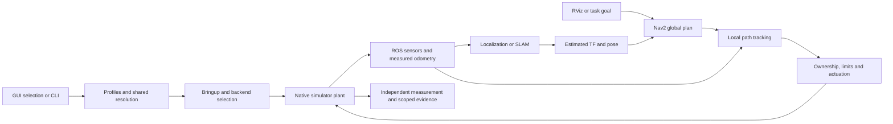
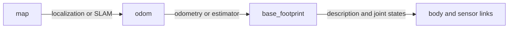
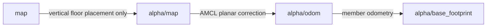

# Explore Robot Lab from the GUI

## Run

```bash
source /opt/ros/humble/setup.bash
source install/setup.bash
source scripts/ssd_env.sh
ros2 run robot_lab_gui robot_lab_gui
```

Choose **Learn & diagnose** in the sidebar. This is the existing **Health**
workspace, expanded with **Architecture & learning**, **Tutorials & source
library** and **Diagnostics & roadmap**. No browser, downloaded diagram engine
or running simulator is required for the architecture lessons.

The platform remains partial. A designed diagram explains implemented routing
and responsibilities; a live discovery snapshot records advertised endpoints;
only a scoped measured mission establishes working robot behavior.

## Start with a guided tour

In **Architecture & learning → System diagrams**, choose **New here · follow a
navigation command**, then **Start tour**. Use **Next**, **Previous** or **Play**.
Playback advances teaching cards every 4.5 seconds; it does not run the robot.
Clicking a card or arrow stops playback. Other tours cover troubleshooting,
mapping, multi-floor transport, robot classes and networking.

Click a card to see its responsibility, interface examples, source files,
incoming/outgoing relationships and related guide. Click a connected component
in the inspector to follow it. Source links and **Read the related guide** open
inside the same Health workspace. Search for a concept such as `costmap`,
`MAVLink`, `joint_states`, `ownership`, `source` or `map→odom` and choose a result.
The layer selector spotlights architectural responsibilities in the current view.

Wheel or **+ / −** zooms; **Fit** resets the view. Drag the background to pan;
middle/right drag also pans. Focus the drawing and use **Left / Right** to select
cards and **Home** to fit. At smaller scales the diagram keeps compact titles;
zoom in for summaries and use the inspector for complete text. **Save SVG**
exports a self-contained vector diagram for sharing or printing.

## Twelve views of one system

| View | Question it answers |
|---|---|
| System at a glance | Where do selections, physics, controllers and evidence fit? |
| Selection to running robot | How does a GUI selection become launch processes? |
| Navigation feedback loop | How does an RViz goal eventually move a wheel? |
| Localization versus SLAM | Which inputs and saved artifacts does each mode need? |
| Robot classes and actuation | Why do a humanoid, arm, drone and ROV need different controllers? |
| Frames, clocks and truth | Who publishes each transform, and which pose is estimated? |
| Fleet and lift | How do shared physics, queues, RMF events, gates and floor maps interact? |
| Flight and aerial swarm | How are ROS, FCU identities, MAVLink and rotor physics linked? |
| Marine | How do force control, sensing, acquisition and routes fit together? |
| Manipulation | How does a coordinate become a previewed, bounded native action? |
| Networking and isolation | What is isolated by a ROS domain, Gazebo partition or MAVLink endpoint? |
| Experiments and evidence | How do runs, observations, artifacts and support claims connect? |

## Follow a navigation request end to end

<!-- diagram: navigation -->


1. Select an exact robot variant, world, backend, mode and compatible algorithms.
   The preview shows the command that Run will execute. Structural tags help
   browse; they do not grant a working controller or navigation capability.
2. Bringup applies robot/world/algorithm overlays and starts the backend and
   selected ROS stack. A source robot and a world are physical assets, not
   algorithms. Controllers, sensors, clock and actions must become ready.
3. Physics produces measurements. Bridges preserve frames, units and stamps.
   Wheel/contact/visual estimation produces odometry; AMCL or SLAM supplies the
   selected global correction. Ground truth remains separately labeled.
4. A goal enters the Nav2 action lifecycle. The global planner uses the global
   costmap; a local controller tracks the Path using nearby obstacles and
   kinematic constraints. Their outputs are different from native motor effort.
5. Ownership, watchdogs and bounds arbitrate commands before actuation. A
   differential base, steering car, mecanum platform and legged policy require
   different physical mappings. The plant moves and the feedback loop repeats.
6. Observe the action result and actual settled robot endpoint. Save the source,
   configuration, trace and outcome. An accepted goal or visible topic alone is
   not a successful physical mission.

## Understand modes before choosing algorithms

| Mode/workflow | Main purpose | Required distinction |
|---|---|---|
| Display | Inspect a robot and/or world | Import/rendering does not establish motion |
| Localization | Estimate pose against an existing map | A known map and suitable sensor model are needed |
| 2D SLAM | Build a planar map while estimating motion | Save actual occupancy image/YAML for later use |
| 3D SLAM | Acquire RGB-D/visual graph/database/cloud data | Depth, calibration and synchronized frames are required |
| Navigation | Drive a compatible base to goals using maps/costmaps | Planner/controller/footprint must suit the robot |
| Flight | Execute an actual FCU/rotor workflow | Arm, takeoff, flight, landing and disarm are separate stages |
| Arm/Hand | Plan/jog/teach source-native articulation | Reachability, limits, collisions and contact matter |
| Marine/Gait/Tracks | Use source-appropriate class controllers | Ground Nav2 assumptions are not universal |
| Fleet/Aerial Swarm | Operate several members in one physical world | Member identity, ownership, clocks and failure policies are explicit |

## Read the frame tree correctly

<!-- diagram: frames -->


Each edge needs one owner. The facility fleet inserts a per-member floor frame:

<!-- diagram: frames -->


The robot's observed height selects L0/L1; infrastructure does not inject truth
XY/yaw into AMCL. During vertical travel the planar AMCL scan relay pauses,
while raw obstacle scans remain live. Map loading and both costmap clear
acknowledgments precede releasing the robot. See [the facility guide](../tutorials/fleet-infrastructure.md).

## Inspect the real ROS graph

Start a compatible simulation, then choose **Live ROS graph → Discover ROS graph**.
The GUI creates an owned, short-lived ROS context/node in its current domain,
collects endpoint declarations, and destroys that context after discovery. It
does not issue robot commands or call robot services. The standard rclpy node
may advertise parameter events; no application command publisher is created.
The GUI/control ROS context is never shut down by this inspector.

The graph has node and topic columns: **node → topic** means publisher;
**topic → node** means subscriber. Select a card for actual names/types,
advertised services and offered/requested endpoint QoS. QoS detail is bounded
to 40 topics/40 endpoints per role; unqueried is not incompatible. Filter by a node/topic substring or member namespace.
Common TF, clock, logging and parameter topics can be hidden from the drawing.
Refresh explicitly to obtain another timestamped snapshot. **Save snapshot JSON**
exports the actual discovery data, including warnings and truncation flags.

Discovery is bounded to 80 nodes/160 topics and a finite query window. The
drawing uses at most 40 nodes/60 topics/400 arrows. It is deliberately a readable
subset; the UI reports drawn counts and snapshot limits. Nodes may disappear
during discovery. No endpoints is a legitimate observation, not an invented
example graph. A discovered publisher/subscriber pair does not prove compatible
QoS, advancing timestamps, useful rate, TF readiness or mission success.

For other views, use **Live Monitor** for actual subscribed measurements and
the existing **Diagnostics & roadmap** ROS node/topic tools. If installed,
`ros2 run rqt_graph rqt_graph` provides the standard external ROS graph tool;
the native explorer does not depend on it. Set domain/discovery configuration
before starting the GUI; changing a teaching field does not change discovery.

## Learn networking without changing the robot

The **Networking playground** compares offered publisher and requested
subscriber settings. Try a different domain, `/alpha` versus `/beta`, mismatched
types, or best-effort offered versus reliable requested. Restore settings and
watch the explanation. The playground is illustrative: no environment variable,
ROS endpoint, firewall or actual robot connection is changed. It models selected
compatibility conditions, not all DDS policies or network reachability.
Use **Glossary** for new terms. Read [networking and troubleshooting](networking.md) for the real boundaries.

## Find tutorials and implementation

**Docs & tutorials** is the documentation library. It follows
[`docs/library.yaml`](../library.yaml): Start here, the beginner course, using
the GUI, robots, drones/water/teams, algorithms, measured comparisons,
architecture, status and roadmap, project guides, then maintained ROS packages.
Pages not listed there appear under Other documents. Figures and animations
show inline (click one to enlarge), and Mermaid diagrams show as the images
`scripts/render_doc_diagrams.py` rendered. Search filters titles, paths and
package descriptions. Select a guide, use **On this page** for headings,
search text with **Find text**, and follow local Markdown links without leaving
the GUI. **Back** returns to the previous document. External HTTP links open
only when clicked. Binary meshes/maps belong in Registry 3D or the map viewer.

Source directory links open a bounded, read-only file/folder browser in the
same reader; parent links and Back let you explore the structure. Local package
dependencies are clickable manifest links. Package descriptions/dependencies come from actual top-level `package.xml`
files, including the nested registry/benchmark packages. Imported vendor
subassemblies are not counted as independent maintained stacks. Declared
dependencies are not a running ROS graph. Source previews stay inside this
workspace and are limited to 1.5 MB; they never execute the file.

## Continue learning

- [Architecture reference and package map](overview.md)
- [Networking, QoS and debugging](networking.md)
- [GUI controls and workspace](../tutorials/gui-workspace.md)
- [Robot and workflow tutorial index](../tutorials/README.md)
- [Current measured status](../status/CURRENT_STATUS.md)
- [Remaining agent work](../REMAINING_WORK_GUIDE.md)

The architecture catalog, graph helpers, native canvas, document library and UI
live in `src/robot_lab_gui/robot_lab_gui/architecture_*.py`. Add source-linked
components and valid view/tour references together. Preserve the distinction
between teaching models, read-only observations and measured robot missions.
