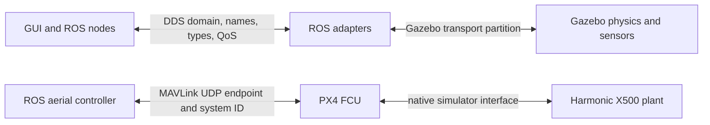

# Robot Lab networking, time and troubleshooting

## Run

Open **Learn & diagnose → Architecture & learning → Networking playground** for
an interactive lesson. Open **Live ROS graph** for explicit endpoint discovery
in the GUI's actual ROS domain. Neither view changes host networking or drives
a robot. This guide describes the current source paths; backend/profile-specific
names and settings must be inspected in the resolved launch/session.

## Three transport boundaries

<!-- diagram: network -->


| Boundary | Identity/configuration | Robot Lab responsibility |
|---|---|---|
| ROS 2 / DDS | `ROS_DOMAIN_ID`, middleware/discovery/interface settings, topic/service/action names, types and QoS | Match the intended graph; isolate independent trials |
| Gazebo transport | `GZ_PARTITION` / `IGN_PARTITION`, version-compatible native bridges/plugins | Keep the selected world and bridge in the same partition |
| MAVLink | UDP address/port, PX4 instance and system ID | Route each vehicle's telemetry/setpoints to its own FCU |
| Files and resources | Selected source profile, installed paths, model resources, runtime directory | Resolve the same robot/world assets and preserve provenance |

A ROS domain does not configure Gazebo discovery. A Gazebo partition does not
rename ROS topics. A ROS namespace does not assign a MAVLink system ID. These
must be composed explicitly by each workflow.

## ROS discovery and names

Nodes must share the intended DDS domain to discover one another. Across hosts,
matching domain numbers alone does not establish communication: interface,
reachability, discovery, security and middleware settings also matter. Domain
choice affects UDP port allocation and has platform/participant constraints;
the lesson accepts 0–232 as an illustrative range, not a guarantee every value
is suitable for every host. Follow [the official Humble domain guidance](https://raw.githubusercontent.com/ros2/ros2_documentation/humble/source/Concepts/Intermediate/About-Domain-ID.rst).

A relative topic `cmd_vel` in `/alpha` resolves to `/alpha/cmd_vel`; an absolute
`/cmd_vel` ignores that namespace. Two robots with different node namespaces can
still collide if both use absolute command topics or the same TF frame IDs.
The shared fleet creates per-member controller/Nav2 configuration and frame
prefixes. Independent experiments also need distinct clocks and transport
partitions; multiple robots interacting physically need one shared plant.

The GUI graph snapshots the domain inherited by the GUI process. Start the GUI
from the intended environment. The playground fields are examples only.

## Message, service and action contracts

| Kind | Example | How to think about it |
|---|---|---|
| Topic | Scan, odometry, joint states, velocity | A typed stream between advertised endpoints |
| Service | Map load, costmap clear, lifecycle query | Request/response; advertised existence does not mean ready |
| Action | Nav2 goal, joint trajectory | Long-running goal with acceptance, feedback, result and cancellation |
| TF | `map → odom → body → sensor` | Time-indexed transforms with explicit edge ownership |

The native live graph shows topic publisher/subscriber relationships,
offered/requested endpoint QoS for a bounded subset, and service declarations
in the node inspector. QoS is advertised metadata, not a delivery test. It does not call services, execute
actions, measure topic rates or subscribe to sensor messages. Actions have
underlying topics/services, but a drawing of those endpoints is not an action
state machine or a result.

## QoS: offered versus requested

Matching names and types still require compatible QoS. A reliable offer can
satisfy a best-effort request; a best-effort offer cannot satisfy a reliable
request. A volatile offer cannot satisfy a request for transient-local
durability. The lesson evaluates these two policies; deadlines, liveliness and
other settings are outside its simplified model. Sensor profiles commonly
prioritize recent samples with best effort. Static metadata can need suitable
late-joiner durability. Inspect actual endpoints before changing settings.
[Official Humble QoS reference](https://raw.githubusercontent.com/ros2/ros2_documentation/humble/source/Concepts/Intermediate/About-Quality-of-Service-Settings.rst).

## Time, TF and estimates

The selected simulator publishes `/clock`; `use_sim_time` consumers must agree
on its epoch and progress. A paused clock does not stop wall-time ownership
watchdogs. TF and sensor stamps must describe a compatible instant. A graph
with every node present may still fail because transforms are stale, duplicated
or outside a buffer's time range.

For ordinary ground workflows, localization/SLAM owns `map → odom`, and the
selected odometry/estimator owns `odom → body`. Joint states and the description
provide articulated body/sensor transforms. Facility floor placement owns only
`map → <member>/map` vertically; AMCL keeps planar ownership. Simulator truth
is a separate measurement source, not an unnoticed localization shortcut.

## Aircraft endpoints in this repository

The current native Robot Lab PX4 ROS controller uses pymavlink/MAVLink. The
ordinary endpoint defaults to `udpout:127.0.0.1:14580`; the aerial session model
assigns `14580 + instance`, member IDs and separate system IDs. Inspect the
resolved session rather than assuming fixed ports for arbitrary launches.
These are distinct from DDS domains and Gazebo partitions. Do not assume a
generic PX4 DDS bridge is the active source path here.

See [PX4 Flight](../tutorials/px4_x500.md),
[Aerial Swarm](../tutorials/aerial-swarm.md),
`src/robot_lab_adapter/robot_lab_adapter/px4_ros_controller.py` and
`aerial_swarm_model.py`. The native flight backend uses Harmonic; ground/marine
Fortress plugins and flight Harmonic plugins have different ABI requirements.

## Debug from symptoms to the failing boundary

| Symptom | Inspect next | What the observation actually establishes |
|---|---|---|
| No nodes in the GUI snapshot | GUI domain/environment, intended process state, discovery/interface configuration | Empty discovery in this domain/window |
| Nodes but no useful data | Exact names/types, offered/requested QoS, sensor timestamps/rates | Endpoints alone do not establish delivery |
| Robot jumps or RViz disagrees | TF owners, frame prefixes, clock/stamp alignment, joint feedback | Correct graph topology alone does not establish pose correctness |
| Goal accepted but no motion | Action/lifecycle, localization, costmaps, ownership/interlocks, native actuator feedback | An accepted goal is only one stage |
| World visible but ROS sensors absent | Native sensor/plugins and the ROS↔engine bridge/partition | Rendering is separate from data transport |
| One drone affects another | Per-FCU endpoint/system ID and ROS member namespace | Port and identity routing require separate checks |
| Lift/robot stays held after loss | Operator epoch, source interlocks and actual floor/feedback | Explicit re-enable is intentional; safe recovery is a new operation |

Useful read-only commands in the sourced environment:

```bash
ros2 node list
ros2 node info /alpha/amcl
ros2 topic list -t
ros2 topic info /alpha/scan -v
ros2 action list -t
ros2 service list -t
```

Names in these examples belong to a matching named-member workflow; substitute
the actual snapshot names. `ros2 topic hz` and `echo` subscribe to real data and
can add load; use them deliberately. If available, `rqt_graph` is a separate
standard graph viewer. The native explorer works without that dependency.

## Read-only discovery implementation

`architecture_graph.discover_ros` creates a private Context/Executor and
short-lived node, gathers bounded node/publisher/subscriber/service declarations,
then destroys its own resources. Its standard rclpy constructor may advertise
parameter events; it creates no application command publisher or robot service
client. Worker results reach Tk through a queue; graph work does not run on the
Tk thread. Closing the explorer cancels its discovery window without shutting
down the control GUI's context. The API is documented in the
[official Humble rclpy source](https://raw.githubusercontent.com/ros2/rclpy/humble/rclpy/rclpy/node.py).

Snapshots report timestamps, domain, middleware, errors and bounds. They do not
report fabricated traffic or health scores. Save JSON for actual discovery;
export SVG from the teaching diagram for architecture communication. See
[the interactive guide](interactive-guide.md) for controls and limitations.
