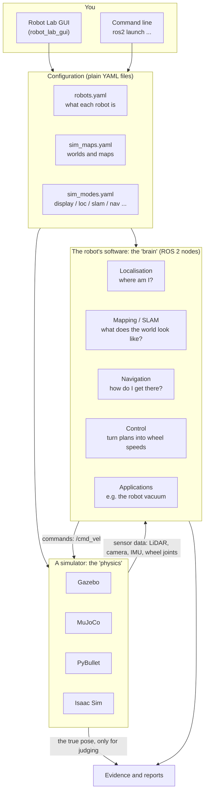
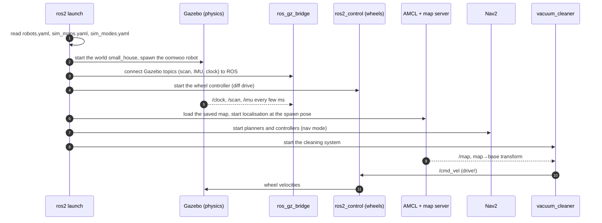

# 1 · The big picture

**In one sentence:** Robot Lab is a set of programs that puts a simulated
robot into a simulated world, gives it the "brain" software a real robot
would run (mapping, localisation, planning, control), and measures what
happens.

## What is in the box



Three ideas carry the whole project:

1. **The simulator is swappable.** The same robot "brain" talks to Gazebo,
   MuJoCo, PyBullet or Isaac. Each simulator gets a small adapter so it
   produces the same messages a real robot would.
2. **Everything is a profile.** A robot, a world and a mode are entries in
   YAML files: 37 robots in `robots.yaml` and 39 worlds in
   `sim_maps.yaml`. The GUI and the launch files read the same files.
3. **Claims are measured.** A feature is "working" only when a recorded
   run, judged against the simulator's ground truth, says so (chapter 8).

## The pieces you will meet

| Piece | Package (folder under `src/`) | Job |
|---|---|---|
| GUI | `robot_lab_gui` | choose a robot/world/mode, launch, drive, monitor |
| Bring-up | `robot_lab_bringup` | the launch files that start everything in the right order |
| Robots | `robot_lab_robots` | robot descriptions (URDF/xacro) and `robots.yaml` |
| Worlds and maps | `robot_lab_maps`, `robot_lab_models` | Gazebo worlds, 2D maps, 3D models |
| Simulator adapters | `robot_lab_description` (Gazebo), `robot_lab_mujoco`, `robot_lab_pybullet`, `robot_lab_isaac` | start a simulator and connect it to ROS |
| Control | `robot_lab_controller` | wheel controllers, teleoperation, the command multiplexer |
| Localisation, mapping, navigation | `robot_lab_localization`, `robot_lab_mapping`, `robot_lab_navigation` | EKF/AMCL, SLAM, Nav2 configuration |
| Algorithms | `robot_lab_algorithms`, `robot_lab_planning` | algorithm implementations and comparisons |
| Robot vacuum | `robot_lab_vacuum_cleaning` | the cleaning system of chapter 7 |
| Learned walking | `robot_lab_adapter` | legged robots, policy training |

## What happens when you press Launch

The GUI shows you the exact command it will run. For the robot vacuum it is:

```bash
ros2 launch robot_lab_bringup simulated_room_vacuum.launch.py \
    robot_model:=oomwoo map_name:=small_house simulator:=gazebo mode:=nav controller:=cleaning
```

That single command starts about 25 programs. In order:



The **mode** decides which parts of the brain run:

| Mode | Runs | Use it to |
|---|---|---|
| `display` | robot model only | look at the robot |
| `loc` | + odometry, sensor fusion | drive and watch odometry |
| `slam` | + SLAM (builds a map live) | map a new world |
| `nav` | + saved map, AMCL, Nav2 | navigate on a known map |
| `3d_slam` | + RGB-D mapping | 3D maps (needs a camera) |
| `flight`, `marine`, `gait` | class-specific stacks | drones, underwater robots, walkers |

## Try it

```bash
source scripts/ssd_env.sh && source install/setup.bash
ros2 run robot_lab_gui robot_lab_gui          # the GUI
# In the GUI: Run a robot → pick bumperbot, world empty, mode display → Launch.
ros2 node list                                # in a second terminal: the running programs
```

Next: [2 · ROS 2 concepts](02-ros2-concepts.md).
