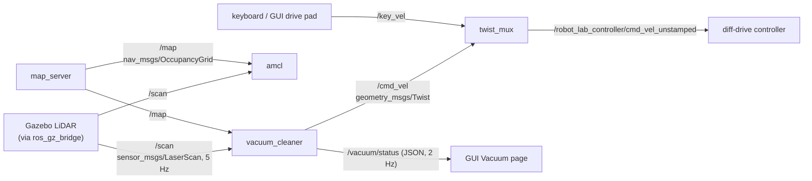
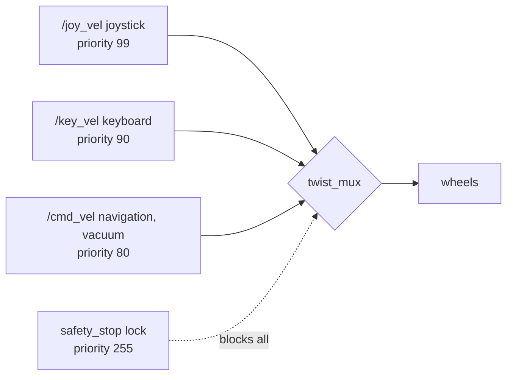
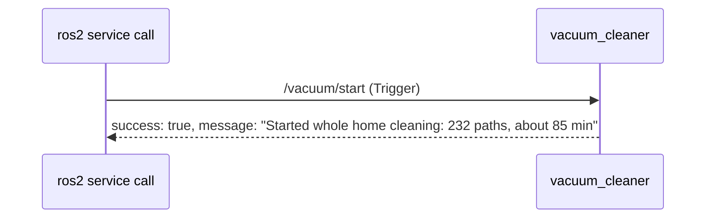
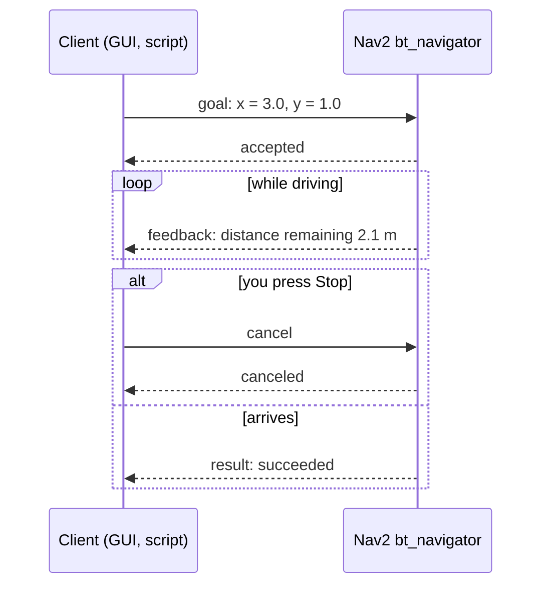
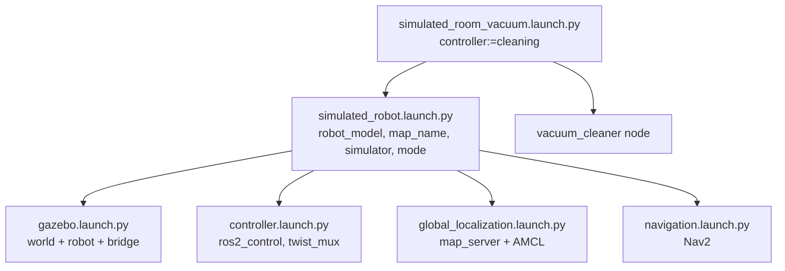
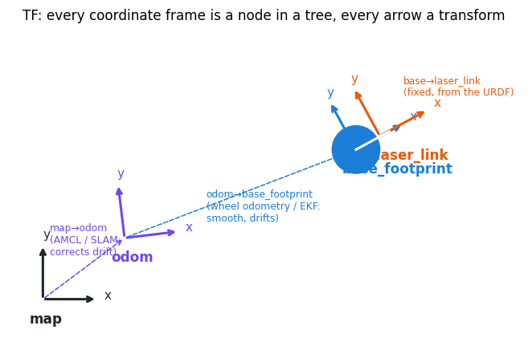
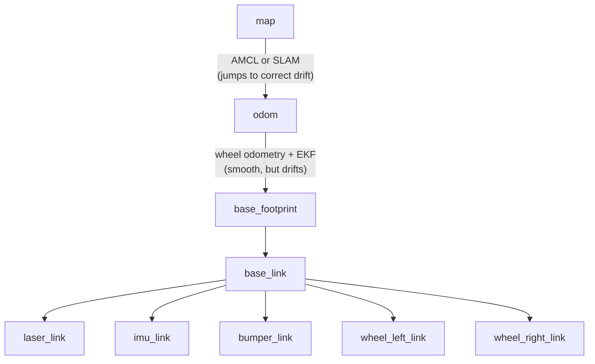

# 2 · ROS 2 concepts

**In one sentence:** ROS 2 lets many small programs (**nodes**) cooperate
by sending each other typed messages, without knowing where the others run.

A robot's software is not one big program. It is dozens of small ones: one
reads the LiDAR, one estimates the position, one plans, one drives the
wheels. ROS 2 is the "post office" between them.

## Nodes

A **node** is one program (or one part of a program) with one job. While a
robot-vacuum simulation runs, `ros2 node list` shows about 25 of them, for
example:

| Node | Job |
|---|---|
| `/robot_state_publisher` | publishes where each part of the robot is (from the URDF) |
| `/controller_manager` | runs the wheel controller |
| `/map_server` | serves the saved map |
| `/amcl` | estimates where the robot is on the map |
| `/vacuum_cleaner` | plans and drives the cleaning |
| `/twist_mux` | picks which velocity command reaches the wheels |

## Topics: one-way broadcasts

A **topic** is a named channel with a fixed message type. Any number of
nodes may publish on it, and any number may subscribe. Nobody waits for an
answer.



A message type is a small fixed structure. `geometry_msgs/Twist`, the
standard "drive like this" command, is:

```text
linear:  {x: 0.25, y: 0.0, z: 0.0}    # forward speed, m/s
angular: {x: 0.0, y: 0.0, z: 0.8}     # turn rate, rad/s (positive = left)
```

### Who wins when two nodes drive? The multiplexer

Several nodes may want to move the robot: you on the keyboard, a joystick,
the cleaning system. `twist_mux` passes on the highest-priority input that
is still active (newer than its 0.5 s timeout):



That is why pressing a key in the GUI drive pad overrides the vacuum at
once. When you let go, the vacuum takes over again after 0.5 s.

## Services: ask and wait for an answer

A **service** is a request/response call, like a function call to another
program. The cleaning system offers `vacuum/start`, `vacuum/pause`,
`vacuum/resume`, `vacuum/stop`, `vacuum/dock` and `vacuum/locate`
(type `std_srvs/Trigger`: no input; the answer is success plus a message).



## Actions: long jobs with progress and cancel

An **action** is for jobs that take time: "drive to this goal". The caller
gets feedback while the job runs and can cancel it. Nav2's
`navigate_to_pose` is an action.



| | Topic | Service | Action |
|---|---|---|---|
| Direction | one-way | request → response | goal → feedback… → result |
| Waits? | no | yes, briefly | no; you get updates |
| Cancel? | – | – | yes |
| Example here | `/scan`, `/cmd_vel` | `vacuum/dock` | `navigate_to_pose` |

## Parameters

A **parameter** is a node's setting, given at start and sometimes changeable
while it runs. The cleaning node has, for example, `robot_model`
(`oomwoo`), `map_key` (`small_house`) and `use_sim_time` (`true`):

```bash
ros2 run robot_lab_vacuum_cleaning vacuum_cleaner --ros-args -p robot_model:=oomwoo -p use_sim_time:=true
ros2 param get /vacuum_cleaner robot_model
```

## Launch files: starting many nodes at once

A **launch file** (Python, in `launch/` folders) starts and configures a
group of nodes, and can include other launch files. Launch **arguments**
(`name:=value`) choose what to start:



## QoS: how carefully to deliver

**Quality of Service** settings say how a topic behaves when the network is
busy or a subscriber starts late. Publisher and subscriber must be
compatible, or no data flows (a classic beginner's surprise).

| Setting | Options | Used here for |
|---|---|---|
| Reliability | *reliable* (resend lost messages) / *best effort* (drop them) | `/scan` is best effort: a late scan is useless anyway |
| Durability | *volatile* / *transient local* (keep the last message for late joiners) | `/map`, `/vacuum/layout`, `/vacuum/rooms`: a GUI started later still gets them |
| History depth | keep the last N | commands: 10 |

## TF: where is everything?

A robot has many **coordinate frames**: the map, the odometry origin, the
robot's base, the LiDAR, each wheel. **TF** keeps the transforms between
them, and any node can ask "where is the LiDAR in map coordinates, right
now?"





Why two "world" frames? Wheel odometry is smooth but slowly drifts.
Localisation against the map is accurate but jumps. Keeping them as
separate frames gives a controller a smooth pose and a planner an accurate
one (chapter 5).

## Simulated time

A simulator may run slower or faster than real time. Every node started
with `use_sim_time:=true` reads the clock from the `/clock` topic, which
the simulator publishes. Ten seconds of driving are then ten *simulated*
seconds, even if the computer needed fifteen.

## Try it

With a simulation running (chapter 1):

```bash
ros2 topic list                       # all channels
ros2 topic echo /cmd_vel              # watch velocity commands
ros2 topic hz /scan                   # how often the LiDAR publishes
ros2 topic info /map --verbose        # publishers, subscribers, their QoS
ros2 run tf2_tools view_frames        # draws the TF tree to frames.pdf
ros2 service call /vacuum/locate std_srvs/srv/Trigger
rqt_graph                             # the live node/topic graph
```

Next: [3 · Networking](03-networking.md).
