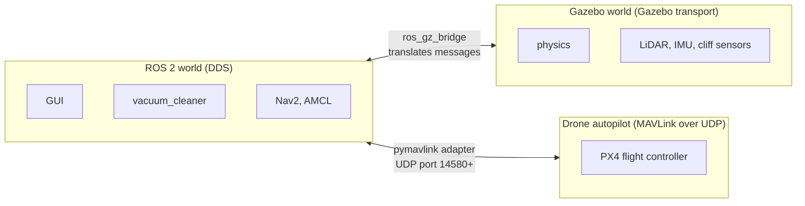
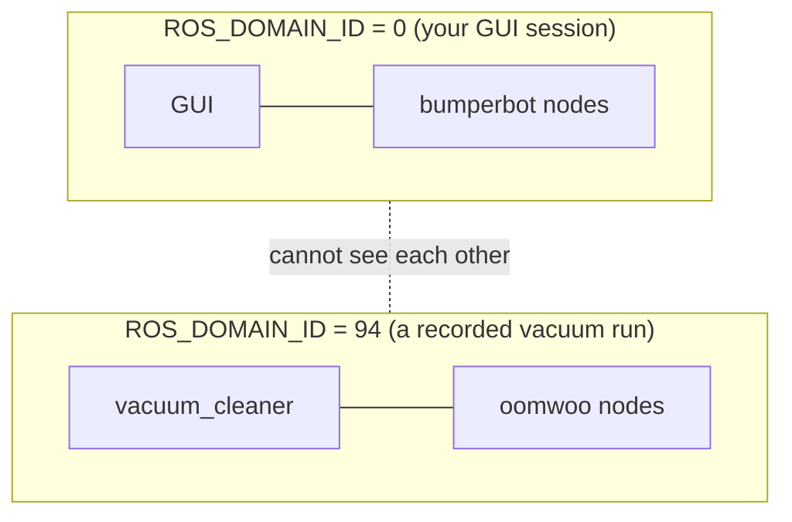
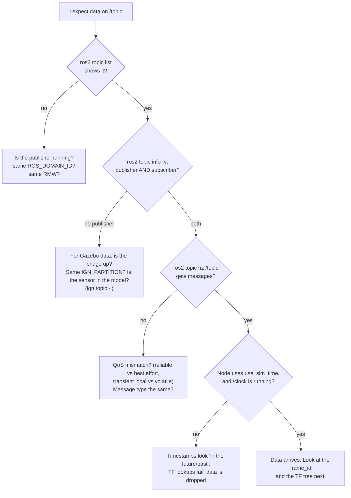

# 3 · Networking: how the programs find each other

**In one sentence:** ROS 2 nodes find each other automatically by
broadcasting "I'm here, I publish /scan" on the local network. Robot Lab
keeps separate experiments apart by giving each its own *domain* and its
own Gazebo *partition*.

This is the chapter to come back to when "the topic is there but no data
arrives".

## Three separate networks in one lab

Robot Lab uses three different communication systems. They do not know
about each other; bridges connect them.



| Network | Talks | Kept apart by | Set with |
|---|---|---|---|
| ROS 2 (DDS) | nodes, topics, services, actions | **domain ID** (0–232) | `ROS_DOMAIN_ID=94` |
| Gazebo transport | the simulator's own sensors and plugins | **partition** name | `IGN_PARTITION=vacuum_1234` |
| MAVLink | PX4 drone autopilots | UDP **port** and system ID | 14580, 14581, … |

## DDS: the post office under ROS 2

ROS 2 does not invent its own networking. It uses **DDS**, an industrial
publish/subscribe standard. This workspace uses the CycloneDDS
implementation (`RMW_IMPLEMENTATION=rmw_cyclonedds_cpp`).

### Discovery: how two nodes meet

There is no central server. Every node announces itself with small UDP
**multicast** messages (one packet reaches everyone on the network). The
others answer, and matching publishers and subscribers connect directly.

```mermaid
sequenceDiagram
    participant A as vacuum_cleaner (subscribes /scan)
    participant Net as multicast group (domain 94)
    participant B as ros_gz_bridge (publishes /scan)
    A->>Net: "participant A here; I read /scan (LaserScan, best effort)"
    B->>Net: "participant B here; I write /scan (LaserScan, best effort)"
    Net-->>A: B's announcement
    Net-->>B: A's announcement
    Note over A,B: names, types and QoS match → connect
    B->>A: LaserScan data, sent directly (unicast UDP)
    B->>A: LaserScan …
```

If any of the three checks fails (same name, same type, compatible QoS),
the two nodes see each other in `ros2 topic info`, but no data flows.

### Domains: separate post offices

The **domain ID** picks which multicast group and which UDP ports DDS uses.
Programs in different domains cannot see each other at all, even on the
same computer. Robot Lab's measurement scripts use this to run trials
without crosstalk:



Under the hood each domain gets its own port range. Discovery multicast
uses UDP port `7400 + 250 × domain`, so domain 0 uses 7400 and domain 94
uses 30 900. Data goes to nearby ports.

## Gazebo transport and the bridge

Gazebo (the Fortress version used for wheeled robots) has its own message
system, separate from ROS. Its sensors publish Gazebo messages such as
`/scan` (`gz.msgs.LaserScan`). **`ros_gz_bridge`** subscribes to those and
republishes them as ROS messages, following a list generated at launch:

| Gazebo topic | Gazebo type | ROS topic | ROS type |
|---|---|---|---|
| `/clock` | `gz.msgs.Clock` | `/clock` | `rosgraph_msgs/Clock` |
| `/scan` | `gz.msgs.LaserScan` | `/scan` | `sensor_msgs/LaserScan` |
| `/imu` | `gz.msgs.IMU` | `/imu/out` | `sensor_msgs/Imu` |
| `/model/oomwoo/odometry_truth` | `gz.msgs.Odometry` | `/odom/ground_truth` | `nav_msgs/Odometry` |
| `/cliff/front_left` | `gz.msgs.LaserScan` | `/cliff/front_left` | `sensor_msgs/LaserScan` |

Gazebo transport separates runs by **partition**. The run scripts give every
recorded run its own (`robot_lab_isolate_gazebo`), so a GUI session and a
measurement can run Gazebo side by side without exchanging sensor data.

## MAVLink for drones

PX4 autopilots speak **MAVLink** over UDP. Each simulated drone has a
**system ID** and a port (first drone 14580, then 14581, …). The adapter in
`robot_lab_adapter` turns ROS commands into MAVLink setpoints. A ROS
namespace does not choose the drone; the port and system ID do.

## Names and namespaces

Topic names work like file paths. A node in namespace `/alpha` that uses
the *relative* name `cmd_vel` talks on `/alpha/cmd_vel`. An *absolute*
name `/cmd_vel` ignores the namespace. Two robots in one world need
different namespaces and different TF frame prefixes, or they would steer
each other.

## When data does not arrive: a checklist



A real example from this project: Gazebo was asked for a `/bumper` contact
sensor. `ign topic -l` listed `/cliff/front_left` but no `/bumper`, so the
problem was on the Gazebo side (the sensor was never created), not in ROS
(chapter 7).

## Try it

```bash
echo $ROS_DOMAIN_ID $RMW_IMPLEMENTATION
ROS_DOMAIN_ID=42 ros2 topic list        # a different domain: an empty list
ros2 topic info /scan --verbose          # QoS of each side
ign topic -l                             # Gazebo's own topics (Fortress)
ros2 doctor --report | head -40          # network and middleware summary
```

The full reference is [networking and troubleshooting](../architecture/networking.md).

Next: [4 · Robots and sensors](04-robots-and-sensors.md).
