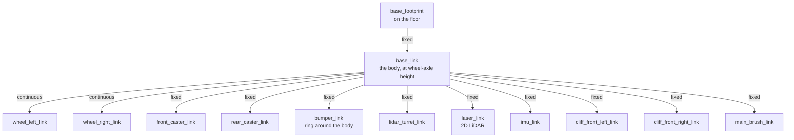
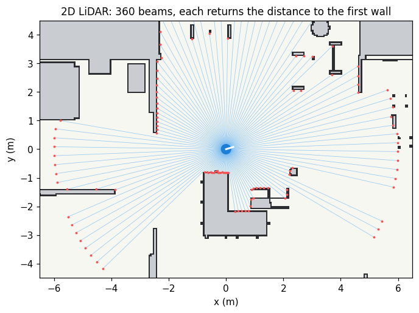
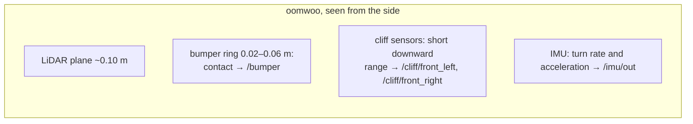
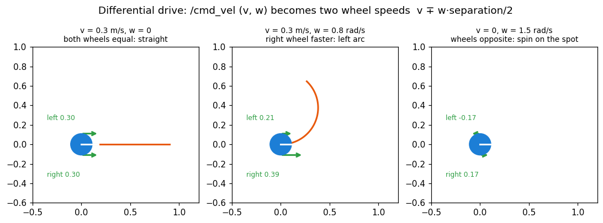
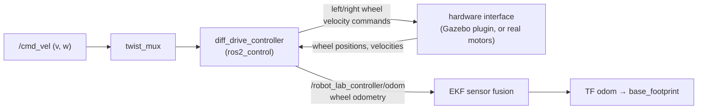

# 4 · Robots and sensors

**In one sentence:** a robot is described as a tree of rigid parts
(**links**) connected by **joints**, with sensors attached to some links;
the simulator turns that description into physics, and ROS turns sensor
data into messages.

## Describing a robot: URDF and xacro

**URDF** is an XML format for robot geometry. **xacro** adds variables and
macros, so a wheel is written once and used twice. The robot vacuum `oomwoo`
lives in `src/robot_lab_robots/oomwoo/urdf/`:

| File | Contains |
|---|---|
| `oomwoo.urdf.xacro` | links, joints, sizes (body 0.33 m, wheels r = 0.035 m, 0.22 m apart) |
| `oomwoo_gazebo.xacro` | simulator parts: friction, sensors (LiDAR, cliff, bumper, IMU), plugins |
| `oomwoo_ros2_control.xacro` | which joints the wheel controller may command |

The tree of links (an arrow is a joint):



*Continuous* joints rotate forever (wheels). *Fixed* joints just place a
part. `robot_state_publisher` reads this tree and publishes it to TF
(chapter 2).

Each robot also has a **profile** in `src/robot_lab_robots/config/robots.yaml`,
which tells the launch files and the GUI what the robot is:

```yaml
oomwoo:
  xacro: oomwoo/urdf/oomwoo.urdf.xacro
  supported_modes: [display, loc, slam, nav]
  features: [ros2_control, lidar_2d, velocity_base, bumper_sensor, cliff_sensor, vacuum]
  drive: {type: diff, wheel_radius: 0.035, wheel_separation: 0.22, max_speed: 0.5}
  supports_room_vacuum: true
  vacuum: {radius: 0.165, cleaning_width: 0.26, power_modes: [eco, standard, turbo, max]}
```

## Sensors

### 2D LiDAR: the main sense

A spinning laser measures the distance to the first obstacle in each
direction. The vacuum's LiDAR takes 360 readings (one per degree), 5 times
per second, up to 12 m, in a plane about 10 cm above the floor.



The message `sensor_msgs/LaserScan` is mostly a list of distances:
`angle_min`, `angle_increment` (1°) and `ranges[360]`. Everything else
(mapping, localisation, obstacle avoidance) is computed from it.

**What a LiDAR cannot see:** anything below or above its plane, such as a
low box, a cable or a table top. Hence the next sensors.

### Bumper, cliff sensors, IMU



| Sensor | Detects | Message |
|---|---|---|
| Cliff (×2) | a drop in front, such as stairs (the floor reads ~5 mm away; a drop reads far) | `sensor_msgs/LaserScan` with one range |
| Bumper | touching something | `ros_gz_interfaces/Contacts` |
| IMU | rotation rate, acceleration | `sensor_msgs/Imu` |
| Wheel encoders | how far each wheel turned | `sensor_msgs/JointState` → odometry |

Measured in the November 2026 Gazebo runs, the cliff sensors read the floor
at 4.9 mm. Gazebo Fortress did not create the bumper's contact topic, so the
vacuum also has a **virtual bumper** made from the LiDAR (chapter 7).

## Moving: differential drive

Two driven wheels on one axle; casters keep the body level. A velocity
command (`v` forward, `w` turning) becomes two wheel speeds:

```text
v_left  = v − w · separation / 2        v_right = v + w · separation / 2
wheel angular speed = v_wheel / wheel_radius
```



The chain from "drive" to "wheels turn":



**ros2_control** separates the controller (the maths above) from the
hardware interface. The same controller drives a simulated wheel in Gazebo
or a real motor driver.

**Odometry** integrates the wheel motion: "both wheels turned 1 m, so I
moved 1 m". It is smooth but drifts, because wheels slip and the radius is
never exact. An **EKF** (extended Kalman filter) blends it with the IMU's
turn rate for a better estimate. Chapter 5 removes the drift with the map.

## Try it

```bash
xacro src/robot_lab_robots/oomwoo/urdf/oomwoo.urdf.xacro > /tmp/oomwoo.urdf
check_urdf /tmp/oomwoo.urdf                     # prints the link tree above
ros2 launch robot_lab_bringup simulated_robot.launch.py robot_model:=oomwoo mode:=display
ros2 topic echo /scan --once | head -20         # with a simulation running
```

Next: [5 · Maps and localisation](05-maps-and-localization.md).
