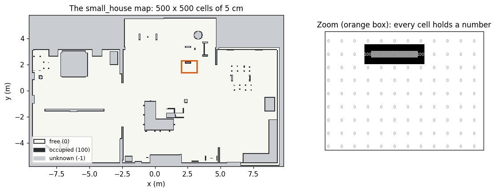
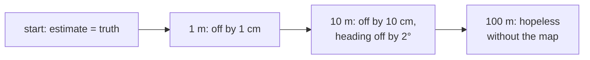
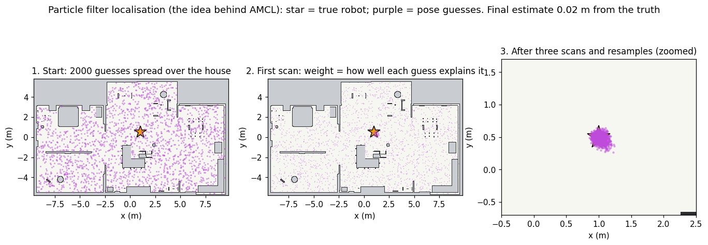
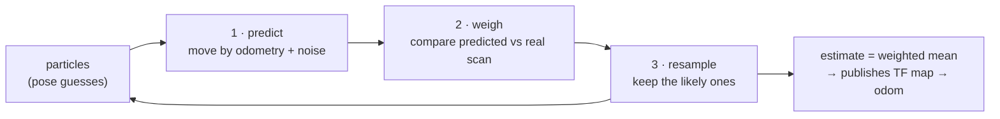
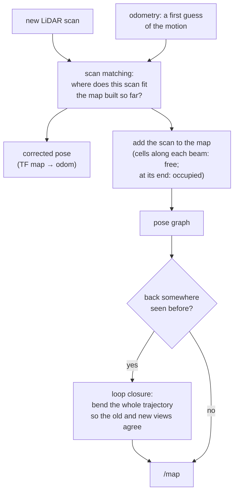

# 5 · Maps and localisation: "where am I?"

**In one sentence:** the map is a grid of cells marked free, occupied or
unknown; *localisation* finds the robot on a known map by comparing what
the LiDAR sees with what the map predicts, and *SLAM* builds the map and
localises at the same time.

## The occupancy grid

A 2D map is a picture: each **cell** (here 5 cm × 5 cm) holds a number.
`0` means free, `100` occupied, `-1` unknown (never seen). It is published
as `nav_msgs/OccupancyGrid` on `/map`, and saved as a `.pgm` image plus a
`.yaml` file with the resolution and the position of the corner (`origin`).



`src/robot_lab_maps/maps/small_house/maps/map.yaml`:

```yaml
image: map.pgm
resolution: 0.050000                     # metres per cell
origin: [-12.500000, -12.500000, 0.0]    # world position of the lower-left cell
occupied_thresh: 0.65                    # darker than this → occupied
free_thresh: 0.196                       # lighter than this → free
```

Converting between metres and cells is all the maths you need:
`cell_x = floor((x − origin_x) / resolution)`.

## Odometry drifts

Wheel odometry (chapter 4) says how far the robot moved, but every small
error adds up. After a few minutes the pose can be off by tens of
centimetres, and it never corrects itself.



## Localisation with a particle filter (AMCL)

**AMCL** (Adaptive Monte Carlo Localisation) keeps hundreds of guesses of
the pose, called **particles**. It repeats three steps:

1. **Predict:** move every particle by the odometry, with a little random
   noise (because odometry is uncertain).
2. **Weigh:** for each particle, predict what the LiDAR *should* see from
   there using the map. A particle whose prediction matches the real scan
   gets a high weight.
3. **Resample:** draw a new set of particles, picking heavy ones more
   often. Unlikely guesses die out.

The figure below runs this on the real map with 2000 particles and 24
LiDAR beams. The robot is not even driving; three scans are enough to find
it:





The lab's AMCL uses 500–2000 particles, the *likelihood field* sensor
model, and updates after every 0.1 m of travel
(`src/robot_lab_localization/config/amcl.yaml`). AMCL does not move the
robot's frame directly. It publishes the correction `map → odom`, so the
smooth `odom → base` from odometry stays untouched (the TF tree in
chapter 2).

Measured in the vacuum runs: the AMCL estimate stayed 4–6 cm from the
simulator's truth on average (10–13 cm at worst).

## SLAM: mapping and localising at once

In a new house there is no map yet. **SLAM** (Simultaneous Localisation
And Mapping) solves both problems together: it localises against the map
built so far and adds each new scan to it. The lab's `slam` mode runs
**slam_toolbox** (`src/robot_lab_mapping/config/slam_toolbox.yaml`,
5 cm resolution).



How each beam paints the map: cells the beam passes through become more
"free", and the cell where it hits becomes more "occupied". Unknown cells
(grey) are places no beam has reached yet. They are exactly where the
vacuum's **mapping run** goes next (chapter 7).

## Sensor fusion: the EKF

Between map corrections, the **EKF** (`robot_localization`, 30 Hz, 2D mode)
blends wheel odometry and the IMU into the `odom → base_footprint`
transform. The IMU measures turning well; wheels measure distance well.
The filter weighs each by how much it is trusted (its covariance).

## Try it

```bash
# With a nav-mode simulation running:
ros2 topic echo /amcl_pose --once         # the estimate and its uncertainty
ros2 run tf2_ros tf2_echo map base_footprint
# Save a map built in slam mode:
ros2 run nav2_map_server map_saver_cli -f my_map
python3 docs/learn/figures/make_figures.py mcl    # re-draw the particle filter
```

Next: [6 · Planning and control](06-planning-and-control.md).
