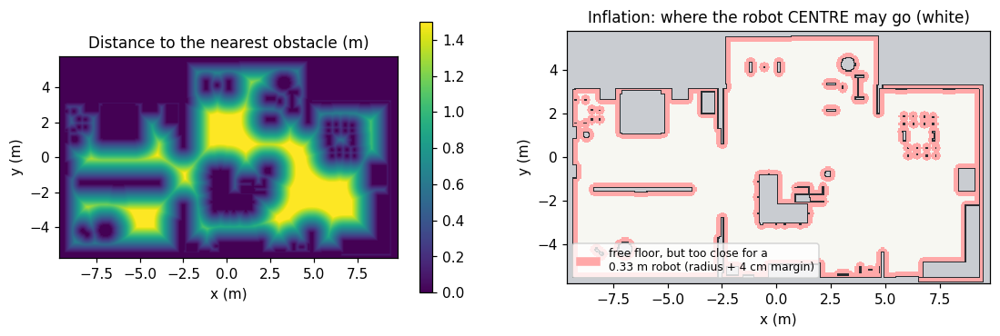
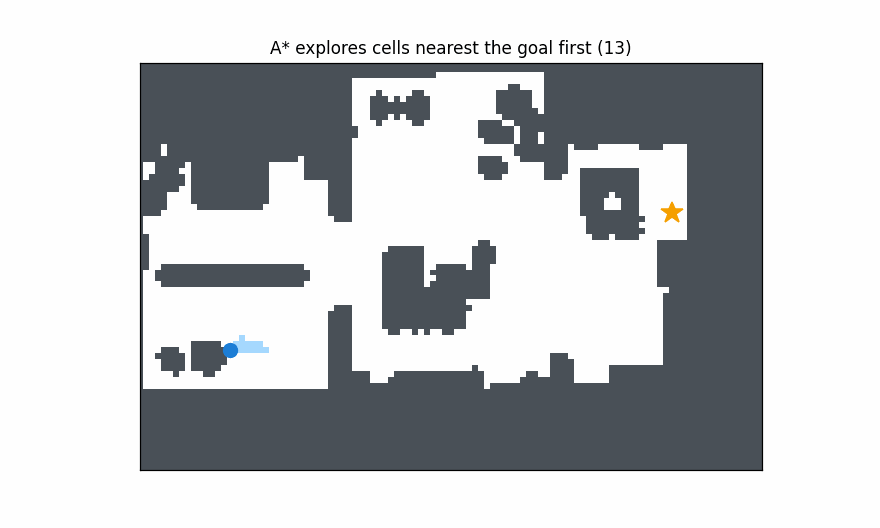
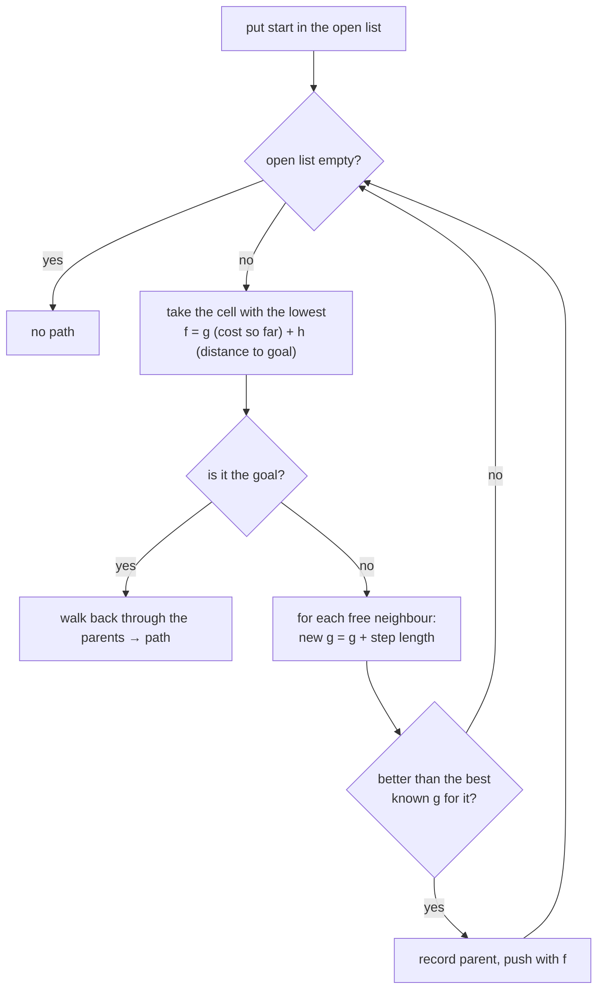
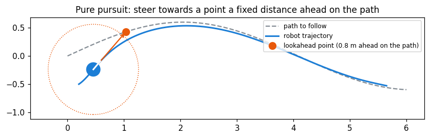
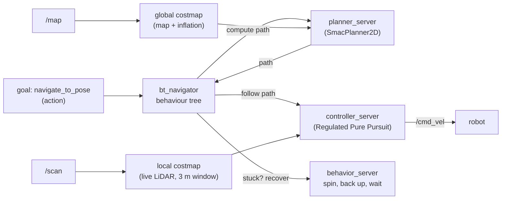
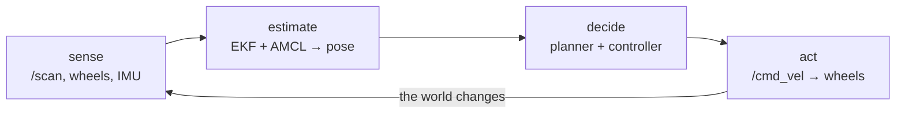

# 6 · Planning and control: "how do I get there?"

**In one sentence:** a *global planner* finds a safe route on the map, a
*local controller* turns that route into velocity commands many times a
second, and both treat obstacles as bigger than they are so the robot
keeps its distance.

## Step 1: make obstacles fat (inflation)

A path planner is easiest to write for a point. So instead of asking "does
a 0.33 m robot fit here?", every obstacle is **inflated** by the robot's
radius plus a margin. Then the robot's *centre* may go anywhere that is
still free.



Left: the distance from every free cell to the nearest obstacle (a
*distance transform*). Right: the cells the robot centre must avoid (red)
for the 0.33 m vacuum. Nav2's **costmap** does the same thing, with a soft
cost that rises near obstacles so paths prefer the middle of a corridor.

## Step 2: search for a path (A*)

**A\*** explores the grid from the start. It always expands the cell with
the smallest *cost so far + straight-line distance to the goal*. The second
term pulls the search towards the goal, so it opens far fewer cells than a
blind search, yet it still returns the shortest path.





Where A* is used in this project:

| Where | Planner | Notes |
|---|---|---|
| Nav2 default | `nav2_smac_planner/SmacPlanner2D` | A* on the costmap |
| Cars (cannot turn on the spot) | Smac Hybrid-A* with Reeds-Shepp curves | plans drivable arcs, forward and reverse |
| Robot vacuum | its own A* (`planner.py`) | 8-connected, prefers the middle of free space, then string-pulled into straight segments |

## Step 3: follow the path (pure pursuit)

A path is just a list of points. The **controller** has to produce `(v, w)`
20–50 times a second. **Pure pursuit** picks the point a fixed *lookahead*
distance ahead on the path and drives along the arc that reaches it:



```text
curvature = 2 · sin(angle to the lookahead point) / lookahead distance
w = v · curvature
```

A short lookahead follows the path tightly but wobbles; a long one is
smooth but cuts corners. The vacuum uses 0.15 m for spot spirals, 0.18 m
for wall-following edges and 0.25 m for lanes. Nav2's **Regulated Pure
Pursuit** (the lab default) also slows down in curves and near obstacles.

## Nav2: the navigation system

**Nav2** packages all of this as servers, coordinated by a **behaviour
tree** (a flowchart of what to do, and what to do when something fails):



Two costmaps, because the two jobs differ. The global costmap covers the
whole house for route planning. The local costmap is a small window that
moves with the robot and uses the live LiDAR, to dodge things not on the map.

## The control loop

Everything above runs in a loop: sense, estimate, decide, act.



| Loop | Rate in this lab |
|---|---|
| Wheel controller (ros2_control) | 100 Hz |
| Vacuum control step | 20 Hz |
| EKF | 30 Hz |
| LiDAR | 5 Hz |
| AMCL update | every 0.1 m of travel |

## Try it

```bash
# nav mode running: send a goal from the command line
ros2 action send_goal /navigate_to_pose nav2_msgs/action/NavigateToPose \
  "{pose: {header: {frame_id: map}, pose: {position: {x: 2.0, y: 1.0}, orientation: {w: 1.0}}}}" --feedback
python3 docs/learn/figures/make_figures.py astar pursuit    # re-draw these figures
```

The algorithm comparison tutorials ([global planning](../tutorials/global_planning_comparison.md),
[local planning](../tutorials/local_planning_comparison.md)) go further.

Next: [7 · Inside the robot vacuum](07-robot-vacuum-inside.md).
