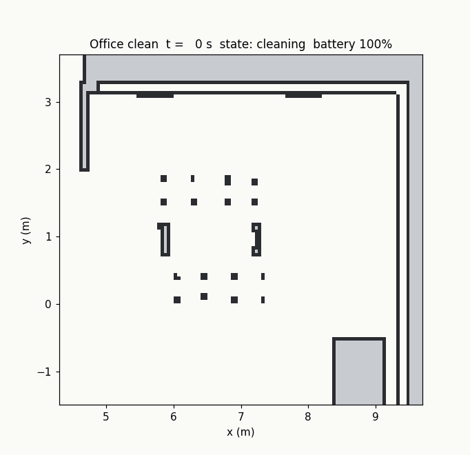
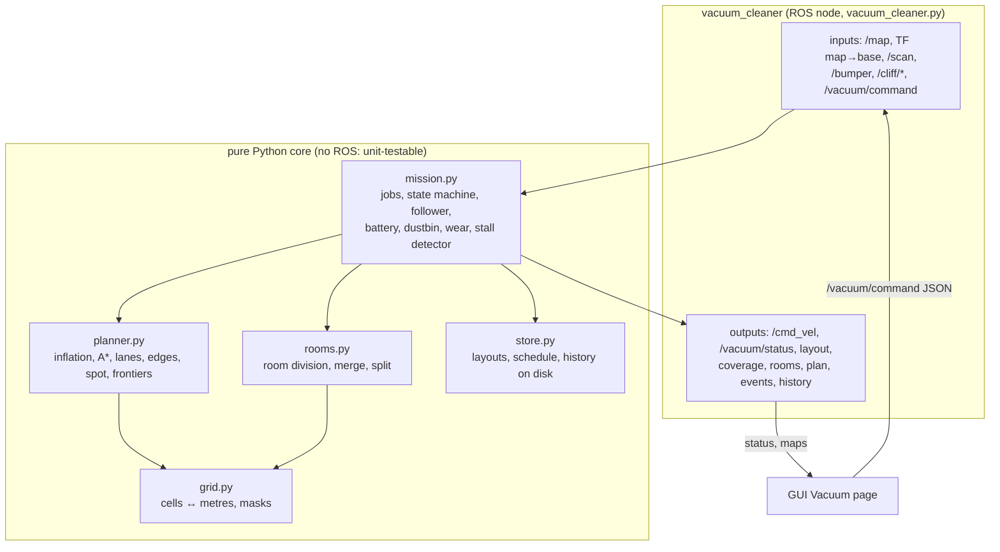
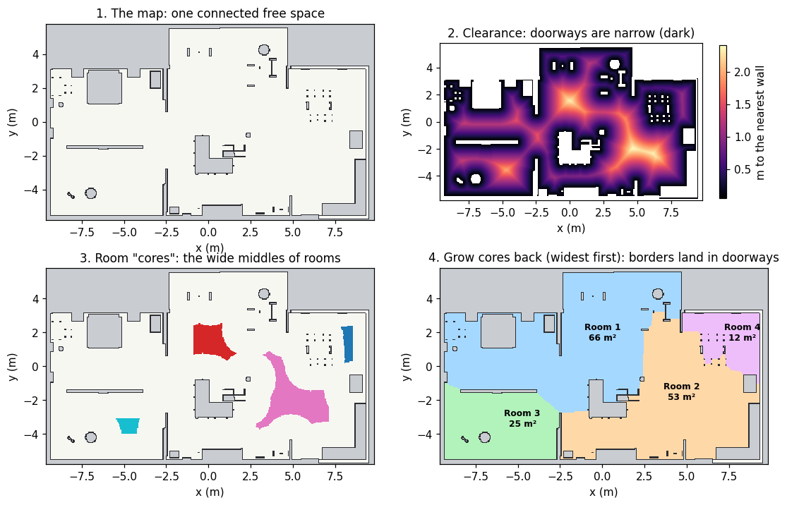
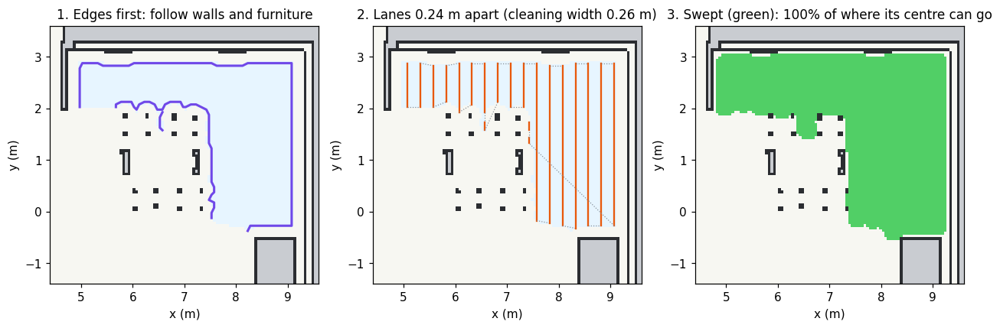
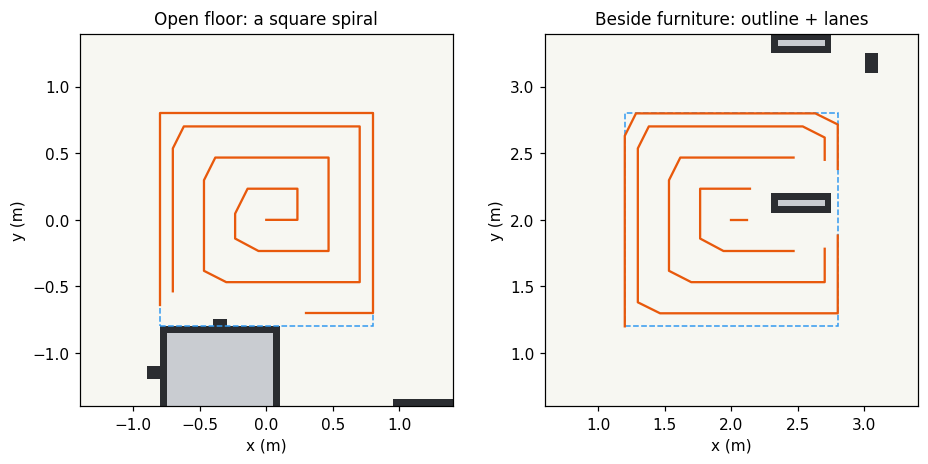
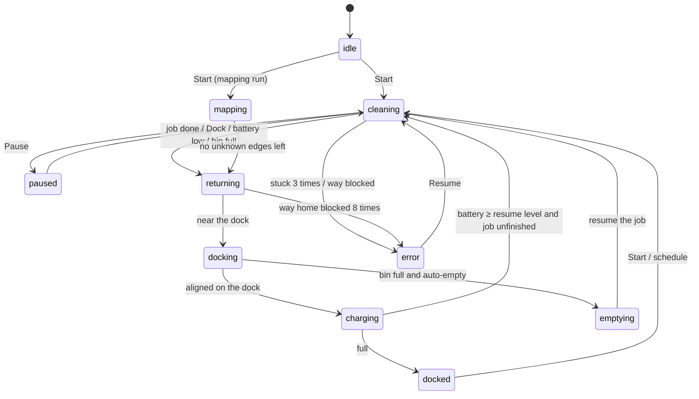
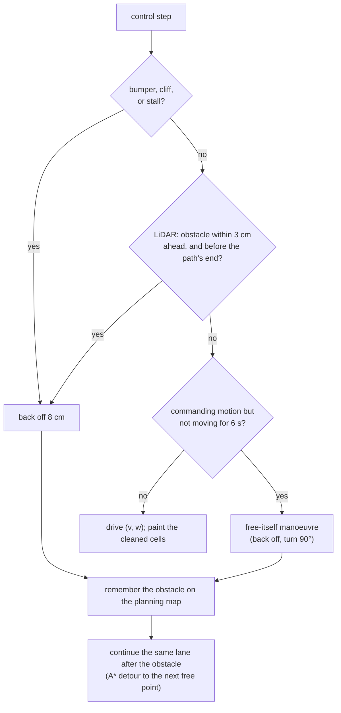
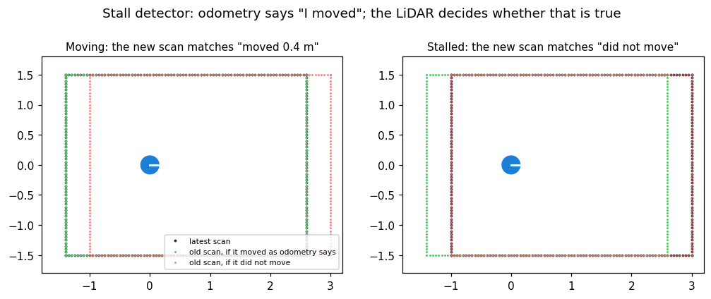
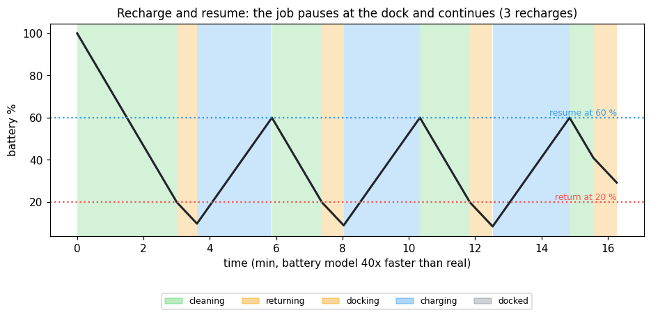
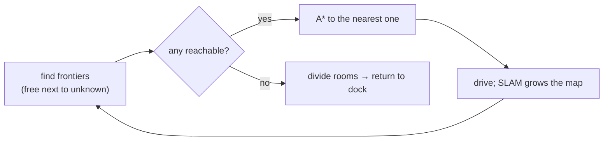

# 7 · Inside the robot vacuum

**In one sentence:** the cleaning system divides the map into rooms, plans
a path that sweeps every reachable bit of floor, follows it while dodging
what the map does not show, and handles the battery, the dustbin and the
dock like a commercial robot vacuum.

Everything here is in `src/robot_lab_vacuum_cleaning/`. The operator guide
(buttons and pages) is [robot-vacuum.md](../tutorials/robot-vacuum.md);
this chapter explains how it works.



## The parts



Keeping the core free of ROS has a big advantage: the unit tests drive the
real mission code with a tiny simulated robot in milliseconds, and the
figures on this page come from the same code.

## 1 · Dividing the map into rooms

People say "clean the kitchen", so the robot must know where the kitchen
is. `rooms.py` finds rooms in four steps:



1. Take the free space of the map.
2. Compute each cell's distance to the nearest wall. Doorways are narrow,
   so their clearance is small. Room centres are wide.
3. Keep only the wide parts. These **cores** fall apart at the doorways;
   each core is the middle of a room. It tries several widths, because a big
   hall and a small office need different thresholds.
4. Grow every core back over the free space, widest cells first (a
   *watershed*). Two rooms meet where the floor is narrowest: the doorway.

You can then rename, merge or split rooms in the GUI. Names are kept when
the map is divided again.

## 2 · Planning the coverage

For each room in order:



1. **Edges:** follow walls and furniture at the closest safe distance.
   The side brush reaches into the corners.
2. **Lanes:** straight parallel lines 0.24 m apart (the brush is
   0.26 m wide, so they overlap). The direction is chosen to need fewer
   turns. Lanes are ordered greedily, each starting from the end nearest the
   previous one, which gives the classic back-and-forth pattern.
3. A **second pass** (if chosen) crosses the first at right angles.
4. Moving between lanes uses A* (chapter 6), so it never crosses a no-go
   area or a virtual wall.

Zones and spots get an **outline** pass first, so the lane ends leave no
fringe. A spot is a square spiral on open floor; next to furniture the
spiral would be cut into pieces, so it becomes outline + lanes instead:



**No-go areas and virtual walls** are added to the planning map as
obstacles with an extra 12 cm berth, so localisation error cannot carry the
body into them.

## 3 · Running the job: the state machine

The mission is always in exactly one **state**, and events move it to the
next:



## 4 · Following the path and dealing with surprises

Each control step (20 Hz) the follower projects the robot onto its path,
aims a lookahead ahead (pure pursuit, chapter 6) and outputs `(v, w)`. Then
the surprises:



### The virtual bumper (stall detector)

A box lower than the LiDAR plane is invisible. When the robot pushes
against it, its wheels keep turning, and odometry and AMCL report that it
is moving. In a measured Gazebo run the estimate "drove" 1.2 m while the
robot stood still. The stall detector compares two LiDAR scans 1.5 s apart
under two hypotheses:



It only uses surfaces that face the direction of travel. A wall *beside*
the path looks the same whether the robot moved or not (the "aperture
problem"), so it decides nothing. A stall needs "did not move" to fit
clearly better, and "moved" to miss by at least half the claimed distance.

## 5 · Battery, dustbin, consumables

The simulators have no battery, so the battery is a **model**: each suction
mode has a runtime on a full charge (Eco 180 min … Max 80 min) and charging
takes 180 min. Below 20 % the robot goes home, charges to the resume level,
and continues where it stopped:



The dustbin fills with cleaned area times suction (150 m² at Standard).
When it is full, a robot with an auto-empty dock goes home, empties for
10 s and continues. The brushes, filter and sensors count cleaning hours
against their replacement intervals (main brush 300 h, side brush 200 h,
filter 150 h, sensors 30 h).

## 6 · The mapping run (new houses)

With no map yet (`slam` mode), the **mapping run** finds **frontiers**:
free cells next to unknown ones. It drives to the nearest reachable one,
lets SLAM extend the map, and repeats. When no reachable frontier is left,
the map is complete: it divides the rooms and returns to the dock.



## What has been measured

The recorded Gazebo runs (`scripts/sim_vacuum_mission.sh`) are judged
against the simulator's truth: coverage, keep-out compliance, and the final
pose against the dock. See [chapter 8](08-evidence-and-testing.md) for the
method and [current status](../status/CURRENT_STATUS.md) for the numbers.

## Try it

```bash
PYTEST_DISABLE_PLUGIN_AUTOLOAD=1 python3 -m pytest -q src/robot_lab_vacuum_cleaning/test   # 23 tests, ~20 s
python3 docs/learn/figures/make_figures.py rooms coverage cleaning
scripts/sim_vacuum_mission.sh gazebo oomwoo small_house /tmp/run.json \
  '{"mode": "rooms", "rooms": [4], "edge": true}'          # one recorded Gazebo job (~6 min)
```

Next: [8 · Evidence and testing](08-evidence-and-testing.md).
