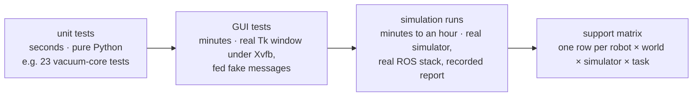
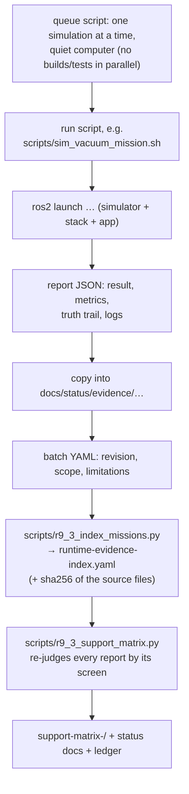
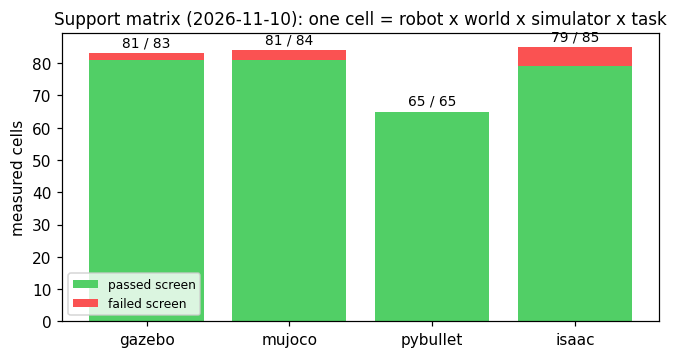
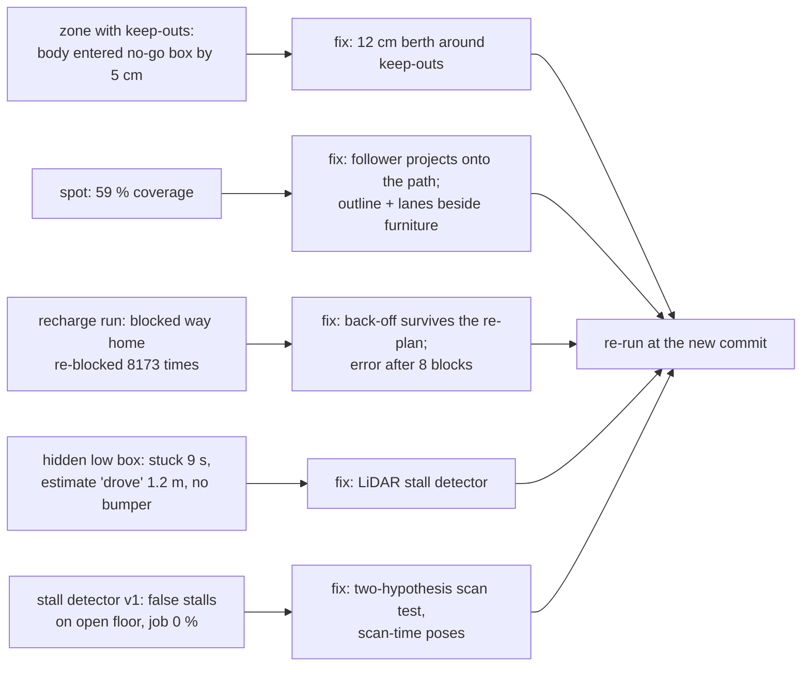

# 8 · Evidence and testing: how we know it works

**In one sentence:** code is checked by fast tests; a robot capability
counts as working only when a recorded simulation run, judged against the
simulator's ground truth by a fixed rule, says so; failures are kept, not
deleted.

## Three kinds of checks



| Check | Proves | Does not prove |
|---|---|---|
| Unit test | the algorithm does what its author intended, on small cases | that it works in a real simulator |
| GUI test | buttons send the right commands, the display shows the status | that a robot moves |
| Simulation run | this robot did this task in this world and simulator, once | that it always works, or works on hardware |

A unit test can even include a simple simulated robot. The vacuum's tests
drive the real mission code with a kinematic robot that moves exactly as
commanded and stops at walls. That is fast and catches logic errors. It
cannot catch timing, physics or sensor effects; for example, the false
stalls described below only appeared in Gazebo.

## From a run to the matrix



The matrix never trusts a `"passed": true` written by the run itself. Each
report kind has a **screen**: a function that recomputes the verdict from
the measured numbers. The robot-vacuum screen (`cleaning_screen`) requires:

- the job completed, with ≥ 85 % of its reachable target cleaned (a mapping
  run needs ≥ 2 rooms);
- the robot ended on its dock, by simulator truth: within 0.10 m and 10°;
- with no-go areas: the robot's true centre never came within (radius −
  2 cm) of one;
- with virtual walls: no true step crossed one.



## Why "ground truth"?

The robot only *estimates* where it is (chapter 5). If you judged it by its
own estimate, a robot that is lost but confident would pass. Simulators know
the true pose (`/odom/ground_truth`), and every recorded run saves a 1 Hz
truth trail next to the estimate. Docking error, keep-out compliance and
localisation error are measured from it.

## Failures are evidence too

A run that fails is kept and explained, not rerun until it passes. The
robot vacuum's November 2026 runs show the cycle:



The invalid runs are kept in folders named after the reason (for example
`claude-v65/invalid-stall-detector`), and the reason is written in the
queue log and the commit message.

## Try it

```bash
PYTEST_DISABLE_PLUGIN_AUTOLOAD=1 python3 -m pytest -q src/robot_lab_vacuum_cleaning/test
PYTEST_DISABLE_PLUGIN_AUTOLOAD=1 xvfb-run -a python3 -m pytest -q src/robot_lab_gui/test/test_cleaning_tab.py
python3 scripts/vacuum_run_report.py --map-yaml src/robot_lab_maps/maps/small_house/maps/map.yaml \
  --out-dir /tmp/report run.json            # metrics + figure for one recorded job
```

More: [testing guide](../TESTING.md), [current status](../status/CURRENT_STATUS.md).

Next, for contributors: [9 · Extending the lab](09-extending-the-lab.md). Back to the [course map](README.md).
