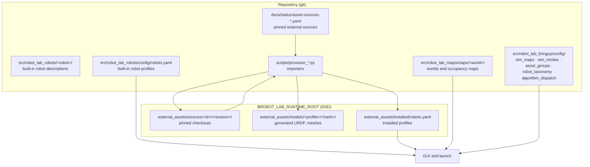
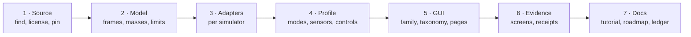

# 9 · Extending the lab: what you need and the path every addition takes

**In one sentence:** anything you add to Robot Lab — a robot, a world, a
controller, a GUI page — travels the same path from a pinned source to a
measured entry in the GUI, and the lab only claims what was measured on that
path.

Chapters 1–8 explained how the lab works. Chapters 9–12 explain how to add to
it:

| # | Chapter | You will be able to |
|---|---|---|
| 9 | this page | set up, know where everything lives, follow the integration path |
| 10 | [Adding a robot](10-adding-a-robot.md) | turn a robot description into a profile that launches in every simulator it supports |
| 11 | [Adding a world and map](11-adding-a-world-and-map.md) | add a world, its occupancy map and spawn pose, and make it work in each backend |
| 12 | [Putting it in the GUI](12-putting-it-in-the-gui.md) | make it selectable, give it controls and algorithms, document it and record evidence |

The worked example throughout is a real integration: the
[Elephant Robotics myAGV Pro and the myAGV Pro + myCobot Pro630](../tutorials/myagv-pro.md)
(ROADMAP R14.2/R14.3).

## Prerequisites

**Knowledge.** You can read Python and YAML and use git and a terminal. You
know what a URDF link and joint are and what a ROS topic is (chapters 2 and
4). You do not need to know every simulator; the lab's adapters hide most
differences, and this course says where they do not.

**The host.** Robot Lab targets ROS 2 Humble on Ubuntu 22.04. This lab's
host is a Jetson (aarch64). It has:

- the built workspace (`colcon build`, see the root [README](../../README.md));
- Gazebo Fortress, MuJoCo, PyBullet and Isaac Sim (each optional: a robot
  advertises only the simulators it was measured in);
- Python packages used by the import tools: `trimesh`, `scipy`, `numpy`,
  `pyyaml`, `pybullet`, and for some mesh work `rtree`. Install missing ones
  with `pip3 install --user <name>`;
- a mounted SSD at `/workspace` for everything large.

**Every shell** starts the same way:

```bash
cd /workspace/molar/ros_ws/bumperbot_ws
source scripts/ssd_env.sh          # caches, temp and $ROBOT_LAB_RUNTIME_ROOT on the SSD
source /opt/ros/humble/setup.bash
source install/setup.bash
export ROS_DOMAIN_ID=117           # your own number; see below
```

`ROS_DOMAIN_ID` isolates your simulation from other sessions on the host
(chapter 3). Pick a number nobody else uses; above 232 CycloneDDS fails.

**Rules of the house** (from [AGENTS.md](../../AGENTS.md) and the
[storage guide](../STORAGE.md)):

- Large files live under `$ROBOT_LAB_RUNTIME_ROOT` on the SSD, never in git:
  downloaded sources, meshes, generated models, raw run logs.
- Run one simulation at a time and keep the host quiet while it runs
  (no builds or test suites in parallel); timing results depend on it.
- Never edit a downloaded source. Pin it, then adapt it in code.
- [ROADMAP.md](../../ROADMAP.md) is the single goal list. Claim a task there
  before changing shared files, and update the roadmap, the ledger
  (`docs/status/platform-status.yaml`) and the docs together.

## Where things live



| You want to change | File |
|---|---|
| a robot built into the repo | `src/robot_lab_robots/<robot>/` and `src/robot_lab_robots/config/robots.yaml` |
| keys on an imported (installed) robot | `src/robot_lab_robots/config/installed_overlays.yaml` (merged over the installed profile) |
| an external source pin | `docs/status/asset-sources-2026-10-05.yaml` |
| a world or occupancy map | `src/robot_lab_maps/maps/<world>/` and `src/robot_lab_bringup/config/sim_maps.yaml` |
| what a mode runs and needs | `src/robot_lab_bringup/config/sim_modes.yaml`, `robot_lab_utils/mode_capability.py` |
| how the GUI groups robots and worlds | `src/robot_lab_bringup/config/asset_groups.yaml` |
| the category / type filters | `src/robot_lab_bringup/config/robot_taxonomy.yaml` |
| what an algorithm choice starts | `src/robot_lab_bringup/config/algorithm_dispatch.yaml` and `src/robot_lab/robot_lab_registry/config/algorithms.yaml` |
| the docs library in the GUI | `docs/library.yaml` |

## The integration path

Every addition goes through the same stages. Skipping one is how
integrations end up "working" in a screenshot and nowhere else.



1. **Source.** Prefer an official, open-source description. Record the
   repository, the exact commit and the license, and check that the license
   allows redistribution of what you will generate. For the myAGV Pro:
   `elephantrobotics/agv_pro_ros2` (BSD-3-Clause) and
   `elephantrobotics/mycobot_ros2` (BSD-2-Clause), each pinned to one commit.
2. **Model.** Read the description before trusting it. Check frame names,
   units (the Pro630 meshes are in millimetres), masses and inertias,
   joint limits and wheel geometry. Where the vendor gives nothing (the
   Pro630 has no inertias, speeds or weight), **declare** an estimate in code,
   say where it came from, and never present it as a vendor figure.
3. **Adapters.** Each simulator has its own needs. Gazebo reads URDF/SDF
   plugins; MuJoCo, PyBullet and Isaac are fed by the lab's spawners. A wheel
   contact model that works in one (Gazebo's directional friction) may not
   exist in another; the myAGV Pro needed a physical-roller variant for the
   other three.
4. **Profile.** One YAML entry tells the launch and the GUI everything:
   the description file, drive type and limits, sensors, supported
   simulators and modes, spawn poses, controls.
5. **GUI.** Group the profile into a family, give it a category and type,
   and make sure a control page exists for what it can do.
6. **Evidence.** Launch it and measure: drive screens, arm screens,
   navigation missions, each with real simulator feedback, kept as receipts.
7. **Docs.** A tutorial, the GUI docs library, the roadmap and the ledger.

## What "supported" means here

A robot or world is only as supported as its evidence. The lab keeps three
words apart:

- **implemented** — the code exists and runs;
- **measured** — a named screen or mission ran on a named simulator and map,
  and its report is kept (for example
  [`docs/status/evidence/myagv-pro-2026-11-12/`](../status/evidence/myagv-pro-2026-11-12/README.md));
- **qualified** — the broader acceptance in the roadmap's validation queue.

Catalog counts, static previews, passing unit tests and generated scores do
not qualify a robot mission. Neither does the fact that a model loads. Keep
failures too: the myAGV evidence keeps every failed run with its cause and
repair, because the next contributor will hit the same problems.

## Try it

```bash
python3 -m robot_lab_registry.cli list robots -c src/robot_lab/robot_lab_registry/config | head   # the Registry
python3 -c "import yaml,os; p=os.environ['ROBOT_LAB_RUNTIME_ROOT']+'/external_assets/installed/robots.yaml'; print(len(yaml.safe_load(open(p))['robots']), 'installed profiles')"
```

Then open the GUI (`ros2 run robot_lab_gui robot_lab_gui`) and find the
myAGV Pro under **Run a robot → Mobile robots → Four-wheel mecanum base**.
Chapter 10 shows how it got there.
