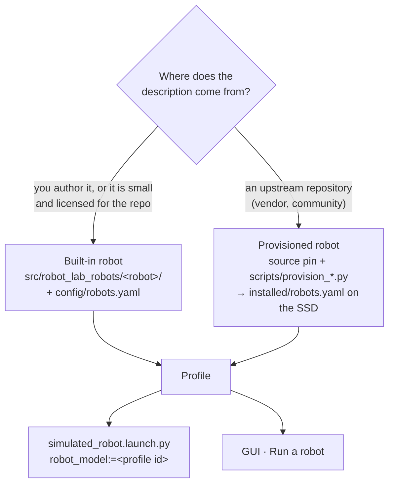
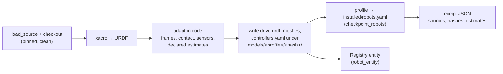

# 10 · Adding a robot

**In one sentence:** a robot enters the lab as one **profile**, a YAML entry
that points at its description and says how it drives, what it senses and
where it runs; everything else (launch, GUI, algorithms) reads that profile.

Read [chapter 9](09-extending-the-lab.md) first for the prerequisites and the
integration path.

## Two ways in



- **Built-in.** The description lives in the repo under
  `src/robot_lab_robots/<robot>/` (`urdf/`, `meshes/`, `config/`), and the
  profile in `src/robot_lab_robots/config/robots.yaml`. Use this for robots
  the lab authors (MOLAR, the laboratory snake) or small open models.
- **Provisioned.** The upstream source stays upstream. You pin it, and a
  provisioning script checks it out to the SSD, adapts it in code, writes the
  generated description to `$ROBOT_LAB_RUNTIME_ROOT/external_assets/models/`
  and the profile to `external_assets/installed/robots.yaml`. The GUI and
  launch merge installed profiles with the built-in ones. Use this for vendor
  robots; the myAGV Pro is one.

## Step 1 · Pin and check the source

Add the source to `docs/status/asset-sources-2026-10-05.yaml`: repository,
exact commit, the entries you use, and the license. The Pro630 entry:

```yaml
  - id: elephant_mycobot_ros2
    repository: https://github.com/elephantrobotics/mycobot_ros2
    revision: d42ff61a78122c79246623391540d75738b03b23
    entries: [mycobot_description/urdf/mycobot_pro_630, mycobot_description/urdf/pro_force_gripper,
              mycobot_pro/mycobot_630_moveit2]
```

Then read the license file in that commit. BSD, MIT and Apache allow
generated derivatives; "no license" or non-commercial terms do not. Record
the result in the profile's `notes` and in the provisioning receipt.

Checkout and integrity are handled by `scripts/catalog_external_assets.py`
(`load_source`, `checkout`): the checkout lands in
`external_assets/sources/<id>/<revision>/`, and provisioning refuses a
checkout that has been edited.

## Step 2 · Read the model before you trust it

Open the URDF (run `xacro` first if it is a `.xacro`) and check each of these:

| Check | Why | myAGV Pro / Pro630 finding |
|---|---|---|
| root and base frames | navigation expects `base_footprint` on the ground and `base_link` on the body | present |
| units | meshes in mm look 1000× too big | Pro630 Collada files are in millimetres → scaled to metres |
| masses and inertias | missing or zero inertias make physics explode | Pro630 has none → declared 8 kg estimate spread by volume |
| joint limits, effort, velocity | controllers and the GUI clamp to them | Pro630 velocities are 0 → declared 1 rad/s cap |
| wheel joints and corners | drive kinematics need the real positions | myAGV wheel names do not match their corners → mapped by geometry |
| sensor frames | scans and images are published in these frames | LiDAR, IMU, camera frames kept from the source |
| collision geometry | what the simulator actually touches | mesh wheels replaced by a contact adapter |

Anything the vendor does not publish becomes a **declared estimate**: a named
constant in code, a line in the profile `notes`, and an entry in the
provisioning receipt. See the top of
[`robot_lab_utils/myagv_pro630.py`](../../src/robot_lab_utils/robot_lab_utils/myagv_pro630.py)
for the pattern.

Quick inspection on the command line:

```bash
xacro path/to/robot.urdf.xacro > /tmp/robot.urdf    # or use the generated drive.urdf
check_urdf /tmp/robot.urdf                            # tree and joint types
python3 -c "
import xml.etree.ElementTree as ET; r=ET.parse('/tmp/robot.urdf').getroot()
print(sum(float(m.get('value')) for m in r.iter('mass')), 'kg')"
```

## Step 3 · Write the profile

A minimal built-in profile, based on the differential-drive `bumperbot` (with `supported_simulators` added, as every new profile should state it):

```yaml
robots:
  bumperbot:
    package: robot_lab_robots
    xacro: bumperbot/urdf/bumperbot.urdf.xacro      # relative to the package share
    name: bumperbot
    supported_simulators: [gazebo, mujoco, pybullet, isaac]
    supported_modes: [display, loc, slam, 3d_slam, nav]
    features: [ros2_control, lidar_2d, rgbd_camera, velocity_base]
    drive_in_display: true                            # the Drive page works in Display
    drive:
      type: diff
      left_wheel_joint: wheel_left_joint
      right_wheel_joint: wheel_right_joint
      wheel_radius: 0.033
      wheel_separation: 0.17
      max_speed: 1.0
      max_accel: 2.0
      max_angular_speed: 2.0
      max_angular_accel: 4.0
    default_algorithms:
      local_planning: pure_pursuit
```

The fields you will use most:

| Field | Meaning |
|---|---|
| `xacro` | the description: package-relative for built-ins, an absolute SSD path for provisioned robots |
| `type` | `mobile`, `mobile_manipulator`, `arm`, … (used by the Registry) |
| `supported_simulators` | only the backends you have measured |
| `supported_modes` | what the GUI offers without the experimental switch |
| `experimental_modes_by_simulator` | modes offered only after **Experimental imported-asset modes** is ticked (launch: `allow_experimental_assets:=true`) |
| `features` | capabilities the mode gate checks (below) |
| `drive` | drive kinematics and limits; `type` is `diff`, `skid_steer`, `mecanum`, `ackermann`, `four_wheel_steer`, or a special controller type (`marine`, `gait`) |
| `drive.<backend>_*` | per-simulator tuning, e.g. `mujoco_wheel_velocity_gain`, `pybullet_expected_mass_kg` |
| `sensor_config` | which links carry the LiDAR, camera and IMU, and their rates/ranges |
| `spawn`, `spawn_by_map` | spawn height, or full poses per world |
| `default_map`, `default_mode` | what the GUI selects first |
| `default_algorithms` | per-category algorithm defaults for this robot |
| `articulation` | joints driven through the shared articulation contract (arms, lifts) |
| `implementation_state`, `validation_state`, `notes`, `validation_scope` | what is real, what is measured, what is estimated |

### Features decide which modes are possible

`robot_lab_utils/mode_capability.py` is shared by the launch (which refuses an
impossible selection) and the GUI (which greys it out with the reason):

| Mode | Robot must have |
|---|---|
| `display` | nothing |
| `loc` | `lidar_2d`, `stands` |
| `slam`, `nav` | `lidar_2d`, `velocity_base` |
| `3d_slam` | `rgbd_camera`, `velocity_base` |
| `flight` / `marine` / `gait` | `flight_controller` / `marine_dynamics` / `source_gait` |

PyBullet, MuJoCo and Isaac cast a LiDAR scan for any robot, so `lidar_2d`
comes free there; in Gazebo it must be in the description.

### Arms and other jointed mechanisms

Joints that are not wheels go in an `articulation` block on the shared
contract (`robot_lab_utils/urdf_articulation.py`, schema
`robot_lab.urdf_articulation.v1`). Every simulator spawner builds it, and it
gives you bounded targets, a Stop service, a 0.5 s heartbeat watchdog and an
interlock: the base cannot drive while a joint moves, and joints refuse
commands while the base moves.

```yaml
    articulation:
      schema: robot_lab.urdf_articulation.v1
      panel: arm                         # the GUI shows the Mobile arm page (chapter 12)
      home: {pro630_joint1_to_base: 0.0, ...}
      base_motion_limits: [0.10, 0.20]   # m/s, rad/s that count as "base moving" (max 0.15, 0.3)
      joints:
        pro630_joint2_to_joint1:
          mode: position                 # or velocity (rollers, conveyors)
          lower: -3.14159
          upper: 3.14159
          max_velocity: 1.0
          effort: 43.4                   # must not exceed the URDF <limit effort>
          kp: 1736.0
          kd: 13.18
```

The limits must lie inside the URDF limits, or the contract refuses to load.
Size `effort` from the gravity torque at the worst pose plus the payload;
`myagv_pro630.gravity_efforts` does this with PyBullet inverse dynamics.

## Step 4 · For a provisioned robot: the provisioning script

A provisioning script is ordinary Python that runs once per host. It is
idempotent and writes a receipt. Its shape, from `scripts/provision_myagv_pro.py`:



```bash
python3 scripts/provision_myagv_pro.py --download --variant pro630
```

Keys you add later by hand (cleaning parameters, extra defaults) go in
`src/robot_lab_robots/config/installed_overlays.yaml`, which is merged over
the installed profile. Re-provisioning then cannot erase them. Never change
source geometry or measured controller settings there.

**Variants.** When one simulator needs a different physical model, make a
separate profile instead of a flag. The myAGV Pro has three: Gazebo
(`asset_elephant_myagv_pro`), the roller variant for MuJoCo/PyBullet/Isaac
(`…_rollers`) and the arm composite (`…_pro630`). The GUI groups them as
variants of a family (chapter 12).

## Step 5 · Build and launch

```bash
colcon build --packages-select robot_lab_robots robot_lab_bringup   # built-in robots
source install/setup.bash
ros2 launch robot_lab_bringup simulated_robot.launch.py \
  robot_model:=<profile id> simulator:=pybullet mode:=display map_name:=nav_empty
```

Python packages install as copies, so rebuild after editing them. Launch,
xacro and world files are symlinked; do not edit them while a queued
simulation is running.

Watch the launch log for: the imported mass (PyBullet and MuJoCo check it
against `*_expected_mass_kg`), URDF parse warnings, missing meshes, and the
spawner's "ready" message.

## Step 6 · Measure it

Three screens exist for this. Each runs against a launch that is already up
(start the launch in one terminal, the screen in another, same
`ROS_DOMAIN_ID`):

| Screen | What it does | Passes when |
|---|---|---|
| `scripts/screen_ground_counterpart.py --robot <id>` | drives forward, reverse, strafe, turn and neutral through the normal `/key_vel` input, records simulator truth, camera, scan and joints, then cuts the publisher | each phase moves as requested, neutral holds, command loss stops |
| `scripts/screen_urdf_arm.py` | moves each articulation joint and back, Stops part-way through a long move, withholds the heartbeat | joints settle, Stop and watchdog hold |
| `scripts/sim_nav_mission.sh <sim> <robot> <map> <out.json>` | launches navigation and runs a detour, cancel, resume and near-obstacle goal | goals reached within tolerance |

```bash
python3 scripts/screen_ground_counterpart.py --robot asset_elephant_myagv_pro_pro630 > drive.json
python3 scripts/screen_urdf_arm.py > arm.json
```

Keep raw output on the SSD and commit a compact summary with its sha256,
as in `docs/status/evidence/myagv-pro-2026-11-12/`.

## Troubleshooting

| Symptom | Likely cause | Fix |
|---|---|---|
| robot explodes or jitters at spawn | zero/tiny inertias, overlapping collisions, spawn inside the floor | real inertias or declared estimates; check `spawn.z` |
| PyBullet mass is several kg too high | empty TF frames get Bullet's default 1 kg | `pybullet_explicit_massless_frames: true` and `pybullet_expected_mass_kg` |
| drives in Gazebo, not elsewhere | contact model exists only in Gazebo | a portable variant (the myAGV roller variant) |
| arm commands refused, "fault/ownership/watchdog hold" | the base counts as moving (arm reaction rocks a light base) | raise `base_motion_limits` within the 0.15 m/s / 0.3 rad/s cap |
| drive does nothing just after spawn | an articulation is still settling and inhibits the base | wait for *Base Drive available*; the drive screen waits automatically |
| mode greyed out in the GUI | a missing feature (hover for the reason) or the simulator is not listed | add the measured feature/simulator, or tick the experimental switch |

## Try it

Provision the Pro630 composite on a fresh store, then launch it:

```bash
python3 scripts/provision_myagv_pro.py --download --variant pro630
ros2 launch robot_lab_bringup simulated_robot.launch.py \
  robot_model:=asset_elephant_myagv_pro_pro630 simulator:=mujoco mode:=display map_name:=nav_empty
```

Next: [11 · Adding a world and map](11-adding-a-world-and-map.md).
