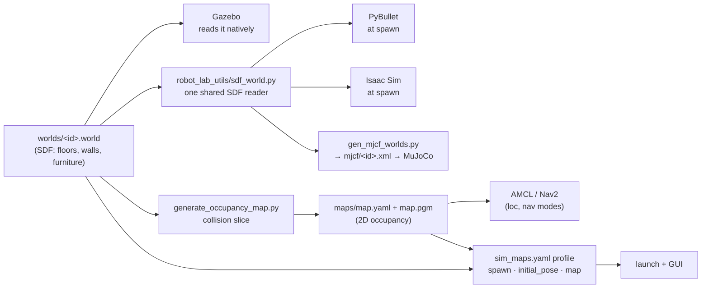
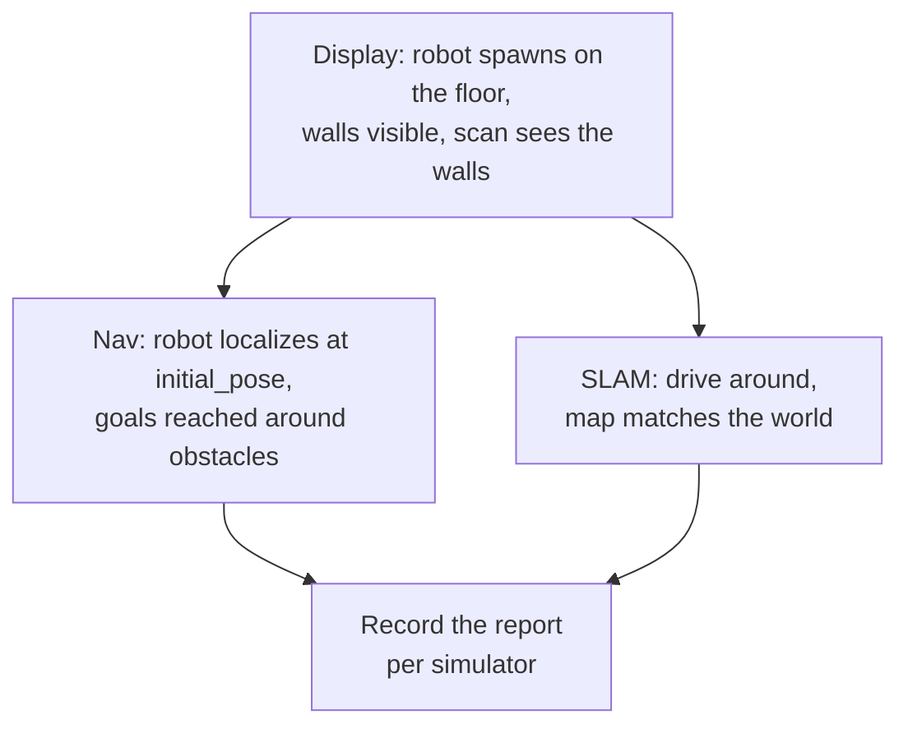

# 11 · Adding a world and map

**In one sentence:** a world is a Gazebo SDF file that every simulator reads.
A **map profile** in `sim_maps.yaml` adds the 2D occupancy map, spawn pose and
starting estimate that localization and navigation need.

Read [chapter 9](09-extending-the-lab.md) for prerequisites and
[chapter 5](05-maps-and-localization.md) for what an occupancy map is.

## The pieces of a world



| Piece | Where | Needed for |
|---|---|---|
| world SDF | `src/robot_lab_maps/maps/<id>/worlds/<id>.world` | every mode with a world |
| MuJoCo scene | `src/robot_lab_maps/mjcf/<id>.xml` (generated) | MuJoCo |
| occupancy map | `src/robot_lab_maps/maps/<id>/maps/map.yaml` + `map.pgm` | `loc` and `nav` |
| map profile | `src/robot_lab_bringup/config/sim_maps.yaml` | the launch and the GUI |
| map family | `maps:` in `src/robot_lab_bringup/config/asset_groups.yaml` | grouping variants in the GUI |

`slam` and `3d_slam` build their own map while driving, so they need the world
but no stored occupancy map. Display can run with `map_name:=none` (robot only).

## Step 1 · The world file

Write or import an SDF world. Whatever you put in `<collision>` is what robots
touch and what the occupancy generator slices, so check collisions, not only
visuals.

- Use SI units and a floor at z = 0.
- Primitives (`box`, `cylinder`, `sphere`, `plane`), meshes, `model://`
  includes and `<heightmap>` terrain are understood by every backend.
  `<actor>` (scripted people) and `<polyline>` are Gazebo-only; the MuJoCo
  generator skips them and reports it.
- For an imported world (a dataset, a vendor scene), keep the original
  untouched on the SSD and generate a derived copy, as the installed dataset
  worlds do (`scripts/provision_extension_assets.py`). Their profiles live in
  `$ROBOT_LAB_RUNTIME_ROOT/external_assets/installed/maps.yaml` and are merged
  with `sim_maps.yaml` at launch.

Generators for repeatable arenas live in `src/robot_lab_maps/tools/`:
`gen_nav_arenas.py` (navigation arenas), `gen_terrain_arenas.py` (rough
ground, stairs, stepping stones, each with a matching occupancy map),
`gen_heightfield_arena.py` (a seeded `<heightmap>` terrain) and others. A
generator that writes the world and the map from the same rectangles keeps
them in agreement by construction. (A terrain generation page in the GUI is
ROADMAP R6.7 and not built yet.)

## Step 2 · MuJoCo's copy

MuJoCo needs an MJCF scene. Without one it falls back to an empty plane.
Generate it from the SDF so the two stay in sync:

```bash
python3 src/robot_lab_maps/tools/gen_mjcf_worlds.py           # writes mjcf/<id>.xml for every world
python3 src/robot_lab_maps/tools/gen_mjcf_worlds.py --check   # fails if any is out of date
```

A hand-built MJCF can be named instead with `mujoco: {xml_path: mjcf/<file>.xml}`
in the profile (as `gait_low_relief` does). PyBullet and Isaac need nothing
extra; they read the SDF through `sdf_world.py` when they spawn.

## Step 3 · The occupancy map

`loc` and `nav` need a 2D occupancy grid whose metres, origin and orientation
match the world exactly. Two ways to make one:

**From the GUI.** **Worlds & mapping** → select the world → resolution,
slice height, seed X/Y and a fresh output folder on the SSD → **Generate 2D
Occupancy Grid**. The seed must be a free point in the area the robot can
reach (the GUI fills it from the profile's spawn).

**From the command line** (the same tool):

```bash
OUT=$(mktemp -d "$ROBOT_LAB_RUNTIME_ROOT/occupancy-XXXXXX")
ros2 run robot_lab_maps generate_occupancy_map.py \
  --world "$PWD/src/robot_lab_maps/maps/my_world/worlds/my_world.world" \
  --output-dir "$OUT" --resolution 0.05 --height 0.3 --seed-x 0 --seed-y 0
```

It slices the real collision geometry at `--height` (pick a height that cuts
walls and furniture legs but not the floor) and writes `map.pgm`, `map.yaml`
and a report. **Look at the image** before you register it: walls closed, doors
open where robots should pass, the free region connected to the seed. Then
copy it to `maps/<id>/maps/` and make sure `image:` in the YAML is relative:

```yaml
image: map.pgm
mode: trinary
resolution: 0.050
origin: [-7.000, -7.000, 0.000000]   # world coordinates of the lower-left pixel
negate: 0
occupied_thresh: 0.65
free_thresh: 0.196
```

How localization uses this grid is in [chapter 5](05-maps-and-localization.md);
the long version, with pitfalls found in real runs, is in the
[extension guide](../ASSET_EXTENSION_GUIDE.md#generate-a-2d-grid).

## Step 4 · The map profile

```yaml
maps:
  my_world:
    gazebo:
      world_package: robot_lab_maps
      world_name: my_world
      world_path: maps/my_world/worlds/my_world.world
    map:
      has_2d_map: true                 # false until a reviewed grid exists
      package: robot_lab_maps
      path: maps/my_world/maps/map.yaml
    spawn:      {x: "0.0", y: "0.0", z: "0.1", yaw: "0.0"}
    initial_pose: {x: "0.0", y: "0.0", yaw: "0.0"}
    notes: "What is real, what is measured, what is not."
```

- `spawn` is where the simulator places the robot. Measure it from the
  collision geometry: a free spot, clear of furniture, on the floor. The
  launch raises the spawn height until the robot's lowest collision clears
  the floor.
- `initial_pose` is the localization's starting estimate. It must be the
  same point in the map frame, or AMCL starts lost.
- `has_2d_map: false` keeps `loc`/`nav` greyed out until a real map exists.
- A robot that needs a different start in this world can add
  `spawn_by_map: {my_world: {...}}` to its own profile.
- Water worlds add a `marine:` block (surface height, density); flight worlds
  add their PX4 settings. Copy a similar existing world.

Rebuild so the installed share gets the files:

```bash
colcon build --packages-select robot_lab_maps robot_lab_bringup --symlink-install
source install/setup.bash
```

## Step 5 · Check it in each simulator



```bash
ros2 launch robot_lab_bringup simulated_robot.launch.py \
  robot_model:=bumperbot simulator:=gazebo mode:=display map_name:=my_world
scripts/sim_nav_mission.sh gazebo bumperbot my_world /workspace/molar/robot_lab_runtime/my_world-nav.json
```

Check each simulator you advertise separately. A world that loads in Gazebo
can be empty in MuJoCo (missing MJCF), have a door blocked by a stray
collision in PyBullet, or have meshes at the wrong scale in Isaac. Support is
never inherited from another world or backend.

## Troubleshooting

| Symptom | Likely cause | Fix |
|---|---|---|
| MuJoCo shows a bare plane | no MJCF for this world | run `gen_mjcf_worlds.py` and rebuild |
| robot falls through or jumps at spawn | spawn inside geometry or below the floor | move `spawn`, check `z` |
| AMCL lost from the start | `initial_pose` ≠ spawn, or the map origin is wrong | match both; check the YAML origin against a known wall |
| map has holes in walls | slice height misses thin geometry, or resolution too coarse | change `--height`, use 0.05 m |
| a room is missing from the map | the seed's free region does not reach it (door closed in collisions) | fix the collision, or seed another room |
| `nav` greyed out | `has_2d_map: false`, or the robot lacks `lidar_2d`/`velocity_base` | register the map; see chapter 10 |

## Try it

Open **Worlds & mapping**, pick `nav_obstacle`, and generate a grid into a new
SSD folder. Compare it with the registered
`src/robot_lab_maps/maps/nav_obstacle/maps/map.pgm`.

Next: [12 · Putting it in the GUI](12-putting-it-in-the-gui.md).
