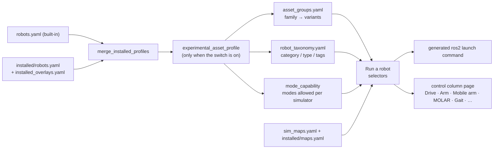

# 12 · Putting it in the GUI, and the other pieces

**In one sentence:** the GUI builds itself from the same profiles the launch
uses. A few presentation files (families, taxonomy, docs library) and, when a
robot can do something new, a control page make your addition usable by
someone who never opens a terminal.

Read chapters [10](10-adding-a-robot.md) and [11](11-adding-a-world-and-map.md)
first; this chapter assumes a profile that already launches.

## How the GUI finds things



Nothing is hard-coded per robot in the launcher. If your profile launches from
the command line, the GUI can launch it. The rest of this chapter is about
making it easy to find and to control.

## Families and variants · `asset_groups.yaml`

A **family** is what the user picks; its **variants** are the executable
profiles. Without an entry, each profile appears as its own family, named
after its id.

```yaml
robots:
  - id: elephant_myagv_pro
    name: Elephant Robotics myAGV Pro
    members:
      - {id: asset_elephant_myagv_pro, label: Official CAD base · measured Fortress contact adapter}
      - {id: asset_elephant_myagv_pro_rollers, label: Portable physical-roller adapter · experimental native backends}
```

- The label is what the user reads. Say what the variant *is* and how far it
  is measured, not what you hope.
- `role:` defaults to `variant`. `component`, `simplified` and `reference`
  members are shown for inspection but not offered for launch, for example a
  robot's bare leg assembly. `source_alternative` marks another description of
  the same robot.
- When you pick a family, the GUI selects its `preferred:` variant (an optional
  family key) if that one can run the selected mode on the selected simulator,
  otherwise the first variant that can. You can always choose another variant
  in **Model / source variant**.

Worlds use the same file, under `maps:`: a family (*Celisca Floor 1*) with
variants (shell, furniture, actors).

## Category, type and tags · `robot_taxonomy.yaml`

The **Category** and **Type** filters on *Run a robot*, and the tag chips
under the selection, come from here:

```yaml
classes:
  - category: Mobile manipulators
    subtype: Arm on omnidirectional base
    tags: [Elephant Robotics, Mecanum base, Six-axis arm, Official CAD, Declared arm estimates, Experimental control]
    members: [elephant_myagv_pro630]       # family ids
```

Reuse an existing category and type when one fits. Tags describe structure
and honesty (*Declared arm estimates*, *Experimental control*), never a
qualification the evidence does not show.

## Modes and the experimental switch

The Task radio buttons are enabled from the profile: `supported_modes`,
plus `experimental_modes_by_simulator` when the user ticks **Experimental
imported-asset modes** (launch argument `allow_experimental_assets:=true`).
`mode_capability` then removes modes the robot cannot do (chapter 10) and
shows why. Put a mode in `supported_modes` only once it has been measured
for that robot; until then keep it experimental.

## Control pages

The control column shows one page at a time and opens the right one when the
robot changes (`_refresh_workspace_selection` in `launcher.py`):

| Page | Opens for | Driven by |
|---|---|---|
| **Drive & limits** | any base that follows `/cmd_vel` (default) | `drive` block, `drive_in_display` |
| **MOLAR** | MOLAR / ProBOT-L | their articulation (lift, telescope, roller) |
| **Mobile arm** | any profile whose `articulation` declares `panel: arm` | the articulation joints, one row each |
| **Tracks** | `articulated_flippers` | flipper controller |
| **Gait** | `source_gait` robots in gait mode | gait controller |
| **Marine** | marine robots | marine controller |
| **Drone & limits** | PX4 flight | flight controller |
| **Arm** | stand-alone arms (`arm_control`) | MoveIt / native planning |
| **Hand** | hands and grippers (chosen by hand) | native hand controls |

So a new mobile manipulator usually needs **no GUI code**: declare its joints
in an `articulation` block with `panel: arm` and the Mobile arm page builds its
rows from the profile. That is how the myAGV Pro + Pro630 got its controls.

### Writing a new control page

Only when a robot has a genuinely new kind of control. Follow
`robot_lab_gui/urdf_arm_controls.py`, which reuses all the safety logic of
`molar_controls.py`:

1. **Ownership.** The page acts only on the launch the GUI itself started,
   with matching robot, simulator, mode and map, while the page is visible.
   It stops the plant when any of that changes.
2. **Fresh feedback.** Validate every state message (schema, model file
   hash, plant id, age under 0.5 s, values inside limits) before enabling a
   button.
3. **Explicit commands.** Only buttons move the robot. Editing a field or
   dragging a slider sends nothing.
4. **Heartbeat and Stop.** Publish a heartbeat while ready; the plant holds
   when it stops. A Stop button is always available while there is state.

Then register it in three places:

```python
# lab_tabs.py · create_tabs
from .urdf_arm_controls import UrdfArmControls
app.urdf_arm_controls = UrdfArmControls(app.control_notebook, app)

# launcher.py · _refresh_workspace_selection: when to open it
elif self._urdf_arm_selectable() and hasattr(self, 'urdf_arm_controls'):
    self.control_notebook.select(self.urdf_arm_controls)

# launcher.py · _stop_all_motion and _on_close: stop and close it
```

Test it with real Tk (see `src/robot_lab_gui/test/test_urdf_arm_controls.py`:
rows from the profile, feedback from the real contract, only explicit
actions publish, loss of ownership holds). Then test it live through the
launcher's own Run path, as `scripts/qualify_urdf_arm_gui.py` does.

## Algorithms and controllers

The **Algorithms & checks** panel offers one algorithm per category for each
step of the selected mode (`sim_modes.yaml`). Adding an algorithm takes two
entries:

1. the Registry entry in `src/robot_lab/robot_lab_registry/config/algorithms.yaml`
   (id, category, implementation package/executable, input/output topics,
   license);
2. how a selection is applied, in `src/robot_lab_bringup/config/algorithm_dispatch.yaml`:
   start a `node`, switch a Nav2 `plugin`, name the `stack` that already
   provides it, or mark it `unavailable` with a reason. `required_features` /
   `not_for_features` keep it off robots that cannot use it.

A test fails if a Registry algorithm has no dispatch entry, so the GUI never
offers something the launch would silently ignore. A robot can preselect its
choices with `default_algorithms` in its profile.

Base controllers follow `drive.type` (chapter 10). Gazebo additionally needs
`ros2_control` in the description and a controllers file (`controllers_yaml`
for provisioned robots). The other backends drive the joints from the
spawner, so the same profile works there without `ros2_control`.

## Documentation

A user should be able to learn your addition from inside the GUI:

1. Write a tutorial in `docs/tutorials/<name>.md`: how to run it from the GUI
   and the command line, how control and sensing connect (a Mermaid diagram),
   what is declared or estimated, what is measured and what is not.
2. List it in `docs/library.yaml` under the right section. That is the tree
   in **Learn & diagnose → Documentation library**. Unlisted pages still
   appear under *Other documents*.
3. Add it to the tutorial index `docs/tutorials/README.md`.
4. Render the diagrams so the GUI can show them:
   `python3 scripts/render_doc_diagrams.py` (a test fails on unrendered
   diagrams).

## Evidence, roadmap and ledger

Keep the record in the same commit as the work:

- **Evidence**: `docs/status/evidence/<topic>-<date>/README.md` with a results
  table, compact summaries (raw logs stay on the SSD, referenced by sha256)
  and every retained failure with its cause and repair.
- **Roadmap**: the task's State, Have, Remaining and evidence link in
  `ROADMAP.md`, using its uniform task format.
- **Ledger**: the same task in `docs/status/platform-status.yaml`, which the
  GUI's Health page reads. `docs/status/CURRENT_STATUS.md` and the README
  headline follow.

## A checklist for the whole path

```text
[ ] source pinned with license        docs/status/asset-sources-*.yaml
[ ] model read; estimates declared    code constants + profile notes + receipt
[ ] profile                           robots.yaml or provisioning script
[ ] per-backend adapters measured     only advertised simulators
[ ] world: SDF, MJCF, grid, profile   sim_maps.yaml (for a new world)
[ ] family + taxonomy                 asset_groups.yaml, robot_taxonomy.yaml
[ ] control page exists               articulation panel, or a new page
[ ] algorithms registered + dispatched
[ ] screens run, evidence committed   docs/status/evidence/...
[ ] tutorial + docs library + index + diagrams rendered
[ ] roadmap + ledger + current status
[ ] tests: focused + GUI suite pass; packages rebuilt
```

## Try it

Open the GUI, choose **Mobile manipulators → Arm on omnidirectional base**,
PyBullet, Display, and launch. The **Mobile arm** page opens; press Home, jog
J2 and press Stop. Then open **Learn & diagnose → Documentation library** and
find this chapter under *Extending the lab*.
