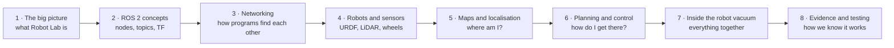

# Learn Robot Lab from zero

This course is for someone who has never used ROS. It explains what this
project does, how the pieces fit together, and how a robot goes from "a
picture of a house" to "a cleaned floor". The robot vacuum runs through it
as the example.

Each chapter has diagrams and figures. The figures are drawn from the
project's own code and maps by
[`figures/make_figures.py`](figures/make_figures.py), so they show what the
software really does. GitHub draws the diagrams (Mermaid) directly in the
page.

## The path



| # | Chapter | You will understand | Key visuals |
|---|---|---|---|
| 1 | [The big picture](01-big-picture.md) | what happens when you press **Launch**, and which program does what | system map, launch sequence |
| 2 | [ROS 2 concepts](02-ros2-concepts.md) | nodes, topics, services, actions, parameters, launch files, QoS, TF, simulated time | message-flow diagrams, TF frames |
| 3 | [Networking](03-networking.md) | DDS discovery, domains, ports, Gazebo transport, bridges, MAVLink, debugging | discovery sequence, isolation diagram, troubleshooting flowchart |
| 4 | [Robots and sensors](04-robots-and-sensors.md) | URDF/xacro, links and joints, LiDAR, cliff, bumper, IMU, differential drive | robot tree, LiDAR scan, wheel kinematics |
| 5 | [Maps and localisation](05-maps-and-localization.md) | occupancy grids, SLAM, the particle filter (AMCL), odometry drift | real map, particle filter in three steps |
| 6 | [Planning and control](06-planning-and-control.md) | inflation, A*, Nav2, pure pursuit, the control loop | A* animation, pure pursuit, Nav2 pipeline |
| 7 | [Inside the robot vacuum](07-robot-vacuum-inside.md) | room division, coverage lanes, edges, spot, the mission state machine, stall detection, battery | room division in four steps, cleaning animation, state machine |
| 8 | [Evidence and testing](08-evidence-and-testing.md) | unit tests vs simulation runs, reports, the support matrix | evidence pipeline, matrix chart |

Short on time? Read 1, skim 2, then go to 7. Every chapter starts with a
"**In one sentence**" summary and ends with "**Try it**" commands.

## Before you start

- You need the workspace built (see the root [README](../../README.md)).
  Nothing in chapters 1–6 requires running a simulator; the "Try it" boxes
  that do say so.
- Words in **bold** the first time are in the [glossary](../architecture/glossary.md).
- The more advanced, complete references are the
  [architecture overview](../architecture/overview.md) and
  [networking reference](../architecture/networking.md). The GUI has an
  interactive version under **Learn & diagnose**.

## Regenerating the figures

```bash
python3 docs/learn/figures/make_figures.py          # all (a few minutes)
python3 docs/learn/figures/make_figures.py astar    # one
```

Names: `grid lidar mcl tf inflation astar pursuit diff rooms coverage spot
stall cleaning battery matrix`.
