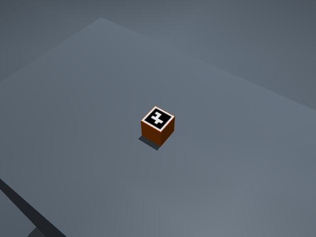

# Manipulation implementation receipts — November 14

The source manifest binds the changed camera/Panda/hand modules. The repository
base revision alone is not the whole working-tree revision. Each retained
runtime report names its actual robot, world, backend, source and plant.

`render-corrected.png` is an actual MuJoCo fixture render; marker 7 is detected
from its pixels. `render-result.json` records IPPE pose and the independently
compared authored fixture position: error **0.002522894 m**, reprojection RMS
**0.167824 px**. `focused-final.log` records 15 initial source/camera/GUI checks.
The ROS transport case uses explicitly synthetic pixels, not this render.

The raw camera artifacts remain at the SSD path in `manifest.json`, including
the initial mirrored marker that was not detected. This fixture does not
establish a full camera-only robot grasp mission or calibration accuracy.

Panda raw artifacts and source-specific failures remain on SSD under
`panda-object-task-20261114/`: zero appended world key coordinates, repeated
static collider removal, centre-pinch bench clearance, redundant attachment
REMOVE, hidden Gait focus Stop, unreachable 10 cm lift and post-release
single-seed retreat. Retaining these failures is separate from the latest run.

Hand/source checks establish protocol binding, original actuator preservation,
interruption, relative-pose custody and actual Robotiq supported release.
UMI transport protocol tests explicitly declare their observations; they are
not physical lift measurements. Full source/backend missions remain ROADMAP
acceptance.
