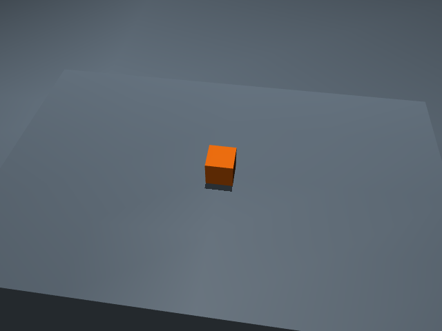

# Unmarked RGB-D targets — November 14, 2026

This implements known-size upright colored-box targets for the native mobile
task builder. It is separate from a complete source-robot grasp/transport
mission and does not enable other robot/backend controllers.

An actual MuJoCo render of the installed immutable unmarked task fixture gives
**0.000493575 m** cube-center error. The estimator receives RGB, metric depth,
calibration, observer-camera transform and a size/color binding. The native
object pose is read only afterward for comparison. The camera is a declared
fixture observer, not a native robot camera mission. `render-result.json`
contains the estimate, comparison, calibration and transform; `render.png` is
the actual input. Raw depth and the reproducer remain on SSD.

The source/transport checks exercise calibrated projected pixels, actual ROS
image/depth/CameraInfo/TF delivery, rejection on frame mismatch, endian/stride
decoding, ambiguity/occlusion/size guards, separate marker/RGB-D caches, native
source contracts and actual Tk recipe construction. They do not establish a
physical robot pick. The initial duplicate-image test fixture and camera
quaternion fixture errors are retained on SSD with their corrections.

The focused source/ROS/Tk/document batch passes **52 checks**; two updated
GUI-feedback checks also pass. Four changed packages build. A normal installed
GUI probe verifies the grouped variant, command preview and RGB-D option,
without launching motion. Camera visibility/rejection now refreshes during
normal polling instead of requiring the measured-base button.

`native-launch-result.json` records actual launch of that GUI-derived command,
with only viewers disabled: the native source camera and detector publish
matching plant/source/scene identities and cleanly shut down. Its default
camera view does not see the cube, so estimates correctly remain empty.
`head-view-result.json` records a later head-only source-motor trial: **four
frames detect the box**, with the last center about
`[0.000419, -0.619989, 0.514893]` m. This is a pose observation, not a live
independently measured error certificate or a pick/base/transport mission.
The view seed was derived from the declared fixture prior on a private source
FK model; the estimator receives no simulator object pose. Runtime source
joint/body/object poses were not written.

The first head command was rejected while the mobile base was still settling.
The successful trial waits for the existing stopped-base gate and retains
original source motors/rates/limits. Its failed result remains on SSD.

The unmarked world has the same physical 35 g cube, benches and occupancy as
the existing task fixture, without a printed marker. Both variants remain in
one normal GUI map family. No object pose is reset or welded to implement
perception. Image-time TF retries keep one pair for at most 0.2 wall seconds;
missing, stale or wrong-method measurements do not fall back to native truth.

Raw artifacts: `/workspace/molar/robot_lab_runtime/unmarked-rgbd-20261114/`.
The manifest binds relevant sources and actual artifacts. See
[the operator and contributor guide](../../../tutorials/rgbd-object-targets.md)
for assumptions, topic names, configuration and limits. General recognition,
unknown geometry, calibrated uncertainty, full native camera/grasp missions
and further mobile-manipulator sources remain ROADMAP work.
