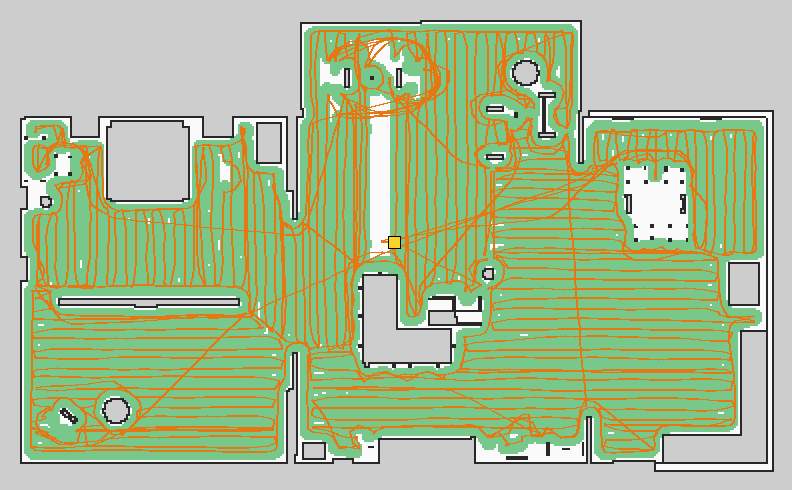
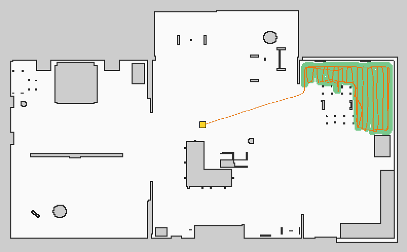
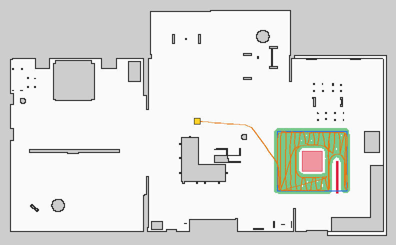
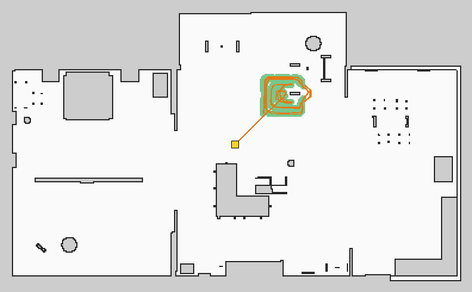
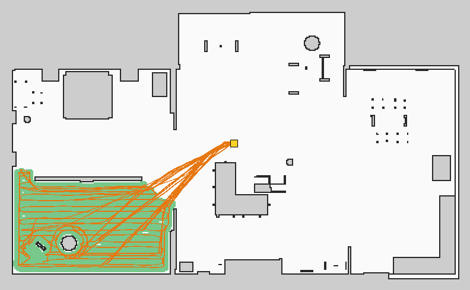

# Robot-vacuum cleaning system: measured Gazebo and MuJoCo runs (November 2026)

`robot_lab_vacuum_cleaning` on the OOMWOO-class `oomwoo` model in
`small_house`, recorded with `scripts/sim_vacuum_mission.sh` (one job per run,
`nav` mode: saved map + AMCL). The batch is
[vacuum-batch.yaml](vacuum-batch.yaml); figures come from
`scripts/vacuum_run_report.py` (truth trail in orange, cleaned area in green,
keep-outs in red, dock in yellow).

Each report is judged by **`cleaning_screen`**
(`scripts/r9_3_support_matrix.py`):
- the job completed, with at least 85 % of its reachable target cleaned (a
  mapping run needs at least two rooms);
- the robot ended on its dock by simulator truth, within 0.10 m and 10°;
- the true centre never came within (radius − 2 cm) of a no-go polygon, and
  no truth step crossed a virtual wall.

## Results

| Run | Revision | Result | Coverage | Time | Dock error (truth) | Notes |
|---|---|---|---|---|---|---|
| Office (room 4), edges | 5061bc1d | pass | 95.4 % (9.6 m²) | 5.4 min | 0.038 m, −3.6° | localisation error mean 0.05 m |
| Zone + no-go box + virtual wall | 5061bc1d | pass | 99.6 % (10.0 m²) | 6.1 min | 0.048 m, 3.0° | centre ≥ 0.26 m from the no-go box (radius 0.165), 0 wall crossings |
| Spot beside a furniture bar | 5061bc1d | pass | 90.7 % (3.0 m²) | 3.0 min | 0.051 m, −1.6° | outline + cross-hatched lanes |
| Zone with a hidden 6 cm box | 5061bc1d | pass* | 99.6 % (12.4 m²) | 5.1 min | 0.027 m, −2.6° | *stuck ~6 s against the box by truth while the estimate moved 1.2 m; the 3 m stall window saw nothing ahead |
| Zone with a hidden 6 cm box | b3a63ae7 | pass | 97.5 % (12.2 m²) | 5.4 min | – | stall detector fired twice at the box; estimate–truth gap ≤ 0.34 m |
| Bedroom (room 3), battery 60× | 5061bc1d | pass | 98.4 % (24.4 m²) | 44 min | 0.042 m, −0.6° | 10 recharge-and-resume stops |
| Zone + keep-outs, **MuJoCo** | 8a122bbe | pass | 99.6 % (10.0 m²) | 7.9 min | 0.041 m, −3.4° | centre ≥ 0.23 m from the no-go box, 0 crossings |
| **Whole home**, edges | 8a122bbe | pass | 96.3 % (141.6 m²) | 77 min | 0.036 m, −4.6° | 4 rooms; 1 auto-empty dock stop; 18 stalls, 17 with truth moving clearly less than the estimate |
| Mapping run (slam mode) | 8a122bbe | **fail** | – | – | – | stayed at the start pose 20 min (explore loop); stopped, no report; fixed in 84dc2704 |

| | |
|---|---|
|  |  |
|  |  |

## What the runs found (and the fixes)

Earlier runs of these queues (claude-v63 to claude-v66; set aside, not indexed)
found, in order:
- the body entering a no-go box by 5 cm (keep-outs now get a 12 cm berth);
- 59 % spot coverage (path-projection follower; outline + lanes beside
  furniture);
- a re-plan on the way home that cancelled its own back-off, re-blocking
  8173 times;
- a hidden low box invisible to every sensor (LiDAR stall detector);
- false stalls on open floor (two-hypothesis scan test, scan-time poses).

The Gazebo contact sensor of the bumper ring never published (`ign topic -l`
lists no `/bumper`); the stall detector is the bump handler.

## Limits

- One run per cell; one house; Gazebo, plus one MuJoCo case.
- Battery, dustbin and part wear are models.
- Recorded queue folders: `/workspace/molar/robot_lab_runtime/claude-v67`, `claude-v68`.
