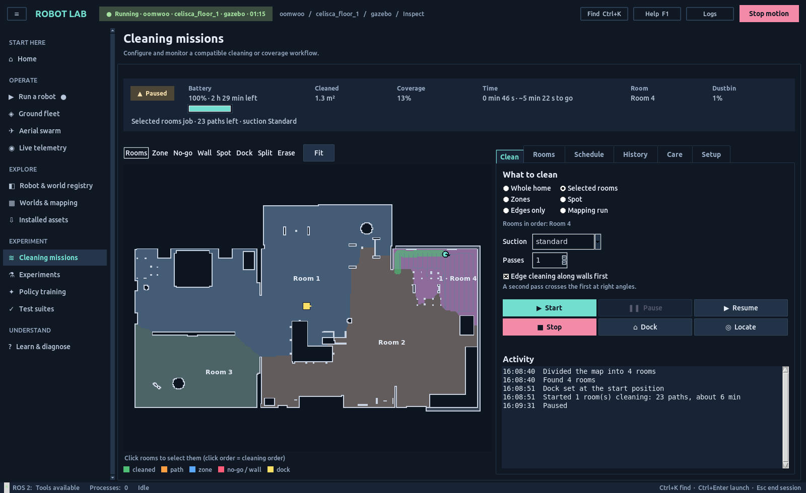
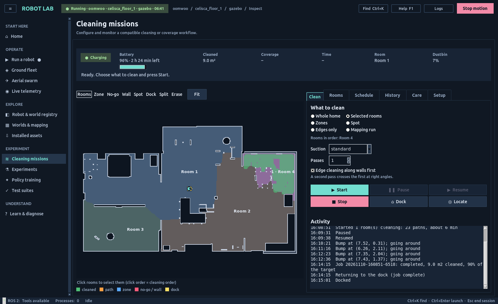
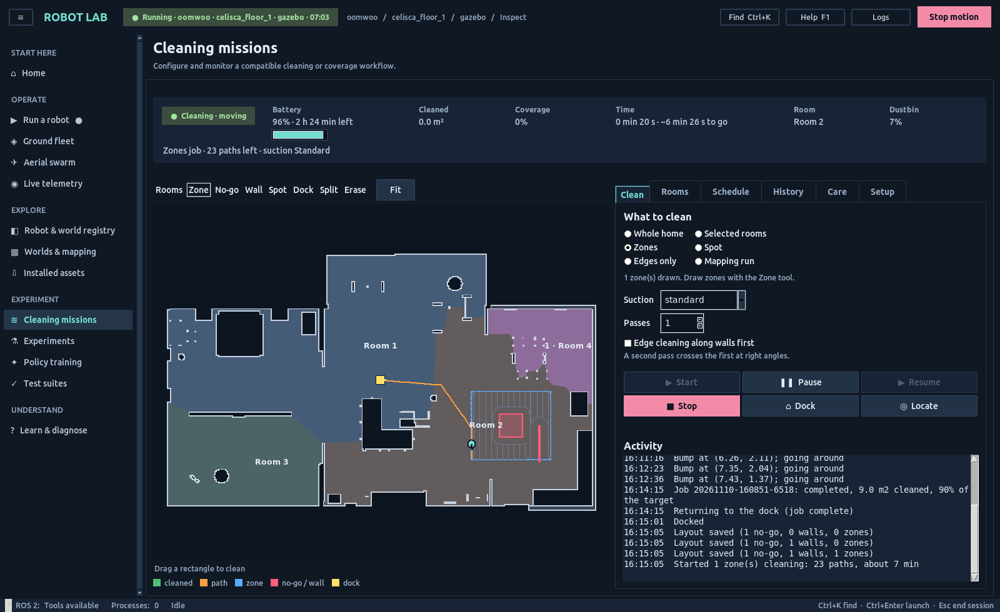
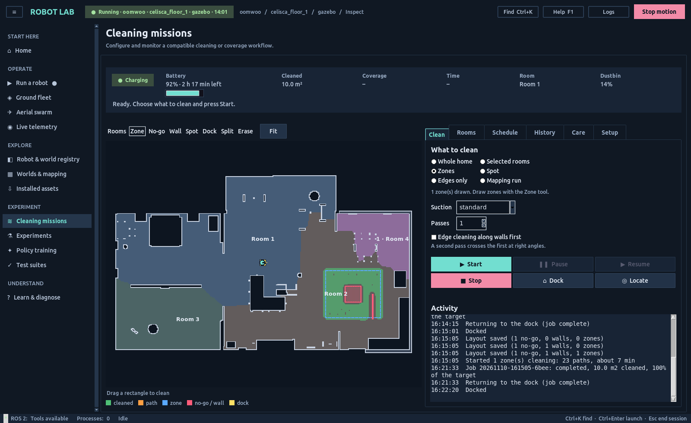
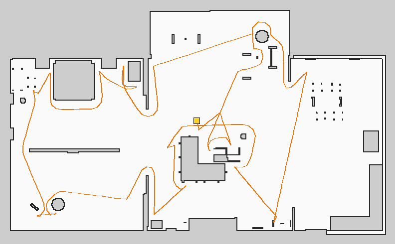
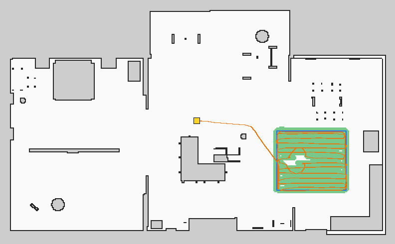

# Robot-vacuum cleaning system: measured Gazebo and MuJoCo runs (November 2026)

`robot_lab_vacuum_cleaning` on the OOMWOO-class `oomwoo` model in
`small_house`, recorded with `scripts/sim_vacuum_mission.sh` (one job per run,
`nav` mode: saved map + AMCL). The batch is
[vacuum-batch.yaml](vacuum-batch.yaml); figures come from
`scripts/vacuum_run_report.py` (truth trail in orange, cleaned area in green,
keep-outs in red, dock in yellow).

Each report is judged by **`cleaning_screen`**
(`scripts/r9_3_support_matrix.py`):
- the job completed, with at least 85 % of its reachable target cleaned (a
  mapping run needs at least two rooms);
- the robot ended on its dock by simulator truth, within 0.10 m and 10°;
- the true centre never came within (radius − 2 cm) of a no-go polygon, and
  no truth step crossed a virtual wall.

## Results

| Run | Revision | Result | Coverage | Time | Dock error (truth) | Notes |
|---|---|---|---|---|---|---|
| Office (room 4), edges | 5061bc1d | pass | 95.4 % (9.6 m²) | 5.4 min | 0.038 m, −3.6° | localisation error mean 0.05 m |
| Zone + no-go box + virtual wall | 5061bc1d | pass | 99.6 % (10.0 m²) | 6.1 min | 0.048 m, 3.0° | centre ≥ 0.26 m from the no-go box (radius 0.165), 0 wall crossings |
| Spot beside a furniture bar | 5061bc1d | pass | 90.7 % (3.0 m²) | 3.0 min | 0.051 m, −1.6° | outline + cross-hatched lanes |
| Zone with a hidden 6 cm box | 5061bc1d | pass* | 99.6 % (12.4 m²) | 5.1 min | 0.027 m, −2.6° | *stuck ~6 s against the box by truth while the estimate moved 1.2 m; the 3 m stall window saw nothing ahead |
| Zone with a hidden 6 cm box | b3a63ae7 | pass | 97.5 % (12.2 m²) | 5.4 min | – | stall detector fired twice at the box; estimate–truth gap ≤ 0.34 m |
| Zone with a hidden 6 cm box, **bumper** | 89b71ebb | pass | 97.0 % (12.1 m²) | 5.5 min | 0.040 m, 2.7° | 116 bumper contacts, 4 Bump events at the box; stall detector silent |
| Bedroom (room 3), battery 60× | 5061bc1d | pass | 98.4 % (24.4 m²) | 44 min | 0.042 m, −0.6° | 10 recharge-and-resume stops |
| Zone + keep-outs, **MuJoCo** | 8a122bbe | pass | 99.6 % (10.0 m²) | 7.9 min | 0.041 m, −3.4° | centre ≥ 0.23 m from the no-go box, 0 crossings |
| **Whole home**, edges | 8a122bbe | pass | 96.3 % (141.6 m²) | 77 min | 0.036 m, −4.6° | 4 rooms; 1 auto-empty dock stop; 18 stalls, 17 with truth moving clearly less than the estimate |
| Mapping run (slam mode) | 8a122bbe | **fail** | – | – | – | stayed at the start pose 20 min (explore loop); stopped, no report; fixed in 84dc2704 |
| Mapping run (slam mode) | 1e229701 | **fail** | – | – | – | mapped 5 rooms, then the node died logging a warning (rclpy severity per call site); fixed in 7fb652e6 |
| Mapping run (slam mode) | 7fb652e6 | pass | map complete, 6 rooms | 6.2 min, 85 m | 0.027 m, −3.2° | frontier exploration of the live slam_toolbox map |
| Office, repeats 2 and 3 | e3a64f40 | pass, pass | 94.4 %, 95.0 % | 5.7, 5.6 min | 0.036 m, 0.046 m | office named by a point (`room_points`); the bumper touches furniture |
| Keep-out zone, repeats 2 and 3 | e3a64f40 | pass, pass | 99.4 %, 99.4 % | 6.1 min each | 0.034 m each | |
| Spot, repeats 2 and 3 | e3a64f40 | pass, pass | 91.2 %, 90.2 % | 3.0 min each | 0.041 m, 0.064 m | |
| Keep-out zone, **PyBullet** | e3a64f40 | pass | 97.9 % (10.4 m²) | 9.9 min | 0.018 m, 2.0° | no bumper/cliff sensor in the PyBullet bridge |
| Keep-out zone, **Isaac** | e3a64f40 | pass | 99.3 % (10.0 m²) | 7.3 min | 0.042 m, −4.4° | no bumper/cliff sensor in the Isaac bridge |
| **Second building** (celisca_floor_1_furniture), two rooms | e3a64f40 | **fail** (interference) | 38.4 % | 17.7 min | 2.65 m | another session's Gazebo run on the same ROS domain sent a second `/clock` from minute 10; AMCL lost the robot. Rerun on domain 117 |
| Zone, **vacuum + mop**, rug as carpet | 0f93fd53 | pass | 99.4 % (10.8 m²) | 5.7 min | 0.059 m | 8.13 m² mopped, 14.6 ml water; centre ≥ 0.249 m from the rug (body radius 0.165) |
| Zone, vacuum, rug as carpet (**carpet boost**) | 73241b4a | pass | 99.7 % (12.5 m²) | 5.1 min | 0.040 m | 1.0 m² cleaned on the carpet at Max suction |
| Zone with a cable, sock, shoe, pet mess (**camera objects**) | 87a97df2 | pass*, contact | 91.1 % (9.4 m²) | 5.7 min | 0.031 m | *all four recognised (ideal segmentation detector), but the body touched the shoe by truth (cable 8.4 cm, sock 10.3 cm, pet mess 34.9 cm clear); fixed in 0cac1f24, rerun queued |
| Second building, rerun on domain 117 | 0f93fd53 | **fail** | 59.9 % | 14.7 min | 8.1 m | under furniture in room 2 its own bump marks walled it in; every path skipped. Escape added |
| Second building | 73241b4a | **fail** | 42.4 % | 14.8 min | 1.66 m | wedged by truth while slipping wheels moved the estimate 1.3 m (7,921 bumper contacts, 0 stall events). Wedge detection added |
| Second building | 87a97df2 | **fail** (no report) | – | 60 min | – | wedge detection backed out twice, then stopped with "Stuck"; headless runs did not write a report in error (fixed in 0cac1f24) |
| Zone with floor objects, after the fix | 0cac1f24 | **pass** | 86.2 % (6.6 m²) | 4.6 min | 0.041 m | all four recognised, 0 bumper contacts; body ≥ 0.156 m from every object footprint by truth |
| Second building | 0cac1f24 | **fail** | 16.6 % | 3.7 min | 2.59 m | wedged, then the estimate (0.61 m off) sat in an unknown pocket of the map; clearing marks could not reconnect it. Rejoin added in 7162a09a |
| Second building, all fixes | 7162a09a | **fail** (coverage) | 73.6 % (28.6 m²) | 27.8 min | 0.002 m | completed and docked; recovered from 1 wedge and 1 hemmed-in spot; 26 paths skipped (furniture area of room 2) |

### Live GUI session (claude-v72, `scripts/qualify_vacuum_gui.py`)

The real Tk Vacuum tab under Xvfb, independent truth from `/odom/ground_truth`
in the GUI process ([report](gui-v72/report.json)):

| Job | Result | Coverage | Dock error | GUI steps |
|---|---|---|---|---|
| Office, paused and resumed | pass | 90.2 % (9.0 m²) | 0.022 m | Setup launch → Divide map → office clicked with the Rooms tool → Start → Pause (truth still for 5 s: 0.0 m) → Resume (moved 1.39 m in 8 s) → docked; History row read back |
| Zone with no-go box and wall | pass | 99.5 % (10.0 m²) | 0.038 m | No-go, Wall and Zone drawn with the map tools → Start → docked |

| | |
|---|---|
|  |  |
|  |  |

| | |
|---|---|
|  |  |
|  |  |
|  |  |

## What the runs found (and the fixes)

Earlier runs of these queues (claude-v63 to claude-v66; set aside, not indexed)
found, in order:
- the body entering a no-go box by 5 cm (keep-outs now get a 12 cm berth);
- 59 % spot coverage (path-projection follower; outline + lanes beside
  furniture);
- a re-plan on the way home that cancelled its own back-off, re-blocking
  8173 times;
- a hidden low box invisible to every sensor (LiDAR stall detector);
- false stalls on open floor (two-hypothesis scan test, scan-time poses).

Until 89b71ebb the Gazebo contact sensor of the bumper ring never
published: a model spawned at runtime gets no contact data from a
model-level Contact system. `gazebo.launch.py` now adds the Contact system
to the world it starts, and the bridge maps Fortress's scoped topic
`/world/<world>/model/oomwoo/link/bumper_link/sensor/bumper/contact` to
`/bumper`. The hidden-box run then bumped 4 times; the LiDAR stall detector
stays as the backup for obstacles the bumper does not touch.

## Limits

- Three runs each for office, keep-out zone and spot; one run for the other cells.
- One house so far (the second-building run was invalidated by interference).
- Gazebo for all jobs; MuJoCo, PyBullet and Isaac for the keep-out zone only.
- Battery, dustbin and part wear are models.
- Recorded queue folders: `/workspace/molar/robot_lab_runtime/claude-v67`, `claude-v68`, `claude-v70`, `claude-v71`, `claude-v72`.
