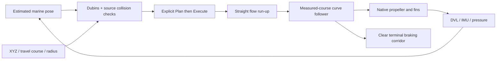
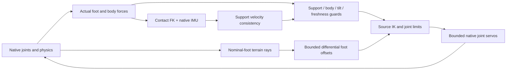

# Curved AUV routes, terrain adapters and concurrent fleets

These controls are available in the native GUI. A configured workflow and a
measured robot mission are separate: consult the [November 3 receipt](../status/evidence/curves-terrain-concurrency-2026-11-03/README.md)
for the exact physical cases and retained failures.

## Run

```bash
source /opt/ros/humble/setup.bash
source install/setup.bash
source scripts/ssd_env.sh
ros2 run robot_lab_gui robot_lab_gui
```

Choose the native workflows below. A direct gait example is
`ros2 launch robot_lab_bringup gait_simulator.launch.py robot_model:=lab_octopod simulator:=mujoco map_name:=gait_low_relief`.

## Tethys: build flow before turning

Select `tethys_auv`, Gazebo, Marine and a compatible water world. Run, Connect,
and use the Marine missions page. The planner uses the estimated pose and
configured source geometry; simulator body pose is only an independent
observer. Enter the goal XYZ, a turn radius and optionally an **exit travel
course** in degrees in world XY. This course describes motion through water,
so it can differ from hull heading when the hull crabs.

1. Use a clear starting corridor and sufficient depth. **Ahead** provides an
   initial goal; it does not guarantee a feasible curve.
2. Choose **Plan**. The pinned MIT PythonRobotics Dubins solver supplies the
   six forward-only curve families. The wrapper checks the entire inflated
   3D route, depth, slope, length and terminal braking corridor.
3. Inspect the actual accepted plan. Arm and explicitly Execute. A successful
   plan does not itself produce motion. Replaced, canceled or stale planning
   results cannot resume a mission.
4. The source hull drives along **−X**. A 1 m straight run-up establishes fin
   flow before the curve. The follower compensates measured ground-velocity
   sideslip, applies bounded yaw guidance and brakes on a clear terminal
   corridor. No lateral hovering thrust is added.
5. Stop removes propulsion immediately and the hull coasts. If an obstacle
   invalidates the curve, stop and explicitly plan again; a generic A* corner
   is not a substitute for an achievable AUV turn.

The authored planning envelope is 10–30 m turn radius (12 m default), at most
45 m route length, 0.1 depth slope, and a 3 m clear terminal corridor. The
measured demonstration is a gentle 20° turn in `marine_tank`, within the
existing 0.6 m arrival envelope. Tight turns, arbitrary destinations and all
water worlds have not inherited that result. Native fin/propeller limits are
unchanged. [Source and license](../../src/robot_lab_utils/robot_lab_utils/_vendor/pythonrobotics-provenance.json).



## Multi-leg: adapt observed low relief

Choose `hexapod_ros2`, `lab_octopod` or `lab_centipede`, a backend and **Gait**.
The launch command includes the selected backend and task. Source-based
adapters exist for MuJoCo, PyBullet, Gazebo Fortress and Isaac Sim. The
passive-wheel snake retains its separate MuJoCo workflow.

For a small deterministic terrain example choose `gait_low_relief`: a 4 × 4 m
heightfield with 8 mm relief, source friction 0.9 and an occupancy boundary
that does not invent support outside the terrain. Select **Connect**, wait
for actual joints/body/contact feedback and standing support, then select
**Adapt measured low relief** and explicitly **Arm walking**. Drive/WASD/
joystick use the existing ramped command path; enabling terrain does not
command travel. Start around 0.02 m/s. Stop holds current bounded joint targets.

The sensor and control path is:



MuJoCo/Bullet/PhysX use native collision rays. Gazebo uses exact selected
static collision triangles for its range model, placed by native pose/source
FK; its UI explicitly excludes dynamic-actor coverage. The Fortress private
Physics serializer exposes actual engine contact force/normal/depth omitted
by the standard `ContactSensorData` serialization. It is loaded only into the
Gait world and does not change integration, collision or actuator laws.

Ground ranges use a level source reference, so body pitch does not shorten
the low-side legs through positive feedback. Common body heave is removed
before differential foot corrections. Offset
slew is at most 0.02 m/s; local swing extension is at most 0.02 m. A 4 cm
support-height span, 2 cm local step, common support gap beyond 4 cm, missing
rays, slip, body contact or excessive tilt stops the gait. Loss of the minimum
actual supporting-foot count, or inconsistent support velocity, lasting over
**80 ms of simulation time** also stops it; the short window accounts for contact exchange, and is shown in
runtime state. Observation and operator wall-time watchdogs remain active.

Initial/reset floor alignment is separate from locomotion and uses actual
support or source static collision/FK. No adapter writes body poses during
travel or feeds simulator XY into contact odometry. Gazebo converts native
encoder zero to the source standing reference in a generated session model;
source URDF, limits, inertias and RViz encoder coordinates are retained.
Bullet removes its implicit 1 kg defaults from source massless fixed frames.

The source gait PD, Bullet implicit servo, Fortress force PID and PhysX PD
are distinct engine adapters. Their availability does not qualify a learned
policy transfer or every terrain/navigation mission. Read the live feedback
and [multi-leg guide](multi-leg-gaits.md) before selecting a higher task.

## Fleet: separate tasks in one actual world

Open **Fleet & Swarm**, configure named Bumperbot/Labbot members, select the
map and enable **Per-robot AMCL + Nav2**. Run and Connect. Each member has
separate frames, sensors, controller, Nav2 server, queue and task identity.
Uncheck **Reserve one autonomous route at a time** while all members are idle
to permit concurrent missions. Select a member and dispatch its goal; select
another and dispatch a separate clear route. Inspect both actual task results
and measured settled bodies. A shared world provides physical interactions;
separate experiment launches are not a fleet.

RGB-D cameras are optional and run at a declared 5 Hz in this shared-world
derivative; lidar and IMU source rates remain unchanged. Keep independent
body, scan and localization feedback fresh. Load/timeout failures stop the
affected workflow and require a new explicit request.

For facility floors, **Park after exit** selects source-clear unoccupied
slots, submits a normal owned Nav2 route after exiting and waits for actual
settling before releasing the task. A batch round-trip queues all outbound
members before their returns. Fresh observed floor identities filter planar
traffic only for known separate floors; unknown, stale and held members
remain conservatively in the same traffic space. Reservations prevent manual
or unrelated queued commands from taking over a lift passenger.

The facility profile declares finite slow-host wall-time budgets: 900 s per
transport, 300 s per phase and 180 s per Nav2 leg. Other configurations retain
the prior defaults (300/100/90 s). These budgets do not relax live feedback,
lease, force, floor, door or independent-settling requirements. The larger
multi-member floor/parking mission is separate from the measured concurrent
single-floor navigation case.

## Read the architecture in the GUI

Open **Learn & diagnose → Architecture & learning → Robot classes &
actuation**. Click **Measured low-relief adaptation** for source files,
message paths and this tutorial. Marine mapping/routes and Ground fleet
owner explain their ownership and execution paths. The library's tutorial
filter also finds this page. Live ROS discovery remains opt-in.

Agent continuation: build the changed seven packages, use the receipt's
bounded producers on SSD, preserve failed cases and pair every new claim
with exact source, robot, map, backend, task and independently observed result.
Do not refresh historical policy or navigation certificates from adapter tests.
