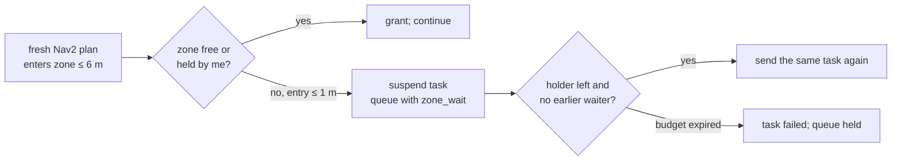

# Shared-world fleet and ground swarm controls

## October 27 workflow

Ground Fleet is available in the sidebar. Queues, cooperative sweep waypoints,
optional Humble Open-RMF and bounded traffic yielding/resumption now have native
controls. A real opposing-route mission and an isolated two-goal workload have
measured body results; full traffic/contact/infrastructure coverage remains open.
See [current delivery](../status/workflows-2026-10-27.md).

Use **Experiments → Fleet point goals** to queue an independent copy of the
Ground Fleet editor. Enter `alpha 0.3 -0.5 0; beta 0.3 -1.5 0` (member ID,
world X/Y and heading degrees). The producer dispatches actual owned routes,
measures each body independently and waits for the fixed endpoint/speed/settling
contract. It records resources and owned cleanup. Cancel/relaunch a batch;
live per-member Reset remains on Ground Fleet. No random/completion-only
benchmark result counts as a mission.

Aerial vehicles have their own [native Aerial Swarm page](aerial-swarm.md),
shared Harmonic world and separate PX4 FCUs. Ground/marine use Fortress.
The original October 15 description below retains its historical scope;
use the current delivery/receipt for implemented features and remaining work.

The native **Fleet & Swarm** tab starts several complete Bumperbot/Labbot
instances in one selected Gazebo world. Their physics, obstacles and clock
are shared. Each instance has separate controllers, sensors, joint states,
odometry, TF frames and optional AMCL/Nav2 actions. This is an experimental
extension on the current ROS 2 Humble / Gazebo Fortress 6 installation.
Other shared-world backends, Open-RMF traffic scheduling, aerial swarms and
marine/multi-legged adapters remain separate roadmap work.

## Start from the GUI

1. Open **Fleet & Swarm**. Select the map family and its installed variant.
2. Keep the example `alpha` Bumperbot and `beta` Labbot, or add up to eight
   instances of these two complete models. Instance ids must be distinct
   lowercase ROS names. Instances do not add duplicate robot catalog entries.
3. Leave X/Y blank for nearby automatic placement. Placement checks the
   selected occupancy grid, including unknown/exterior cells and member
   footprint separation, and prefers a lateral row. A world without a 2D map
   requires explicit X/Y for every instance. Z/yaw can override the map defaults.
   Occupancy clearance does not establish dynamic or 3D collision clearance.
4. Enable **Per-robot AMCL + Nav2** for localized goals. The GUI selects
   AMCL, Smac 2D and regulated pure pursuit using the existing robot parameters.
   One shared map server publishes the actual selected occupancy map.
5. Choose Gazebo/RViz windows and click **Run shared world**. The run command
   is filled automatically; Copy command reproduces the same session file.
   Connect and keyboard enable start neutral and send no movement input.

The GUI writes presets and resolved launch assets under the workspace SSD.
Save/load preserves map, complete model ids and optional explicit spawn poses.
Editing a preset affects the next launch; it does not move live entities.

## Drive one robot or a group

Choose a live instance, or **All included**, and click **Arm manual · neutral**.
Click a direction once to latch it; click again to release and brake. Forward,
reverse, yaw left/right and forward diagonals use the existing bounded ramp
logic. The displayed Δ values are the change per 0.1 seconds, not actual speed.
The live status separately shows the applied command and measured positions.
Fleet limits are 0.35 m/s and 0.8 rad/s or the lower robot profile limits.

Enable WASD/joystick for W/S forward/reverse and A/D yaw. A real gamepad starts
from its calibrated neutral position; touchscreens and other non-gamepads are
ignored. Keyboard input applies while this tab is selected and a text editor
does not have focus. **Space / ALL STOP** clears group inputs and stops owned
actions. Stop selected affects the selected manual members. Changing the
manual target clears the previous latches. Leaving the application clears
manual inputs; closing/stopping the simulator sends All Stop.

The controller closes the command gate on stale clock, wheel feedback, scan
or simulator pose. Commands expire after 0.35 wall seconds; manual/swarm
operator heartbeat expires after 0.8 wall seconds. The wheel controller also
has its own 0.4 simulation-second command timeout. Source acceleration limits
still apply: motor commands going neutral does not mean an instantaneous
physical stop. Scan and predicted member-separation guards can block an input;
the live member reason explains why. They are conservative guards, not a
qualified collision-avoidance or traffic system.

## Dispatch and allocate actual Nav2 goals

The **Tasks** page takes X/Y/yaw in the common map frame. Dispatch selects one
member; **Nearest idle** allocates the goal from fresh estimated positions to
an idle included member. Goals require free occupancy with body clearance,
fresh localization and a real available namespaced NavigateToPose server.
The default budget is 120 wall seconds, with an explicit runtime range of
5–600 seconds. No demonstration goal runner or synthetic PASS metric is used.

Pause cancels the actual owned action and retains its goal. Resume sends it
again after the old action returns a terminal result. Stop immediately closes
the motor gate and requests cancellation. A cancellation acknowledgement is
not a terminal result: replacement or manual commands wait for the result.
Late goal acknowledgements are canceled and cannot reopen a stopped gate.
Autonomous Nav2 goals retain their own budget; the operator heartbeat applies
to manual and swarm ownership. Battery, charging, doors and lifts are unknown.

Reset first requests Stop/cancel and waits for measured physical settling.
It restores only that entity's recorded settled spawn pose through Gazebo's
SetEntityPose service. World time, other entities and continuous wheel encoder
history remain intact. Display re-anchors odometry; Nav2 receives an initial
pose and waits for a consistent localization transform. The acknowledgement,
subsequent physical pose, member isolation and dynamic clearance are distinct
observations. Broad reset/contact qualification remains open.

## Shared zones: corridors, doors and chargers

With navigation enabled, the controller reserves places where two members
cannot pass each other. One member at a time holds each:

- **single-lane passage**: found from the occupancy map when a corridor is
  narrower than two footprints plus Nav2 inflation (clearance below
  2 × radius + 0.25 m, using the largest member's radius);
- **door**: each declared facility door sweep (the lift car keeps its own
  reservation);
- **dock**: a 1.2 m square around each declared charger;
- **declared zone**: `shared_zones` in the facility file, or in an optional
  `fleet_zones` file named by a map profile, with optional `holding` poses.

A member's fresh Nav2 plan (`/<member>/plan`) claims a zone it enters
within 6 m. The member inside the zone holds it; otherwise the grant goes to
a member that is already waiting, then to the nearest claim within 2 m.
Another member whose plan reaches the zone within 1 m is held: its task is
suspended (not canceled) and queued with the zone it waits for. If the zone
declares holding poses within 4 m, the member first drives to the nearest.
When the zone is free, the same task is sent again. A parked member inside a
zone holds it, so the wait reason names that member. The task's own budget
bounds the wait; when it runs out, the task fails and the queue is held.

`/fleet/state` reports `zones` (declared zones, grants, occupants, waits)
and each member's `zone_wait`. The journal records `zone_wait` and
`zone_granted`. The controller also breaks circular yield waits between
queued tasks: the oldest admission proceeds and the others keep waiting for it.

Measured in `fleet_facility`: two robots crossing the main door at once
(the Labbot held 12.4 s, both settled, closest 2.40 m), and the same crossing
under Open-RMF with calibrated energy (closest 0.92 m, both settled). See the
[evidence](../status/evidence/fleet-zones-energy-2026-11-14/README.md).
Zones are experimental; three or more robots, contacts and loss are not yet
measured.



## Ground swarm page

Start controls all included members with fresh estimated state and scans.
The initial centralized kernels are:

| Controller | Actual commanded behavior |
|---|---|
| Formation | Seek equally spaced positions on a lateral row about the group centroid or explicit map anchor |
| Rendezvous | Seek a spaced ring about the centroid/anchor; members do not converge into one occupied point |
| Dispersion | Separate close neighbors using a bounded repulsive velocity field |
| Flocking | Combine separation, centroid cohesion, circular heading alignment and an operator heading bias |

Spacing is 0.6–3 m. Differential bases rotate toward a feasible heading before
translation; they are never repositioned to a formation. These centralized
kernels use every member's estimated pose. Leave group keeps the physical
robot in the world and stops the group; Rejoin requires fresh feedback and
starts neutral. Air swarms need separate FCU instances/leases and are not
enabled by this ground interface.

### Distributed behaviours

The `local_*` controllers run one behaviour per member, using only that
member's own laser scan. They are a port of
[ROS2swarm](https://github.com/ROS2swarm/ROS2swarm) (Apache-2.0) with its
TurtleBot3 burger parameters:

| Controller | What each robot does from its own scan |
|---|---|
| local_dispersion | Potential field away from everything within 3.5 m; drives straight when alone |
| local_attraction | Field toward far returns; turns in place when alone |
| local_aggregation | Explore → join a seen robot → stay 2ⁿ × 4.8 + 3.2 s → leave (at most 6.4 s) → explore |
| local_flocking | Zones: avoid ahead, separate when close, cohere left/right, turn to a robot behind |

A peer is a free-standing object 5–60 cm wide with farther background on
both sides. After every behaviour, ROS2swarm's protection layer turns a
robot away from anything inside its radius + 18 cm. The usual separation
and scan guards still apply.

### Member loss

With **Continue without a lost member (replan)**, a member whose feedback,
scan or localization goes stale leaves the group instead of stopping it.
It stays in the world as an obstacle at its last pose (+0.3 m), and its
remaining lane-coverage goals go to the nearest remaining members. A swarm
needs two remaining members and coverage needs one; otherwise everything
stops, as with the default policy. Motion by any member outside the group
also stops everything. Rejoin brings a member back explicitly.

## Coverage page

**Measure coverage from scans** (the default) counts the free map cells
crossed by each member's scan rays, up to 2 m, from its estimated pose.
Idle members get the nearest reachable unseen cells, at least 1.5 m from
other members' goals. A failed goal is skipped for a minute. The mission
ends at 95 % (`goal_fraction`), when no reachable unseen cells remain, on
Stop, or on heartbeat loss. The page shows the measured fraction. Without
the option, the earlier lane sweep plans waypoints only.

Measured with two Bumperbots and a Labbot in `nav_empty`:
- distributed dispersion spread a 0.9 m triangle to 3.15 m mean spacing in 35 s;
- sensed coverage reached 90 % of a 6 × 6 m area in 62 s, although the
  Labbot's localization was stopped at 40 s and the group replanned;
- distributed aggregation grouped two of three robots but has not passed.

Sessions with RGB-D off showed a 90° −inf sector on Bumperbot lidars once
the robots moved, which holds them; keep RGB-D on. See the
[evidence](../status/evidence/swarm-distributed-2026-11-14/README.md).

## Source and measurement details

The launch uses one physics server and one sensor bridge clock. Model entity
names and Gazebo sensor topics are distinct; ROS namespace alone is not enough.
Source link/joint names remain local to each entity. Robot state publisher,
feedback controller and sensor frames use `<id>/...` consistently. Wheel
feedback owns `<id>/odom → <id>/base_footprint`; AMCL or a known spawn/reset
anchor owns the map relationship. Simulator truth is separate from estimates.

The first-party Labbot fleet derivative raises its physical lidar mount by
**5 cm**. Its original scan plane intersects the OAK-D visual. This removes
self returns by moving the actual sensor and its TF, rather than inventing
free scan rays. The resolved manifest records the adjustment. Single-robot
descriptions and historical source certificates are unchanged.

Some initial model-odometry diagnostics reported zero twist while their
poses moved. Fleet velocity/settling is calculated from successive measured,
stamped poses; the original reported twist is retained separately. Sensor
samples must advance and match the current world clock. Wheel and localization
estimates are labeled and never replaced with simulator truth for navigation.

## Run from a terminal, and artifacts

```bash
source scripts/ssd_env.sh
source /opt/ros/humble/setup.bash
source install/setup.bash
ros2 launch robot_lab_bringup shared_world.launch.py \
  map_name:=nav_empty navigation:=true gui:=true rviz:=true
```

The default session is `robot_lab_bringup/config/fleet_demo.yaml`. Example:

```yaml
schema_version: 1
map: nav_empty
members:
  - id: alpha
    model: bumperbot
  - id: beta
    model: labbot
    spawn: {x: -0.5, y: 0.5, z: 0.1, yaw: 0.0}
```

`session:=/absolute/path/session.yaml` selects a saved preset. Other simulator
values are rejected explicitly. The launch prints an SSD `fleet_sessions/
session-.../session.json` path containing the selected world, source/generated
hashes, placements and generated descriptions/configs. `requested-session.yaml`
preserves the request; `events.jsonl` records real commands, rejections, Nav2
results and reset acknowledgements with wall/simulation time, bounded at 16 MiB.
`/fleet/state` publishes actual member counts, ages, estimates, simulator poses,
commands and action state. Runtime artifacts are not automatically a passed
mission; record exact scope and failed attempts with the ledger.

The GUI/controller share a session id and one live operator lease. Direct
clients must publish `/fleet/operator_heartbeat` with `session_id/operator_id`
and `/fleet/command` with those fields, an `op` and target id list. `/fleet/stop`
is a Trigger service for a session-wide neutral gate and cancellation request.
Each `<id>/reset` Trigger acknowledges the reset request; observe state for
completion. ROS domain/transport partition isolation is still required when
running a separate simulation. Isolated experiment jobs remain separate worlds.

## Agent continuation

Read the ledger and claim the next R10 task before edits. The runtime is in
`robot_lab_utils/fleet_controller.py`; session preparation is in `fleet_session.py`,
bounded group kernels in `fleet_motion.py`, launch in `shared_world.launch.py`
and the native editor in `robot_lab_gui/fleet_tab.py`. Keep these contracts:

- Humble's ground launch forces Fortress 6; PX4's Harmonic 8 is separate.
  Keep compatible system plugins and explicit per-instance controller files.
- The control plugin prepends its namespace to `robot_param_node`; use the
  relative `robot_state_publisher` name. Prefixing it twice aborts the server.
- Pass the controller file to the spawner before controller initialization,
  and serialize embedded manager startup. Do not name a callback `_clock`:
  rclpy already owns that field.
- Preserve per-instance actuator/source limits and generation/cancel barriers.
  Do not silently reset the common world clock or relabel odometry as truth.
- Add real task queues/coverage and a Humble-compatible Open-RMF adapter before
  claiming scheduling, resources or infrastructure. Record unknown energy data.
- Additional plants, robot families and marine/gait dynamics need their own
  adapters and GUI capability gates; a copied namespace is not an adapter.
- Keep broad map/member/contact/loss sweeps in the validation lane. Necessary
  launch errors are implementation defects and should be fixed as encountered.

Primary implementation references: [Humble control plugin namespaces](https://control.ros.org/humble/doc/gz_ros2_control/doc/index.html),
[feedback differential-drive controller](https://control.ros.org/humble/doc/ros2_controllers/diff_drive_controller/doc/userdoc.html),
[Humble multi-robot Nav2 example](https://github.com/ros-navigation/navigation2/blob/humble/nav2_bringup/launch/cloned_multi_tb3_simulation_launch.py).
