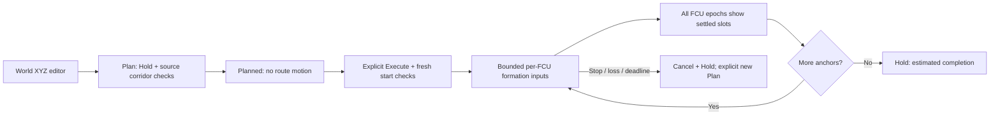

# Aerial formation itineraries

## Run

Source ROS, `install/setup.bash` and `scripts/ssd_env.sh`, then run
`ros2 run robot_lab_gui robot_lab_gui`. Open **Aerial Swarm**, select the
installed measured two-drone reference configuration, launch its shared world
and Connect. Use the Plan/Execute workflow below after the normal flight
readiness and takeoff checks; a plan alone never starts a route.

The native Aerial Swarm workspace can plan and execute an itinerary for two
to four existing X500/PX4 members. This is a new experimental software
workflow. The earlier two-drone formation/landing receipt does **not** qualify
this route executor or larger groups.

1. Run a shared aerial session, Connect, Check clearance and explicitly Takeoff.
   Keep the existing source-bound checks and wait for fresh airborne estimates.
2. Select **All vehicles**, or the same group used by the route. A route needs
   two to four members. Choose spacing between 2 and 8 m.
3. Open **Show formation itinerary**. It replaces the manual pad in the same
   control column; Hold and Land remain visible. **Add estimated centre** copies
   the selected group's estimated centre into the editor without sending motion.
4. Enter one **world X Y Z** formation-centre anchor per line, separated by
   spaces or commas. Z is world altitude, not height above the initial floor.
   Every member's resulting slot must remain 0.5–10 m above its spawn origin.
   Use short initial transfers and inspect the selected world.
5. **Plan route** holds the vehicles. A bounded background worker checks each
   member's 0.8 m source-static corridor and simultaneous straight-transfer
   separation of at least 2 m. It refuses crossing member assignments, blocked
   geometry, over 16 anchors, a leg over 20 m or total travel over 100 m.
6. Wait for **planned**, then explicitly **Execute route**. The selected members
   must match the plan, remain fresh/airborne and be within 0.25 m of their
   captured starting estimates. Editing the text does not change a running route.
7. The coordinator advances only after all selected members are within 0.2 m
   of their slots, have estimated speed below 0.08 m/s, and each member's FCU
   timestamps advance through a continuous one-second settled interval.
8. Completion requests Hold. Land remains an explicit action. Hold, operator
   loss, member loss, 120 wall seconds on one leg or 600 seconds overall cancels
   execution. Returned feedback never resumes an interrupted route automatically.

<!-- diagram: aerial -->

The runtime still checks actual current estimates, source lookahead and all
session peers. A planned synchronized transfer is not a guarantee that a real
vehicle follows it. Dynamic actors, observed depth obstacles, wind/current
prediction and independent flight qualification are separate work. Simulator
truth may be displayed and logged; it never steers the route or satisfies its
estimated completion condition.

Implementation: `aerial_swarm_route.py` is the geometry/settling model;
`aerial_swarm_controller.py` owns planner generations, leases and actual member
inputs; `aerial_swarm_tab.py` is the native editor. Command operations are
`plan_route` with `targets`, `spacing`, `anchors`, and separate `execute_route`
for those exact targets. Session/operator IDs are still required.

For continuation, first record an actual short two-anchor flight with native
body traces, final settling and landing/disarm. Then extend to three/four
members, a second world, inserted obstacles and actual member-process loss.
Preserve failed runs and exact source/runtime identities. A passing geometry
fixture or FCU-estimated completion is not an independent physical receipt.
