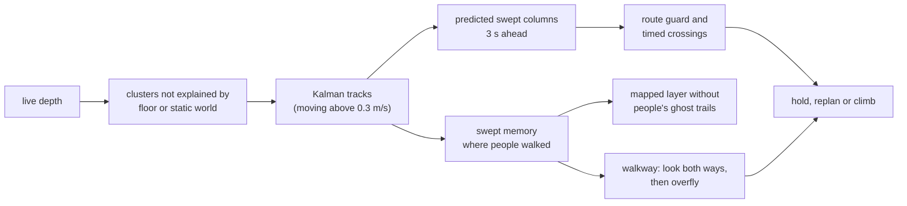

# Plan drone routes with mapped and live depth obstacles

October 14, 2026. This experimental integration supplements the complete
selected **static world** with RTAB-Map obstacle occupancy and current depth
observations. It uses the existing native PX4 X500/Gazebo Harmonic Flight
workflow. No new mapped-route flight mission has been qualified; see
[implementation and diagnostics](../status/aerial-obstacles-2026-10-14.md).

## Operator workflow

1. Reopen the rebuilt GUI. Choose **PX4 X500**, **Gazebo**, **Flight** and a
   compatible installed static world.
2. Enable **Drone route: mapped + live depth obstacles (experimental)** in
   Launch's advanced options. RGB-D and RTAB-Map mapping are enabled together.
   The preview contains `px4_vehicle:=x500_depth`, `aerial_mapping:=rtabmap` and
   `aerial_obstacles:=mapped_depth`. A saved database remains an optional
   localization input. Configure these options before Run.
3. Run. Use the existing **Check takeoff clearance → Takeoff** workflow.
   In Drone, wait for the observed route layer to report ready and inspect
   the map/depth cell counts and observation ages.
4. **Use current FCU position**, edit a small target, then **Plan route**.
   Plan runs 3D A* against the canonical world plus observed occupancy.
5. **Execute route** first rechecks the entire route asynchronously against
   current observations. A clear, unchanged FCU/operator/resource context
   starts the actual Offboard waypoint controller.
6. A detected blockage, a moving obstacle predicted on the route, or stale
   sensing interrupts that route and holds at the current FCU position. The
   planner then replans to the same goal around current observations and
   predicted sweeps ([moving obstacles](#moving-obstacles-and-sensor-loss)).
   **Cancel / Hold**, Space, manual input, direct goals and Land interrupt
   pending work and stop automatic replanning.

The existing manual Drive/yaw/altitude and Takeoff controls remain separate
control paths. Enabling the observation option requests no takeoff or motion.

## Run

```bash
source scripts/ssd_env.sh
source /opt/ros/humble/setup.bash
source install/setup.bash
ros2 launch robot_lab_bringup simulated_robot.launch.py \
  robot_model:=px4_x500 simulator:=gazebo mode:=flight map_name:=nav_empty \
  px4_vehicle:=x500_depth aerial_mapping:=rtabmap aerial_obstacles:=mapped_depth
```

The launch selects the existing SSD PX4 Python environment and native `-d`
FCU runtime. It rejects observation mode without RGB-D, RTAB-Map and Flight.
No new upstream model or download step is required.

## Data and execution contract

- RTAB-Map's `/rtabmap/cloud_obstacles` supplies mapped occupancy in
  `aerial_map` or `map`; the capture-time TF converts it to the FCU's `map`.
- `/x500/camera/depth/image_raw` and matching fresh CameraInfo supply registered
  pinhole depth. Every valid pixel between the native 0.2 m near clip and
  the declared 8 m observation range is projected; no sparse pixel sampling.
  The native camera itself renders to 19.1 m, while mapping uses an 8 m range.
- A latest-message worker performs decoding, transforms and voxel/tree building
  outside ROS/FCU callbacks. Oversized/malformed/untransformed observations
  reject. Old/replayed stamps do not renew health. Point clouds have a 300,000
  point/16 MB admission limit and occupancy a 100,000-cell cap; overflow
  rejects instead of silently removing obstacles.
- Occupancy uses 0.15 m cells and conservative half-diagonal inflation around
  cell centres. It adds to the existing 0.7 m spherical planning envelope.
- The FCU route controller checks current map/depth occupancy along 2 m of
  the upcoming route. Depth expires after 0.75 wall seconds, CameraInfo after
  2 seconds, mapped occupancy after 60 seconds (RTAB-Map republishes only when
  it adds a node, which a hovering drone does not). A failed or near-contact
  query requests Hold. The existing setpoint rate/speed and telemetry-loss Land
  behavior remain.
- Background Plan/Execute rechecks bind the operator command generation. A
  late worker result cannot start an old route after manual input, Stop or a
  direct goal. World resource changes or >0.3 m FCU drift reject execution.

Unseen space is not certified clear by an absent cloud point; the complete
canonical static world remains the planning baseline. Gazebo actors (people)
are not part of that baseline: they are seen only through the camera.

## Moving obstacles and sensor loss

November 13, 2026 (ROADMAP R5.11). Implemented and experimental.



- **Tracking.** Each depth frame's voxel centres that lie neither on the floor
  nor within 0.35 m of the known static world are clustered (0.3 m voxels).
  Clusters feed constant-velocity Kalman tracks. A track is *moving* after
  three frames above 0.3 m/s. A track that leaves the camera's view keeps
  being predicted for 4 s, with its radius growing by 0.3 × speed × the
  unseen time. A track whose bottom is within 0.8 m of the ground is assumed
  to be at least 2 m tall. The camera sees only part of a person, and a drone
  once passed 0.4 m over a walker's head. This is a stated prior, not a
  measurement.
- **Prediction.** Moving tracks become vertical columns swept 3 s ahead. The
  3D A* replanner treats them as obstacles. The route guard compares the
  drone's own position along the route (0.4 m/s) with each track's position
  at the same time, and holds when they meet.
- **Ghost removal.** RTAB-Map keeps a walking person as a wall of cells along
  their path. Mapped points inside columns that moving tracks have swept in
  the last 5 minutes are dropped. Live depth still reports what is there now.
- **Walkways.** The same swept memory marks walkways. A forward camera cannot
  see someone walking in from the side, so before the route enters a walkway
  the drone:
  1. holds at the edge;
  2. turns 75° left and right (0.8 s at each heading), then back;
  3. crosses only if no track, seen or coasting out of view, is predicted on
     the route until it is past the walkway.

  It crosses above the walkway's swept columns (their top + 0.7 m drone radius
  + 0.3 m), but no higher than the level camera still sees ground within 80 %
  of its 8 m depth range (about 3.5 m for the X500's camera). Higher, too
  little valid depth counts as sensor loss. Within 20 s of a look it only
  re-times the crossing. After 15 s of waiting it looks again, and after 3
  looks it replans.
- **Evasion.** A moving track predicted to reach the hovering drone, or to
  meet it inside a walkway, makes the drone climb to 1 m above the track's
  top (within the altitude limit). The replan then continues from there.
- **Sensor loss.** Depth staler than 0.75 s for 1 s (grace for single late
  frames) holds the drone. If sensing has not returned within 10 s, it lands.
  Recovery replans to the goal.
- **Estimator heading gate.** PX4 SITL sometimes starts its EKF with a gyro
  bias of up to 0.15 rad/s. The magnetometer does not remove it, so the
  heading drifts on the ground and the hover then orbits several metres.
  Takeoff waits until the resting heading drifts less than 0.25°/s over 4 s.
  If it does not after the 8 s preflight settle, the runtime restarts PX4's
  `ekf2` (at most 3 times).

Limits: constant-velocity prediction (a sudden turn is seen only in the next
frames); objects never seen are not predicted; the walkway memory is learned
during the flight; the standing-height prior and the overflight assume open
space above walkways; people do not react to the drone in the test world.

The integration uses the official
[RTAB-Map obstacle publishers and frame contract](https://github.com/introlab/rtabmap_ros/blob/ros2/rtabmap_util/src/MapsManager.cpp)
and [Humble PointCloud2 decoder](https://github.com/ros2/common_interfaces/blob/humble/sensor_msgs_py/sensor_msgs_py/point_cloud2.py).
SciPy supplies the nearest-neighbour tree; the existing canonical planner
checks collision edges. Installed library versions remain in the receipt.

## Next agent's qualification work

Read the ledger and claim the validation scope separately. First run a short
normal-GUI `nav_empty` flight, record actual FCU and independent Gazebo body
pose, RGB-D/TF/RTAB-Map messages, planner states and the exact source/command.
Measure observed versus world obstacle alignment, current transform latency,
Offboard setpoint cadence, route/body tracking and minimum physical clearance.

Then introduce an **actual collision model** in the running Gazebo scene ahead
of the camera/route, retaining the insert request/model hash and independent
pose trace. Verify the physical interruption and actual flight clearance;
publishing a fabricated PointCloud2 is only a software test. Stop the camera
producer to measure real sensor-loss/hold behavior and restore it to check
that execution stays interrupted until a new operator request. Repeat manual/
Space/direct-goal/Cancel/Land during both planning and the execution recheck.

Keep existing Takeoff/body/contact/landing criteria; do not infer success from
arming, cell counts, framework availability or action/state strings alone.
Repeat saved-map/localization, furnished/ceiling/terrain worlds and source
changes only after this first mission. Other flight backends, future actor
prediction, automatic detours and full world coverage remain separate tasks.
