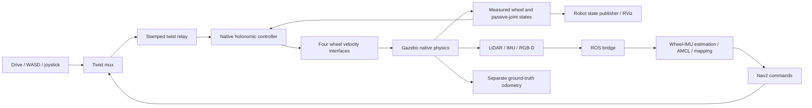

# Elephant Robotics myAGV Pro

The normal installed catalog now includes the complete official myAGV Pro
CAD base, from Elephant Robotics' BSD-3-Clause
[ROS 2 Humble source](https://github.com/elephantrobotics/agv_pro_ros2/tree/d3851c768d2e887eef7ad79fc4dcb9a928b070ac).
It is a four-wheel omnidirectional robot. Its source wheel names do not match
their geometric corners; the adapter resolves those positions explicitly.
It is grouped as one complete robot family, rather than listing its wheel
and sensor parts separately.

## Run

1. Open **Launch → Mobile robots → Four-wheel mecanum base**.
2. Choose **Elephant Robotics myAGV Pro** and its official CAD variant.
3. Choose **Gazebo**, **Display** and `nav_empty` for the measured starting case.
4. Run the automatically filled command. Use the Drive column for forward,
   reverse, turning, strafe, WASD/joystick and Stop. Existing latched button
   behaviour and incremental speed controls apply.
5. For localization, SLAM, 3D SLAM or navigation, first enable **Experimental
   imported-asset modes**. Algorithms and commands fill automatically. These
   pipelines remain experimental; a named physical screen is not universal
   map or mode qualification.

```bash
source scripts/ssd_env.sh
source /opt/ros/humble/setup.bash
source install/setup.bash
ros2 launch robot_lab_bringup simulated_robot.launch.py \
  robot_model:=asset_elephant_myagv_pro simulator:=gazebo \
  mode:=display map_name:=nav_empty
```

For experimental navigation, use `mode:=nav allow_experimental_assets:=true`.
Choose a land world with its matching registered 2D occupancy map. Display can
also select no map.

### MuJoCo, PyBullet and Isaac: the roller variant

Gazebo uses the official CAD wheels with a directional-friction contact model
that only Gazebo has. The other three simulators use a separate variant,
**`asset_elephant_myagv_pro_rollers`**: each wheel keeps the vendor visual and
its original mass and inertia, split into a core and 15 free passive rollers
(FUJI mecanum geometry, MIT). In the GUI pick the same robot family and its
*physical rollers* variant, then MuJoCo, PyBullet or Isaac:

```bash
ros2 launch robot_lab_bringup simulated_robot.launch.py \
  robot_model:=asset_elephant_myagv_pro_rollers simulator:=isaac \
  mode:=display map_name:=nav_empty
```

Forward, reverse, strafe, turn, Stop and publisher loss are measured in all
three; a full Nav2 mission (detour, cancel, resume, near-obstacle goal) passed in
PyBullet ([evidence](../status/evidence/myagv-pro-2026-11-12/README.md)).
Navigation there also needs `allow_experimental_assets:=true`.

### With the myCobot Pro630 arm

Elephant Robotics sells the myAGV Pro with its six-axis **myCobot Pro630**
on the deck. **`asset_elephant_myagv_pro_pro630`** is that robot: the roller
base above plus the official arm description from
[`elephantrobotics/mycobot_ros2`](https://github.com/elephantrobotics/mycobot_ros2/tree/d42ff61a78122c79246623391540d75738b03b23)
(BSD-2-Clause). It runs in MuJoCo, PyBullet and Isaac.

1. Open **Launch → Mobile manipulators → Arm on omnidirectional base** and
   choose **elephant_myagv_pro630**.
2. Choose MuJoCo, PyBullet or Isaac, **Display** and `nav_empty`, and run.
3. The control column opens the **Mobile arm** page: one row per joint
   (J1–J6) with a target field, − / + jog, Apply and a slider. **Home**
   returns every joint to zero (the arm upright); **Stop / hold** holds the
   measured joints. The Drive page still drives the base.

```bash
ros2 launch robot_lab_bringup simulated_robot.launch.py \
  robot_model:=asset_elephant_myagv_pro_pro630 simulator:=pybullet \
  mode:=display map_name:=nav_empty
```

Rules the page and the plant enforce:

- Only Apply, Jog and Home move the arm; editing or dragging sends nothing.
- While any joint moves (or still settles after spawn), the base refuses
  drive commands. While the base moves, an arm command is refused and the arm
  holds. The page shows *Base Drive available / inhibited*.
- The page sends a heartbeat at 10 Hz. Without one for 0.5 s the plant holds
  the measured joints, as it does on Stop, on leaving the page, or on any
  change of robot, simulator, mode or map.

The vendor publishes no Pro630 weight, joint speeds or mount position, and
its description has no inertias. The lab declares them: 8 kg spread over the
links by volume, 1 rad/s per joint, torque caps sized for the rated 2 kg
payload, and the arm centred on the deck rails. Treat arm dynamics as
estimates. A gripper, MoveIt planning and pick-and-place for this robot are
not yet integrated. Measured drive and arm screens for all three simulators,
and the live GUI run, are in the
[evidence](../status/evidence/myagv-pro-2026-11-12/README.md#myagv-pro--mycobot-pro630-r143-2026-11-13).

The existing Registry preview opens this complete source model inside the GUI.
**Learn & diagnose → Documentation library** includes this page. Health uses
the same task ledger as the roadmap; prototype pipelines and measured missions
remain distinct.

## How control and sensing connect



The physical contact model drives the body; neither the controller nor its
odometry moves the root pose. Command loss expires the wheel controller's
wall-clock lease. A common scale factor bounds combined forward/strafe/yaw
commands at 8 rad/s per wheel while preserving their twist direction.

The source visual meshes, original body masses/inertias and sensor mounts
are retained. The lab declares these simulation changes:

- Cylindrical wheel envelopes of 0.0762 m radius and directional contact
  replace rigid STL roller collisions. The vendor's Gazebo sample uses
  0.05 m despite the approximately 0.152 m CAD wheel diameter.
- Four passive vertical compliance joints distribute tire contact. They have
  ±12 mm travel, 10,000 N/m stiffness and 100 N·s/m damping, with 0.02 kg of
  added carriers. These are lab approximations, not vendor suspension claims.
  Their measured states are published for correct wheel TF; they are not driven.
- Conservative simulation limits are 5 N·m motor effort, 8 rad/s wheel speed,
  0.3 m/s per translation axis and 0.4 rad/s yaw. These are not hardware ratings.
- Native simulated LiDAR/IMU/RGB-D instruments use the original source frame
  mounts. The camera is a declared lab sensor model, not a calibrated vendor
  camera. The broken joint/controller names in the vendor Gazebo example are
  replaced by the actual source joint names and the existing bounded controller.

The source CAD model has about **20.316 kg**, while the
[hardware product table](https://github.com/elephantrobotics/myagvPro_docs/blob/d2b23d72fa92ce322e9c39617ca04d40685c6f62/MYAGV_PRO_EN/2-ProductFeature/2.1-BasicEdition.md)
lists 40 kg. The discrepancy is unresolved. This integration preserves the
published model rather than presenting it as calibrated hardware dynamics.

## Measured scope and remaining work

One actual Gazebo `nav_empty` Display run measured forward/reverse, 0.25 m/s
strafe, about 0.234 rad/s turn, neutral hold and command-loss stop. Eight real
camera frames, eight LiDAR messages and measured drive/passive-joint feedback
were recorded. Publisher-loss travel was about 0.11 m with zero final speed.

Navigation receipts and negative runs are kept in the
[integration evidence](../status/evidence/myagv-pro-2026-11-12/README.md).
Other maps, furnished obstacle routes, reset/loss histories, calibrated tire
and mass dynamics, hardware serial/charging operation, a Pro630 gripper and
mobile pick-and-place remain separate work. The Basic and
Visual-Navigation product editions are not duplicated as falsely qualified
simulation profiles.

## Install on another host

Assets are already downloaded on this host. Provisioning is an installation
step, with no GUI download requirement:

```bash
python3 scripts/provision_myagv_pro.py --download                    # Gazebo variant
python3 scripts/provision_myagv_pro.py --download --variant rollers  # MuJoCo / PyBullet / Isaac
python3 scripts/provision_myagv_pro.py --download --variant pro630   # with the Pro630 arm
```

The `pro630` variant also needs `trimesh`, `scipy` and `pybullet` (mesh
conversion, link inertias and the payload torque estimate).

Source checkouts, CAD assets, generated URDF/SDF, license, resource hashes,
contact/control recipe and installation receipts stay under
`$ROBOT_LAB_RUNTIME_ROOT/external_assets/` on the SSD. Re-provisioning rejects
edited source checkouts. The incorrect incoming two-wheel prototype is
preserved in the SSD integration directory; it is not registered as myAGV Pro.

For agents: keep R14.2 ahead of other implementation tasks. Preserve the
geometric corner mapping, source CAD/inertias, source sensor frames, observed
passive joints, compiled contact-direction checks and matching Nav2 goal
thresholds. Portable wheel physics is required before enabling another
backend. Use real body/sensor feedback when adding support claims. For the
Pro630, keep the source arm kinematics/limits, the declared estimates in
`robot_lab_utils/myagv_pro630.py` and the per-profile `base_motion_limits`.
