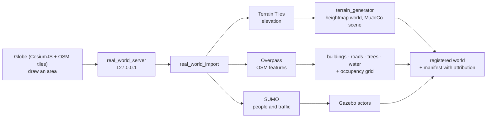

# Import a real place

**Worlds & mapping → Real place** turns a real area of up to 2 × 2 km into a
world for Gazebo, MuJoCo, PyBullet and Isaac: its ground from open elevation
data, and its buildings, roads, trees and water from OpenStreetMap. For a
city you can add people and traffic, simulated by Eclipse SUMO. No account or
token is needed.

## Run

1. Open **Worlds & mapping → Real place** and press **🌍 Open globe**. A globe
   opens in your browser (it needs internet).
2. Type a place in the search box (for example *Rostock, Kröpeliner Straße*)
   and press **Go**, or navigate with the mouse.
3. Press **Draw area** and click two opposite corners. The size appears in
   metres; each side must be 40 m to 2 km.
4. Name the world (lower case, digits, `_`), choose what to include
   (buildings, roads, trees, water, people, traffic) and the terrain detail,
   then **Import this area**. Progress shows on the page; a 300 m city block
   takes about half a minute.
5. Back in Robot Lab the result appears under **Result**. **Use in Launch**
   selects it as the world; **Preview 3D** opens it in the inspector.

Without a browser, type the corners (latitude/longitude) in **Or type the
area** and press **Import area**. From the command line:

```bash
python3 -m robot_lab_utils.real_world_import rostock_centre \
  --bbox 54.0874 12.1382 54.0901 12.1428 --samples 257 [--people --traffic]
python3 -m robot_lab_utils.real_world_import rostock_centre --check   # rebuild offline and compare
```

## What you get

| Layer | Source | In the simulators |
|---|---|---|
| Ground | [Terrain Tiles](https://registry.opendata.aws/terrain-tiles/) (AWS Open Data; SRTM, NED, ETOPO1 and others) resampled to a local metric grid | heightmap collision in every simulator (via the [terrain generator](terrain-generation.md)) |
| Buildings | OSM footprints, height from `height` or `building:levels` × 3 m (6 m if unknown) | one collision + visual mesh each, from just below the ground to the roof |
| Roads | OSM highways, width from `width` or the road type | visual ribbons on the ground (drivable) |
| Trees | OSM single trees; forests and woods filled on a 6 m lattice | trunk collision (0.18 m radius), crown visual |
| Water | OSM water areas | visual surface; blocked in the 2D grid |
| People, traffic | Eclipse SUMO on the OSM road network (sidewalks and crossings guessed), random trips, 300 s | Gazebo actors replaying the tracks |

The 2D occupancy grid blocks buildings, tree trunks, water, slopes over 15°
and the terrain edge; the spawn point is the free spot with 1.5 m clearance
nearest the centre. Everything is written to
`$ROBOT_LAB_RUNTIME_ROOT/terrain/<name>/`, including the downloaded inputs
(`inputs/dem.npy`, `inputs/osm.json`, `inputs/traffic_fcd.xml`), so the world
rebuilds byte for byte without network. The manifest records the area
(WGS84), the local projection, every data source with its attribution and
license, feature counts, the largest roofs and the known limits.



## Measured

REAL_WORLD_RESULTS

## Limits

- Areas up to 2 km a side and 200 m of relief. Fortress heightmaps are 8-bit:
  height steps of *relief / 255* (4.7 cm for the 12 m Rostock example).
- The elevation data is a surface model of 3–30 m source resolution; small
  kerbs, steps and walls are not in it.
- Buildings have flat roofs and no interiors; MuJoCo collides with each
  building's convex hull (courtyards of L- or U-shaped buildings are filled
  there).
- People and vehicles are Gazebo-only actors: they replay recorded SUMO
  tracks and do not react to the robot. MuJoCo, PyBullet and Isaac skip them.
- OpenStreetMap data is © OpenStreetMap contributors under the ODbL: a world
  you share must keep the attribution in its manifest.

An alternative for satellite-textured terrain is the pinned
[gazebo_terrain_generator](https://github.com/saiaravind19/gazebo_terrain_generator)
(BSD-3-Clause, needs a Mapbox token); its output is not imported automatically.
