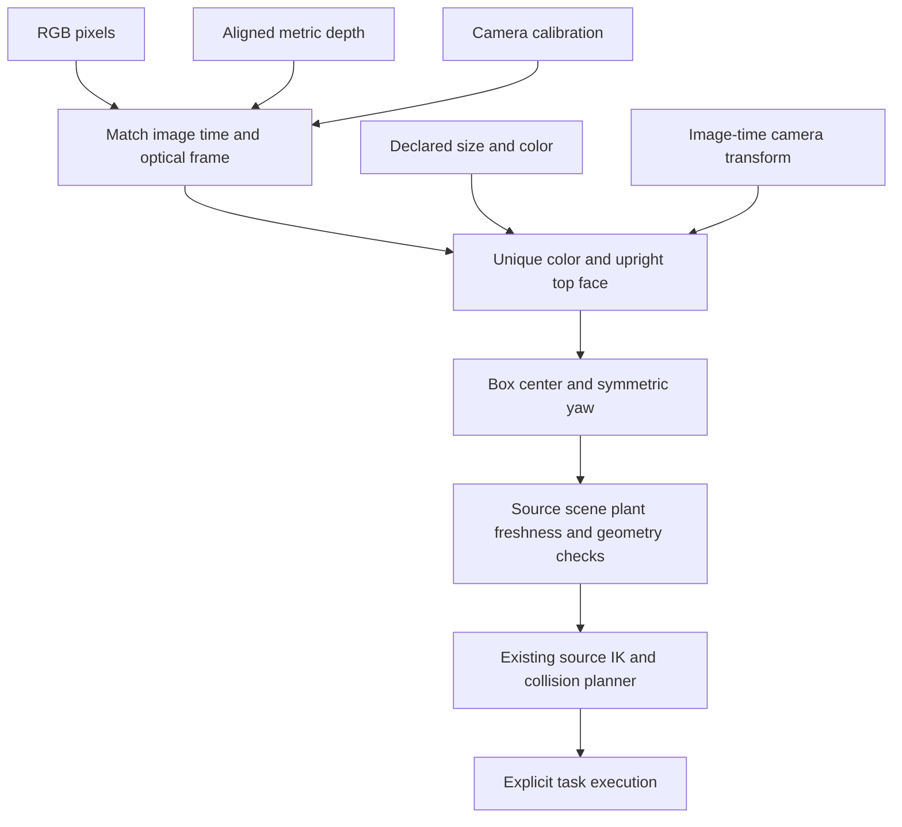

# Unmarked RGB-D box targets

## Run

In the normal GUI, choose **Mobile manipulation lab → Unmarked RGB-D cube**,
native Stretch or Stretch 3, **MuJoCo → Display**, and enable the experimental
**Native mobile controls**. The command box fills the normal launch command;
the selected map automatically supplies its RGB-D box bindings. This variant
is installed alongside the marker fixture, in the same map family.

Press **Run** in the launch workspace to start the simulator.

Point the source camera at the cube using the native head controls before
starting a task. In the mobile task builder, select the exact object and
opposing finger bodies, then choose **RGB-D colored boxes** under **Unheld
object reach targets**. Wait for the selected method to list a fresh target.
Feedback explains missing, ambiguous or rejected observations. Add a reach
or local pick recipe, inspect its steps, then explicitly **Run task**. Editing
the target method or building a recipe sends no movement.

For the pinned original Stretch at this fixture's default spawn, tested head
targets are `head_pan = -1.576 rad` and `head_tilt = -0.923 rad`. Wait for the
base to settle, then set those channels using the existing native joint
controls. These are fixture view seeds, not object-pose estimates; another
spawn or source model needs its own view. The base/articulation interlock stays
active. Four source-camera frames detected the box after head-only commands;
no pick or transport mission is inferred from that observation.

The cube must have its complete top visible, be upright and match the declared
size and unique color. If the target is missing, change the camera view; a
missing RGB-D estimate never switches to simulator geometry. Marker poses and
RGB-D poses have separate caches. Instrumented lift/custody and collision
planning retain their declared native measurements; this is not a camera-only
robot mission.

Equivalent CLI launch:

```bash
source /opt/ros/humble/setup.bash
source install/setup.bash
source scripts/ssd_env.sh
ros2 launch robot_lab_bringup simulated_robot.launch.py \
  robot_model:=menagerie_hello_robot_stretch simulator:=mujoco mode:=display \
  map_name:=mobile_manipulation_lab_unmarked allow_experimental_assets:=true \
  enable_native_mobile:=true native_task:=display object_rgbd:=auto
```

## How the measurements become a target



The ROS node consumes `/oakd/rgb/image_raw`, `/oakd/depth/image_raw`,
`/oakd/rgb/camera_info`, image-time TF into `native_world` and the task's
identity/object-name list. It ignores simulator object poses in the context.
Output is `/robot_lab/object_estimates`, with `pose_source: rgbd_box_top`.

RGB and depth must share an optical frame, calibration, dimensions and sample
time within 20 ms. Depth is `32FC1` optical-Z metres or `16UC1` millimetres.
The decoder handles declared endianness and row padding. Inputs are limited to
1280×960; one latest image/depth/calibration triple is kept. Image-time TF can
arrive afterward: the node retries that one pair for up to 0.2 wall seconds,
without blocking ROS callbacks or substituting the latest transform.

Color segmentation must yield one component of at least 80 pixels and at least
12 pixels per bounding edge. Missing depth, image clipping, incomplete top
area, tilted/nonplanar top points and mismatched visible dimensions reject the
estimate. At most 20,000 depth points per binding are fitted. A configured box
height converts the measured top into its collision-box center. A rectangle
has two indistinguishable yaw orientations; a square has four. The reported
yaw is a canonical representative, not a labelled face orientation.

## Add bindings for another controlled scene

Attach an `object_rgbd` YAML path to the map profile or pass an explicit path
with `object_rgbd:=...`. Use `none` to disable this detector. The current launch
adapter is for the native mobile workflow; it does not enable another robot's
controller or higher modes.

```yaml
schema: robot_lab.rgbd_boxes.v1
boxes:
  - object: environment_pickup_cube
    size_m: [0.03, 0.03, 0.03]
    hsv_low: [5, 100, 60]
    hsv_high: [30, 255, 255]
    depth_noise_m: 0.001
```

Names must match the selected source box and its compiled dimensions. Color
uses OpenCV HSV coordinates: H 0–179 and S/V 0–255. Binding color ranges cannot
overlap. These are controlled-scene appearance/size assumptions: an unrelated
identical-looking object cannot be semantically identified by color. Unknown
shapes, occlusion, arbitrary roll/pitch, object recognition and uncertain
camera registration require further perception adapters.

The target's error bound combines the declared depth noise, pixel footprint,
observed size discrepancy and top-plane variation. It is not an empirically
calibrated covariance and does not certify camera/TF calibration. Samples older
than 0.5 simulation seconds or one wall second, mismatched source/scene/plant,
wrong method and geometry changes are refused. Task motion continues to use
existing source rates, collision worker, custody checks and Stop/watchdog.

For contributors provisioning the declared fixture on another SSD workspace:
`python3 scripts/provision_mobile_manipulation_scene.py --unmarked` installs
the immutable world, grid, binding and registry variant without replacing the
existing marker world. It does not require ArUco to generate the unmarked box.

[Actual rendered fixture and implementation receipts](../status/evidence/unmarked-rgbd-2026-11-14/README.md).
