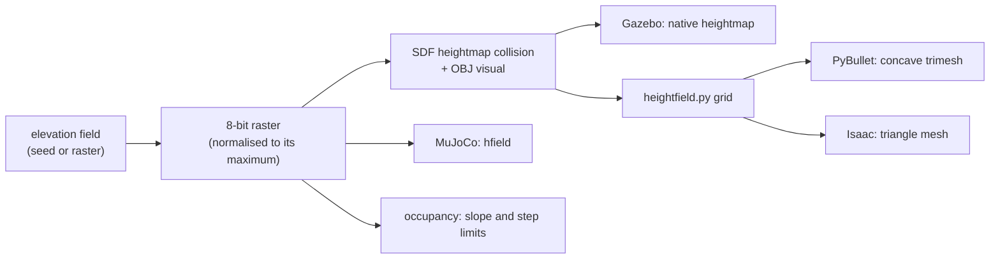

# Generate a terrain world

**Worlds & mapping → Terrain** turns a seed, or an elevation raster you
supply, into a world for all four simulators: a Gazebo SDF heightmap, a MuJoCo
heightfield scene, a 2D occupancy grid for navigation and a manifest that
regenerates it byte for byte. Nothing is downloaded and no token is used.

## Run

1. Open **Worlds & mapping**, then the **Terrain** page.
2. **Source and area.** Give it a name (lower case, digits, `_`). Choose:
   - **Procedural**: a *style*, a seed, the area side and the height range.
     `spectral` (the default) uses *smoothness* (1.5 rough to 4.5 rolling)
     and the *smallest feature* in metres; `rolling_hills`, `ridges`, `rough`
     and `crater` use *roughness* (0 to 1);
   - **Elevation raster**: a GeoTIFF, `.npy` or 16-bit PNG elevation file in
     metres, its metres per pixel, and its **attribution and license**
     (required; they are written into the manifest). The centre of the raster
     is cropped to the area and resampled.

   *Samples per side* (33 to 513) sets the detail; 129 is a good default.
3. **Robot use.** The spawn point gets a flat pad of the given radius. The
   *drivable slope* and *step* limits decide which cells the 2D grid marks as
   blocked for ground robots; the terrain edge is always blocked.
4. **Generate terrain.** A 129-sample terrain takes well under a second. The
   page shows the hill-shaded terrain beside the drivable grid and a summary
   (size, height range, height step, blocked share, spawn height).
5. **Use in Launch** selects it as the world; **Preview 3D** opens it in the
   GUI's inspector.

**Saved terrains** lists everything you generated. *Load settings* fills the
form from a terrain's manifest (to make a variation), *Check regeneration*
rebuilds it from the manifest and compares every file, and *Remove from list*
takes it out of the world list but keeps its files.

From the command line, or from Python (the page calls the same function):

```bash
python3 -m robot_lab_utils.terrain_generator my_crater --style crater --relief-m 4 --roughness 0.3
python3 -m robot_lab_utils.terrain_generator my_crater --check     # regenerate and compare
```


```python
from robot_lab_utils.terrain_generator import generate, regenerate, terrain_root
manifest = generate(dict(id='my_ridges', seed=6, size_m=40, samples=129, relief_m=3.0,
                         smoothness=4.0, min_wavelength_m=14.0))
print(regenerate(terrain_root() / 'my_ridges'))      # {file: True, ...}
```

## What gets written

`$ROBOT_LAB_RUNTIME_ROOT/terrain/<name>/`:

| File | Used by |
|---|---|
| `worlds/<name>.world` + `worlds/<name>.png` | Gazebo natively; PyBullet and Isaac convert the `<heightmap>` collision at spawn (`robot_lab_utils/heightfield.py`) |
| `worlds/<name>_visual.obj` | what cameras and LiDAR see in Gazebo, and the visuals elsewhere |
| `mjcf/<name>.xml` + heightfield PNG | MuJoCo (found beside `worlds/` by the MuJoCo launch) |
| `maps/map.yaml` + `map.pgm` | AMCL / Nav2 in `loc` and `nav` |
| `preview.png` | the page's preview |
| `manifest.json` | every input, provider/attribution/license, datum, metres per pixel, elevation range, spawn, and the sha256 of every file |

The terrain is registered in `$ROBOT_LAB_RUNTIME_ROOT/terrain/maps.yaml`, which
the launch and GUI merge with the other installed worlds. A name that is
already a world id is refused.

## How the four simulators see it



The raster layout (intensity normalised by the raster maximum, row 0 at +y,
cell-centred samples) is the one measured against Gazebo in
[the October 5 probe](../status/evidence/r6-7-heightfield-probe-2026-10-05/README.md).
Heights are quantised to *height range / 255*; the grid and every support
height use the quantised field the simulators load.

**Why the Gazebo visual is a mesh.** Gazebo Fortress draws `<heightmap>`
visuals with its Ogre2 terrain shaders. On this Jetson they fail to compile
as soon as a robot camera renders them, and the server aborts. Generated
worlds therefore keep `<heightmap>` for collision and draw the same grid as a
mesh.

## Measured

Support height through the real launch (`scripts/terrain_support_probe.py`):
a small robot settles at near-flat points, and its height is compared with
the same robot on flat ground. On two generated terrains (relief 2 m and 3 m,
probe points from 0 to 3 m), all **24 points on Gazebo, MuJoCo, PyBullet and
Isaac are within 2.1 mm** of the generated surface, and both terrains
regenerate byte for byte.
[Evidence](../status/evidence/terrain-generation-2026-11-13/README.md).

```bash
python3 scripts/terrain_support_probe.py --terrain my_ridges \
  --output /workspace/molar/robot_lab_runtime/terrain-probe-my_ridges
```

## Limits

- Driving, walking and flight on a generated terrain are not yet measured;
  the grid's slope and step limits are a planning aid, not a traversability
  guarantee for a particular robot.
- The surface is a height field: no overhangs, caves or vertical walls.
- An imported raster is treated as metres in a local flat frame; map
  projections and vertical datums are not converted. Record them in the
  attribution text if they matter.
- Rasters above 257 samples get a half-resolution visual mesh (collision keeps
  full resolution).
