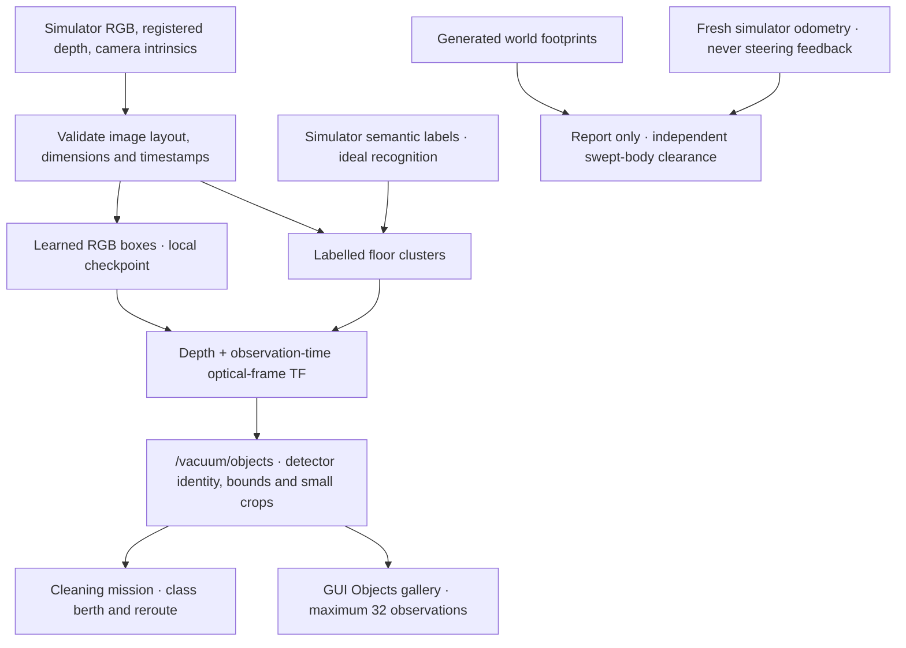

# Vacuum camera recognition, snapshots and training

The camera workflow is **partial**. The November 10 ideal-segmentation cleaning
mission has its own physical receipt. The November 11 patch implements learned
inference, data capture, training contracts, snapshots and an independent object
clearance gate. It supplies **no trained checkpoint** and no learned-detector
robot mission. The [roadmap R13.3](../../ROADMAP.md#r133--vacuum-camera-obstacle-recognition)
owns the remaining work.

## Inspect objects in the GUI

Open **Cleaning missions → Setup**. The object detector can be:

| Selection | Input to recognition | Meaning |
|---|---|---|
| `segmentation` | Simulator semantic labels and aligned depth | Ideal class recognition; the default |
| `learned` | RGB, aligned depth and a local trained checkpoint | Experimental learned recognition |
| `none` | No camera detector | Cleaning retains its existing LiDAR/bumper inputs |

For learned recognition, use **Checkpoint → Browse** before **Launch robot +
cleaning**. A missing file is rejected before starting the simulation. A selected
learned process exiting shuts down its owned launch. Incompatible checkpoint
class maps fail explicitly; runtime inference never downloads model weights.
Changing Setup affects the next launch, not an already running detector.

The **Objects** page lists observed classes and map positions. Select one to see
its timestamped camera crop and, for learned detections, confidence. Crops are
JPEG images at most 160 × 120 pixels, derived from approximately synchronized
RGB and label/depth frames. No matching RGB means no snapshot. The gallery keeps
at most 32 nearby-grouped observations in memory. **Clear snapshot gallery**
clears that display; it does not remove the mission's remembered avoidance
objects. Use the map **Erase** tool for that operation.

Recognition/position errors remain possible. The class berths and source motion
limits are unchanged; learned cable bounds cover its full nominal length.
The current camera wiring is the `oomwoo` front camera. Other profiles need their
own compatible camera topics/calibration; enabling a profile does not prove it
has this sensor contract.

## How the pieces connect



The ideal detector is `vacuum_object_detector`; the learned executable is
`vacuum_learned_detector`. Launch starts exactly one, or neither for `none`.
Torch/torchvision are optional for the learned process/trainer; importing the
default detector or using snapshots does not load them. Image utilities respect
padding, RGB/BGR and depth byte order. Non-matching images and calibration
dimensions are dropped. Both detectors publish the existing object message shape
and explicitly distinguish ideal segmentation from learned RGB recognition.

## Capture representative training images

Keep all output/cache on the SSD. Source ROS, the rebuilt workspace and storage
helper. Launch `oomwoo` in an object-populated Gazebo world, with the ideal
detector so semantic labels remain available as annotations. Drive with the GUI
to vary distance, heading and occlusion. The capture tool itself is read-only:

```bash
source /opt/ros/humble/setup.bash
source install/setup.bash
source scripts/ssd_env.sh
export TORCH_HOME="$ROBOT_LAB_RUNTIME_ROOT/torch"

python3 scripts/capture_vacuum_detector_data.py \
  --out "$ROBOT_LAB_RUNTIME_ROOT/vacuum-camera-data" \
  --scene house-a-layout-1 --split train --frames 100 --timeout 300
```

Change the world/object layout for validation, then capture into the same root:

```bash
python3 scripts/capture_vacuum_detector_data.py \
  --out "$ROBOT_LAB_RUNTIME_ROOT/vacuum-camera-data" \
  --scene house-b-layout-2 --split val --frames 40 --timeout 180
```

Use distinct physical scenes, not adjacent frames from one drive. The tool
rejects reusing one scene ID in both splits. It writes RGB PNGs, COCO-style
connected-instance boxes, image scene/split/stamp metadata and `val_ids.json`.
Background frames remain useful negative examples. Capture is finite and has an
exclusive dataset writer lock; partial captures are recorded and exit nonzero.
Inspect any stale `.capture.lock` before removing it. Reuse the same ROS domain
as the selected simulation; do not start an unrelated simulator on that domain.

`render_vacuum_detector_data.py` remains a primitive synthetic seed-data tool.
Those images are not captures of Gazebo's rendering, and synthetic AP alone does
not qualify camera recognition in a robot mission.

## Train and run a checkpoint

Use a matching torch/torchvision environment. On this host, CPU imports work;
the installed CUDA 13 torch wheel cannot initialize this host's older driver.
Do not replace ROS NumPy or upgrade the host stack as part of this task.

```bash
python3 scripts/train_vacuum_detector.py \
  --data "$ROBOT_LAB_RUNTIME_ROOT/vacuum-camera-data" \
  --out "$ROBOT_LAB_RUNTIME_ROOT/vacuum-camera-model" \
  --epochs 8 --batch 2 --device cpu
```

The torchvision detector performs normalization internally. Dataset tensors and
runtime RGB tensors both use `[0,1]`; no second normalization is applied. The
trainer uses disjoint subsets, refuses empty splits or missing classes in either
subset, and checks captured scene boundaries. Categories are `cable`, `pet_waste`, `shoe`, `sock` (IDs 1–4);
semantic IDs remain 20–23. Checkpoints retain the category map, seed, architecture,
torch version, train/validation image IDs and image/annotation/split hashes. Per-class
AP@0.5 is computed on the held-out subset. Capture directories and weight files
belong on SSD; keep source pins, licenses, receipts and hashes in Git.

The default training initialization uses torchvision COCO weights. Its source
is BSD-3-Clause; retain and review the separate upstream weight/dataset terms.
See [torchvision's model contract](https://docs.pytorch.org/vision/main/models/generated/torchvision.models.detection.fasterrcnn_mobilenet_v3_large_fpn.html)
and [source/license](https://github.com/pytorch/vision).
`--weights none` permits an offline training smoke test; it is not a substitute
for a qualified model. No network weights are fetched during inference.

Run the candidate through GUI Setup or:

```bash
ros2 launch robot_lab_bringup simulated_room_vacuum.launch.py \
  robot_model:=oomwoo map_name:=small_house simulator:=gazebo controller:=cleaning \
  vacuum_detector:=learned \
  vacuum_detector_model:="$ROBOT_LAB_RUNTIME_ROOT/vacuum-camera-model/vacuum_detector.pt"
```

## Independently check object clearance

`scripts/vacuum_object_world.py` writes an object-populated world and a sibling
`<world>.objects.json`. New manifests include oriented box/circle footprints;
old manifests without footprint dimensions cannot satisfy the new gate.
Pass that JSON to `vacuum_object_truth:=<absolute manifest path>` when recording
with `scripts/sim_vacuum_mission.sh`. The cleaning node records its path, raw
SHA-256 and static footprints **only in the report**; it does not send them to
the detector, localizer or steering controller.

For these reports, truth is sampled every 0.2 wall seconds through cleaning and
the return to dock. `cleaning_object_clearance(report)` derives per-object minimum
body clearance from linear sweeps of consecutive actual body positions, including
the final pose. It uses the profile's body radius, oriented rectangle edges and
circle footprints. Missing/invalid footprints or truth older than 0.5 simulation
seconds refuse measurement. `cleaning_screen` requires positive body clearance
as well as all its previous coverage, docking, keep-out and pause conditions.
Linear interpolation is conservative around turns; it does not prove the exact
continuous curved trajectory. Keep native contact observations with the run.

Historical reports retain their historical gate and are not retroactively called
object-qualified by the new code. Without a manifest,
`cleaning_object_clearance` explicitly returns `measured: false`.

## Next agent

1. Preserve the source camera geometry and historical ideal-detector receipt.
2. Capture independent representative scenes, check annotations/negative frames,
   and train/provision the four-class checkpoint with retained provenance.
3. Measure per-class recall/false positives, latency and projection error on real
   held-out simulator frames. Do not infer these from synthetic images or unit tests.
4. Record an actual learned-detector object-world cleaning job using the generated
   truth manifest. Retain failed runs, contacts, coverage and docking results.
5. Update R13.3, the ledger and GUI status together, then continue R14.1 according
   to the roadmap. Broader fleet, terrain and release matrices remain separate.
